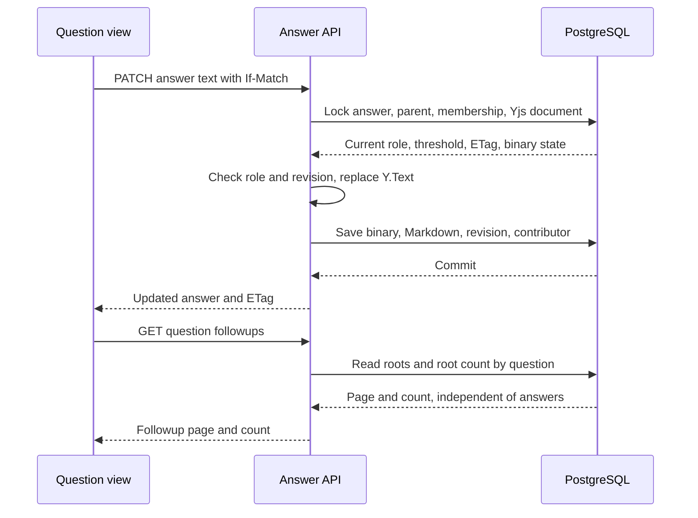

# Answer cards and question followups

Status: approved
Date: 2026-10-11

## Context

The user wants Piazza-inspired answers and followup discussions in the question detail view. Each answer should have a distinct colored text area, a list of people who edited it, and an upvote control below its text. An empty discussion should show a prominent count and a one-line prompt; opening that prompt should use the same Markdown and LaTeX editor as post creation. This phase is text only: no image or document attachments and no object-store integration.

The current implementation has up to two shared answers per question, selected by `kind` (`student` or `staff`), and its answer panels are disabled in the question detail view. The answer body has a private, durable Yjs core but no authenticated editing transport. The documented followup API attaches discussions to answers, while the requested design needs question-level discussion even before any answer exists. There is no followup or upvote table yet. These existing contracts therefore need deliberate replacement, not merely a new view.

The user decided that a question may have **multiple independent answer cards**, that **followups belong to the question**, that answer editing uses **version-checked REST requests** backed by the existing Yjs document store for now, that **both answers and followups can be upvoted**, and that an answer keeps the **creator's role as its stable edit threshold**. Live Hocuspocus editing is outside this phase. The followup lifecycle, anonymity, and legacy migration policies below were also approved.

## Decision

Treat every answer as a distinct answer authored by one course member. The creator's course role at creation becomes the answer's immutable edit threshold: a current student can edit a student-origin answer, a current TA can edit student- or TA-origin answers, and a current instructor can edit any answer. Editing never promotes the threshold. Every successful text editor is recorded once in `answer_contributors`. The server computes permissions from current membership; the browser only uses projected capability to show appropriate controls.

Keep the existing Yjs binary state authoritative for answer text. A versioned REST edit replaces the Markdown content inside `Y.Text('content')` and saves the resulting binary state, Markdown projection, answer revision, and contributor in one serialized PostgreSQL transaction. A stale `If-Match` returns a conflict; the composer preserves the local draft and offers a refresh. Endorsement and deletion keep their existing staff-only and immutability behavior, ordered against edits by the same answer-row lock.

Followups form a question-owned discussion tree. Direct followups can be created when no answer exists, and replies belong to a parent followup of the same question. A followup remains an ordinary versioned Markdown resource, not a Yjs document. The question detail loads answer cards and the first page of direct followups independently, so one failed section need not erase the other. Each answer and followup has a separate, one-vote-per-member upvote state. Votes do not change content ETags.

## Structure

### Ownership and contracts

| Concern | Owner | Contract |
| --- | --- | --- |
| Answer body | Existing answer document store and PostgreSQL | `Y.Text('content')` is durable authority; `answers.body_markdown` is its REST projection. A single transaction also records the authenticated contributor. |
| Answer edit authority | Answer service | Compare current course role with the immutable creator-role threshold inside the edit transaction; reject archived courses, hidden/deleted/merged questions, endorsed or deleted answers, stale ETags, and invalid text. |
| Followup body and tree | Followup service and PostgreSQL | Every row names its question; an optional parent names a followup of that same question. Direct roots are paginated and counted. Nested children are fetched by parent so arbitrary depth does not make initial page load unbounded. |
| Upvotes | Answer/followup services and PostgreSQL | Unique `(answer_id,user_id)` and `(followup_id,user_id)` pairs; idempotent PUT to vote and DELETE to remove. Reads project `upvoteCount` and `viewerUpvoted` for the current member. |
| Presentation | Question detail and shared post body editor | Distinct answer card color, rendered Markdown/math, contributor byline, then vote control below text; followup heading/count and collapsed composer prompt. The same editor, toolbar, preview, and math diagnostics used for creating posts power answer and followup composition. |

Answer reads become an ordered collection with no student/staff slots or `kind` label. The response identifies each card with its stable ID, creator identity projection, contributor projection, creator-role threshold only if needed for display, endorsement state, and vote state. The server should project an explicit `canEdit` or equivalent action capability for the current viewer; the client must not infer authority from hidden or anonymized identities. The old per-kind uniqueness index is removed. Existing answer rows remain distinct cards, so the migration need not discard either body or contributor set.

The followup API moves from answer paths to question paths for direct creation and listing, for example `POST/GET /api/v1/posts/{postId}/followups`; child creation/listing and individual retrieval/update/deletion remain under followup IDs. The direct list response includes a total root-thread count for the heading, including when the first page is empty. The API and OpenAPI reference must describe this changed resource identity consistently.

Votes are independent resources, for example `PUT/DELETE /api/v1/answers/{answerId}/upvote` and corresponding followup paths. Members can read counts on active content even in an archived course; voting requires an active course. Deleted content and hidden/merged parent questions are not votable. This design allows a member to upvote their own content because the request did not specify an exception; that small policy can change without changing the table shape.

For this phase, answer and followup requests accept JSON Markdown only. Multipart requests are rejected. The new answer and followup views render Markdown and LaTeX through the existing sanitized `PostBody` path, configured so Markdown image syntax does not fetch or display a remote image. An image can remain source text without becoming an attachment.

### Followup policy

 implement the documented text-only followup lifecycle at question scope: direct and nested creation, paginated reads, author-or-staff updates and deletion, optimistic ETags, idempotent creation, and bodyless tombstones when children must remain attached. All current course members can create and reply; only the author or staff can edit or delete. This preserves the current target contract's moderation model while moving ownership from answer to question.

### Anonymity policy

 preserve the existing identity-visibility policy. An anonymous answer's contributor list remains hidden from student viewers and visible to staff; named answers show their editor list. Anonymous followups show their real author to staff and the author, and “Anonymous” to other students. Thus the visible-list requirement applies to named answers; the privacy promise is not silently broken. A deleted account is never exposed through contributor or author projections.

### Legacy migration policy

 keep every existing answer row and contributor relationship. Populate a creator ID from the single initial contributor present in publicly created answers, and snapshot the creator's current course role as the edit threshold. If that membership is gone, map legacy `student` to student and legacy `staff` to instructor so missing history cannot grant a lower role edit access. This is conservative but may require an instructor to edit a legacy TA answer. Existing answer IDs and Yjs state remain unchanged. If a legacy row has an unexpected multi-contributor set, do not pick an arbitrary creator silently; migration should fail with a diagnostic for manual resolution.

## Technology choices

| Concern | Choice | Why | Runner-up |
| --- | --- | --- | --- |
| Answer text | Existing Yjs 13 document core behind authenticated REST edit | Preserves the durable CRDT state already shipped, with optimistic conflicts appropriate for this UI phase | Hocuspocus would add a new service, ticket protocol, and live consistency work before the requested UI can ship |
| Followup text | Plain PostgreSQL Markdown row with ETag | Followups have one author and ordinary edits; no collaborative transport is requested | Yjs per followup adds state and synchronization without a current need |
| Editor and renderer | Existing CodeMirror-based `PostEditor` and sanitized `PostBody` | Gives formatting, LaTeX, preview, diagnostics, and accessibility consistent with post creation | Duplicating a textarea/toolbar would drift from the required identical behavior |
| Upvote store | Separate answer and followup vote relations | Foreign keys and one-vote uniqueness remain explicit | A polymorphic target table needs nullable foreign keys and extra consistency checks |

Versions are the dependencies already present in the repository on 2026-10-11; this design requires no new runtime dependency.

## Alternatives rejected

- One shared student/staff answer pair: the user chose multiple independent answer cards and no fixed role-labeled slots.
- Answer-owned followups: the user wants to open a discussion before an answer exists; tying a thread to an answer also makes answer deletion unexpectedly affect that discussion.
- Editing answers by directly overwriting `body_markdown`: this would make the saved Yjs binary disagree with its projection and break later CRDT updates.
- Raising an answer's edit threshold when a higher-role person contributes: a helpful instructor edit would lock students out of their own ongoing answer.
- Live Hocuspocus editing in this phase: the user chose versioned REST editing while the private Yjs core remains durable.
- Sharing content ETags with vote counts: unrelated votes would spuriously invalidate text edits.

## Trade-offs accepted

- Concurrent answer editors get explicit version conflicts and must refresh or reconcile their drafts; there are no live cursors or automatic WebSocket convergence in the UI yet.
- The new public answer shape and question-level followup paths replace earlier target contracts. Documentation, OpenAPI, tests, and clients must move together.
- Root followups are paginated and nested replies are loaded per parent; the first screen does not reveal every descendant at once.
- No object-store attachments are accepted or rendered in these surfaces. Textual Markdown links can still be used.

## Failure modes

| Failure | Response |
| --- | --- |
| Another edit, endorsement, deletion, or role revocation races a text edit | A single locked transaction orders the operations; a later edit fails with a conflict or permission/lifecycle error, and the browser retains its draft. |
| PostgreSQL transaction fails after Yjs mutation is computed | The transaction rolls back binary, projection, revision, and contributor together; the API reports failure. |
| Answer fetch succeeds but followup fetch fails, or vice versa | The working section remains visible with a local retry for the failed section. |
| Vote request is retried or two taps race | Unique vote key and idempotent PUT/DELETE yield one final vote per member; count is read from committed votes. |
| Anonymous or deleted identity is projected | The existing viewer-dependent identity policy hides private IDs and names. |
| A parent followup is deleted while it has replies | A bodyless tombstone keeps child navigation stable. |

## Reversibility

Card color, composer placement, and exact sort order are cheap to change. Separate vote relations and REST edit route can evolve without rewriting answer documents. The answer creator-role snapshot, question-level followup ownership, and public removal of answer `kind` are costly to reverse after clients and data depend on them; their migration and contracts need focused review.

## Visual details

Answer cards use a distinct tinted panel and place the upvote control below the rendered text. Followups use a collapsed composition prompt and share the post editor controls.
