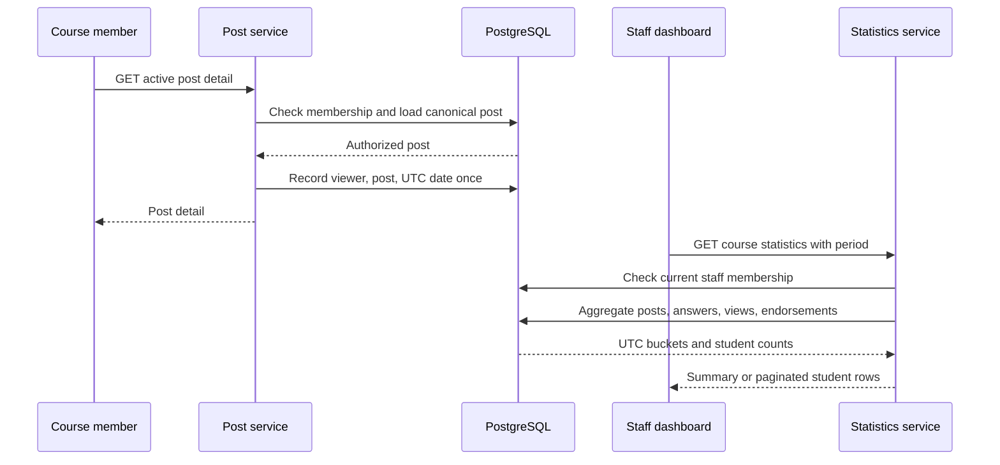

# Course statistics

Status: agreed
Date: 2026-10-11

## Context

The [product design](../../documentation/design.md) calls for a course statistics tab with daily activity, questions and answers per student, post views, and average response time. The [statistics API reference](../../documentation/api/statistics.md) already defines a staff-only course summary and a paginated per-student list, with `7d`, `30d`, and `course_to_date` periods. The implementation has posts, answers, memberships, and endorsements, but no statistics routes, view recorder, or statistics tab. `post_view_events` appears only in the database reference, not in the migrated schema.

This feature is developed from current `main` on a separate branch from the answers and followups feature. Current answers have creator contributions but no public edit route. A later merge with answer editing must preserve the activity-recording contract below.

The user chose these interpretations:

- A view is recorded once per signed-in viewer, canonical post, and UTC date after a successful active post-detail load. Reloads on that date do not add views.
- Response time is from question creation to the **creation of the answer that first receives endorsement**. The question belongs to the period in which that first endorsement occurred. This resolves a conflict: the product design says answer posting time, while the current statistics API text says endorsement time. The API reference and OpenAPI must be corrected together.
- The per-student list contains current student members, including those with zero activity. Historical events continue to contribute to course totals after a student leaves or changes role.

Assumption: statistics are calculated from PostgreSQL on request for the existing scale of a course. No external analytics service, background aggregation, or chart dependency is needed now. Views before this feature is deployed cannot be reconstructed; the UI should explain that older periods may have incomplete view counts.

## Decision

Keep PostgreSQL as the authority for statistics. Add a daily-deduplicated post-view record, a per-creator UTC-day question count, and timestamped answer-contribution activity. Continue using `posts`, `answers`, and `course_memberships` for course daily activity, answer creation, endorsement, and current roster. Put aggregation and staff authorization behind a statistics service that serves the two documented GET endpoints. Present the result in a staff-only course Statistics tab with daily activity, summary values, and a paginated student table.

The daily chart and student table use existing React/CSS patterns. The API, rather than the browser, computes periods and counts, so clients cannot infer identities from anonymous posts or bypass role checks.

## Structure

### Data ownership

`post_view_events` owns recorded views. A uniqueness rule on `(course_id, post_id, user_id, viewed_on)` makes recording idempotent for one UTC date. It retains the first `viewed_at` timestamp on that date, and stores `viewed_on` explicitly so both deduplication and UTC reporting are unambiguous. Only an authenticated, authorized `200 OK` read of an active canonical post records a view. Deleted-post tombstones, confirmed-duplicate redirects, staff duplicate-review reads, feed previews, and failed reads do not. A failed analytics write is logged and does not turn an otherwise successful post read into an error; statistics describe **recorded** views, not a guarantee that every page display was counted.

`answer_contribution_events` owns the time of each successful creation or content-changing edit, with course, answer, actor, and timestamp. The current answer-create transaction records the creation event alongside `answers` and `answer_contributors`. Existing contributor rows are backfilled at their answer's creation timestamp; this is accurate for the current app because it has no answer-edit route. The per-student `answersContributed` count uses distinct answer IDs with at least one contribution event in the selected period, so repeated edits count once. A future REST/Yjs editor must record an event in the same successful persistence transaction whenever the Markdown projection changes, and must not record one for a duplicate or no-op save. It must also maintain `answer_contributors` for the visible editor list. This is the integration contract for the separately developed answers branch; the statistics branch does not depend on its UI or API.

`question_creation_daily_counts` owns per-creator question counts by course and UTC date. The post-create transaction increments one bucket without storing a post identifier, so a later post soft deletion cannot erase attribution or retain a link to that deleted post. Migration backfills active questions only; previously deleted questions cannot be attributed. Account deletion deletes the user's buckets, and course deletion deletes the course's buckets. Course daily totals still use post creation timestamps, including deleted posts.

Questions and daily answers are counted by their creation timestamps, including content later soft-deleted, because those creations were activity. The response-time population is questions whose **first** endorsement occurred in the period. For each such question, use the creation timestamp of that first-endorsed answer, subtract the question creation timestamp, then average the nonnegative elapsed seconds. A question counts once even if multiple answers are later endorsed. Return `null` when no question qualifies. Daily activity uses UTC dates, fills zero-activity dates, and covers the trailing seven or thirty UTC dates including today; `course_to_date` starts on the course creation date.

The student query begins with current memberships whose role is `student`, joins active user profiles, and left-joins period counts. This includes current students with zeroes and excludes former members and current staff. Its cursor is bound to course, period, and stable student order; changing counts do not reorder rows. The course summary can include activity by anyone who was authorized when an event occurred, including a member who has since left. Account deletion removes membership and hides that user from the student table, while historical totals remain aggregate-only.

### Boundaries and access

The existing session cookie and course-membership checks remain the authentication boundary. Both statistics endpoints require a current instructor or TA role; a student receives `403`, and an absent or hidden course receives the established `404`. The Statistics tab appears only for staff, but direct URL access is still enforced by the API. Invalid period, limit, or cursor follows the documented `400 invalid_request` contract. The backend uses indexed, course-scoped SQL and returns only the fields in the published API. The tab offers period selection and paginated student rows, with loading, empty, and unavailable states.

Course deletion must remove view and contribution events and question-count buckets before deleting their parents in the existing deletion job. No new service or queue is introduced.

## Technology choices

| Concern                    | Choice                                                          | Why                                                                                      | Runner-up                                                                                         |
| -------------------------- | --------------------------------------------------------------- | ---------------------------------------------------------------------------------------- | ------------------------------------------------------------------------------------------------- |
| Storage and aggregation    | Existing PostgreSQL with course/date indexes and on-request SQL | Data is already relational and course scoped; one authority for authorization and counts | Separate analytics database adds synchronization and operations                                   |
| View deduplication         | Unique viewer/post/UTC-day row                                  | Makes reloads and browser retries harmless while preserving daily engagement             | Count every GET, which inflates views on refetch                                                  |
| Answer contribution timing | Append-only event rows                                          | Correctly answers whether a student edited a distinct answer within any selected period  | `answer_contributors` alone has no edit timestamp; first/last timestamp cannot cover every period |
| UI                         | Existing React and CSS                                          | Fits the current course navigation and avoids a chart dependency                         | New chart library for four simple metrics                                                         |

Existing PostgreSQL, React, and Node versions were inspected in the repository on 2026-10-11. This design adds no third-party technology.

## Alternatives rejected

- Count every successful post GET: harmless refetches and repeated reloads would inflate the engagement metric.
- Measure response time to endorsement: it can make an early answer look slow when staff endorses it much later, and conflicts with the explicit product-design definition.
- Derive answer activity only from `answer_contributors`: it has no edit timestamps, so a seven-day contribution count would be wrong after edits arrive.
- Materialize daily statistics in a job now: it creates lag and repair paths without evidence that indexed course-scoped queries are too slow.
- Include former students in the current per-student table: the schema does not retain role history, and the user chose the current roster.

## Trade-offs accepted

- The view metric is unique daily reach per post, not total page loads or reading duration.
- View history starts at deployment. Older dates can show questions and answers but cannot recover prior views.
- On-request aggregation can grow slower with very large courses; indexes and query measurements should precede any rollup.
- A rare failed view insert loses that count while leaving the post readable. The failure is logged.
- Separate feature branches will need a merge check that new answer-edit paths emit contribution events; until then, statistics accurately count current answer creation only.

## Failure modes

| Failure                                                  | Behavior                                                                                                                               |
| -------------------------------------------------------- | -------------------------------------------------------------------------------------------------------------------------------------- |
| Post read is unauthorized, redirected, deleted, or fails | No view is recorded. Existing post response semantics remain.                                                                          |
| View insert fails after an authorized read               | Log the failure and return the post; the missing view is not fabricated.                                                               |
| PostgreSQL is unavailable for statistics                 | Return the documented `503 service_unavailable`; the tab shows a retry state.                                                          |
| Statistics query is slow                                 | A bounded database timeout yields `503`; course/date indexes constrain normal reads.                                                   |
| Course or role changes between pages                     | Every request rechecks membership; a cursor bound to course and period cannot cross scopes. Counts may change as new activity arrives. |
| New answer editor omits an activity event                | Per-period answer contributions undercount; integration tests at the answer persistence seam must catch this when branches merge.      |
| Course deletion omits new event tables                   | Foreign keys block cleanup; the deletion job must remove both event sets in its existing transaction.                                  |

## Reversibility

The chart layout, period selector presentation, and service/file layout are cheap to change. The definitions of a view, contribution in a period, and response-time clock are public metric semantics and expensive to change after reports are used. Storing person-level daily views and contribution events is a privacy and retention decision; changing it later requires migration or deletion of historical data. PostgreSQL remains the existing persistence engine.

## Open questions

- Product-wide retention and account-erasure rules for person-level activity events are not specified. Until they are, restrict these endpoints to staff, retain events only while the course exists, and do not expose raw events through the API. A future retention policy must address historical course totals as well as the underlying rows.
