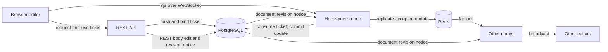
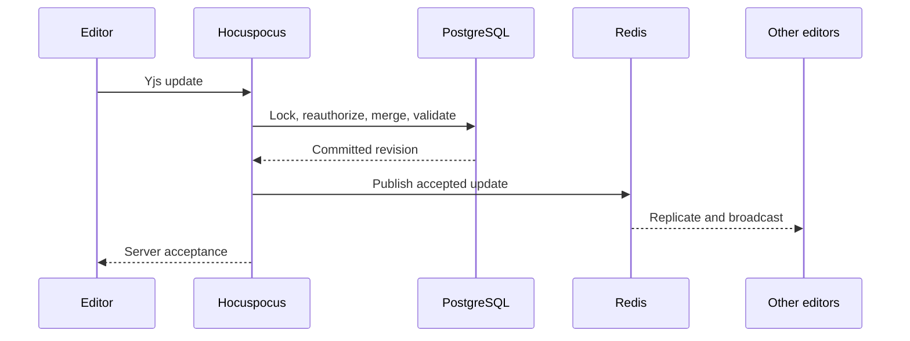

# Live answer and followup editing

Status: proposed
Date: 2026-10-14

## Context

ChalkTalk currently has one shared student answer and one shared staff answer per question. An answer's creator establishes its permanent editing role floor. A followup belongs to the question, can have replies, and can be edited by its author or current course staff. Answer edits use a version-checked REST request that updates both `answers.body_markdown` and `answer_collaboration_documents.yjs_state`; followup edits use version-checked REST and have no Yjs document yet. Votes, endorsement, creation, and deletion are separate REST operations. The existing CodeMirror 6 Markdown/LaTeX editor is local-only.

The agreed change adds simultaneous editing of existing answer and followup **bodies** through Hocuspocus and Yjs. It retains the two answer slots, question-level threaded followups, anonymity, the existing role rules, and REST for other operations. The user chose multiple collaboration nodes, PostgreSQL as the authoritative store, Redis replication, persistence of each accepted update before server propagation, and continued version-checked REST editing. The user also approved temporary empty live text; REST creation and PATCH still require nonblank text.

Assumptions: One Hocuspocus node can handle a particular document's active editors at the initial scale, but nodes must survive one another's failure and distribute WebSocket connections. No named presence or live cursors are required for this phase. Temporary collaboration sessions are outside this change.

## Decision

Run a separate, horizontally replicated Hocuspocus service. Each answer and each followup has its own `Y.Text('content')` document. A session-authenticated API issues a short-lived, one-use, document-bound editor ticket. Hocuspocus consumes the ticket, checks the current role again for every incoming update, and applies each update to the **latest PostgreSQL Yjs state in a transaction before letting Hocuspocus broadcast it**. Redis distributes accepted Yjs updates between nodes; it is never the durable store. Version-checked REST body edits use the same PostgreSQL document transaction and notify open collaboration nodes to apply the resulting change.

An accepted text change updates the Yjs bytes, Markdown projection, content version, timestamps, and author attribution atomically. For an answer, it records the editor in the contributor list and contribution events, and clears the current endorsement while preserving historical endorsement events. Upvotes remain independent and do not change the content revision. An empty live body can be stored and displayed with an editor placeholder; it cannot be endorsed. Nonblank REST input rules remain unchanged.

## Structure

### API and ticket boundary

The API owns the authenticated browser session and CSRF check. It exposes distinct answer and followup connection-ticket routes. A ticket is random, stored only as a hash, expires after five minutes, is consumed once in a PostgreSQL transaction, and is bound to the login session, user, document type and ID, and `write` permission. The credential-free WebSocket URL contains no ticket or identity. Production uses `wss`; allowed browser origins match configured HTTPS frontend origins. Hocuspocus rejects a document name that does not exactly match the ticket target. The existing [WebSocket protocol reference](../../documentation/api/collaboration-websocket.md) supplies close-code and reconnection conventions; it must be extended to followups rather than reusing temporary-session routes.

Only members currently authorized to edit receive tickets. A student may edit the shared student answer; a TA may also edit a TA-created staff answer; an instructor may edit either. A followup author or current TA/instructor may edit that followup. The server checks session validity, active course membership, target visibility, and editing role again inside **every update transaction**. A five-minute ticket lifetime limits entry, not the lifetime of a connected editor. Role removal, account/session revocation, course archive, question merge/deletion, and target deletion close affected connections; the per-update check denies writes even before connection closure arrives. The WebSocket never accepts a client-claimed user ID or role.

### Document and persistence boundary

PostgreSQL owns the complete Yjs update state and the public Markdown projection. Answer documents continue using `answer_collaboration_documents`; a corresponding followup document record is needed. Existing followup Markdown is seeded into `Y.Text('content')` without losing the text or revision. New followups initialize both representations in the creation transaction. Existing answer documents keep their Yjs history and lazy seed behavior. Document names are typed (`answer:<id>`, `followup:<id>`), preventing an ID from crossing resource kinds.

Before an inbound Yjs update reaches the live document, the collaboration node checks its size and Redis health, starts a PostgreSQL transaction, locks the target, rechecks authority, applies the update to the latest saved Yjs state, validates the result, and commits the full binary state and Markdown projection together. An update larger than the configured limit, an update that creates unsupported shared types, a document that exceeds the configured binary-state limit, or resulting text over 100,000 characters is rejected without a broadcast. Only `Y.Text('content')` is writable. Empty text is allowed for the live path; endorsement requires nonblank text. A repeated update that produces no state change adds no content version or contribution event. Hocuspocus then applies and broadcasts the accepted update. Its debounced `onStoreDocument` path must not overwrite the authoritative database snapshot or attribute a Redis-replicated update to the wrong editor.

The server must not claim an update is saved based on the browser's local Yjs change or a WebSocket send. A save indicator may use an explicit application acknowledgement tied to the committed revision; otherwise the UI shows connection status without saying “Saved.” Local changes rejected by authorization, validation, or infrastructure failure stay visible as an unsaved local draft for the user to copy or retry. The UI never silently discards them.

REST PATCH remains available for older clients and fallback editing. It locks and edits the same Yjs document, checks `If-Match` against the current content revision, commits the changed projection and binary state, and emits a document-revision notice after commit. Each collaboration node with that document open applies the saved Yjs delta through a server-origin path that does not write it again. A missed notice is repaired by comparing persistence revisions when a node loads a document and periodically for active documents. This preserves a single durable source while Yjs deterministically merges an update racing a REST edit. A stale REST `If-Match` still returns `412`.

### Lifecycle and replicated state

Endorsement, answer deletion, followup deletion, course archive, and post merge/deletion serialize with document writes through the same target lock. An endorsement sees all previously committed live edits and rejects a currently empty answer. Editors may later correct an endorsed answer; the first later text-changing update clears the current badge, while the first-endorsement statistics continue to use the historical event. Deletion closes the document and connections on all nodes after commit. Deleted followups retain only their existing public tombstone behavior when replies require it; hidden/deleted bodies cannot be loaded into a new live editor.

Redis is a replication bus, not a write queue. If a node cannot confirm Redis availability, it stops accepting new editing connections and updates and closes its active editors. On Redis recovery, nodes discard their in-memory documents and require clients to reconnect with fresh tickets so each document reloads PostgreSQL state. A brief partition between commit and Redis propagation can temporarily delay another node's view; revision reconciliation and forced reload on recovery restore convergence without losing committed edits. PostgreSQL unavailability blocks live updates before broadcast. If only the Hocuspocus service is unavailable, current REST PATCH remains usable with version checks.

Anonymous answers and followups expose no contributor names or named awareness to student peers. This phase does not publish participant names or cursors in presence messages; the existing REST projection still controls contributor and author visibility. The collaboration server does not trust client-supplied awareness identity.

### Browser editor boundary

The answer and followup edit controls mount the existing Markdown/LaTeX CodeMirror editor in a collaborative mode backed by the target `Y.Text`. The editor applies local changes as CRDT operations rather than replacing the whole string on every keypress, and uses collaborative undo. The current formatting toolbar replaces the whole CodeMirror text when inserting formatting; its collaborative mode must express only the selected formatting change so it does not erase a peer's concurrent edit. Creation, replies, voting, endorsement, and deletion retain their REST flows. A disconnected editor requests a new ticket before reconnecting. Offline-local edits are synchronized only if the user still has permission and the target is still editable; there is no durable cross-session offline queue in this phase. Connection, permission, and rejection states are visible without exposing anonymous identity.

## Technology choices

| Concern | Choice | Why | Runner-up |
| --- | --- | --- | --- |
| Live transport | Hocuspocus 4 server and provider | Existing design names Hocuspocus; its hooks support pre-apply checks, ticket authentication, and direct document updates. | Custom Yjs WebSocket server adds protocol and reconnect work. |
| Cross-node sync | Official `@hocuspocus/extension-redis` | Supported fanout across nodes; Redis has no durable authority. | PostgreSQL `LISTEN/NOTIFY` with a custom durable update log would require replay and compaction logic. |
| Durable state | Existing PostgreSQL Yjs bytes plus Markdown projection | Transactionally enforces roles, versioning, attribution, and content limits with existing records. | Debounced full-document snapshots can lose accepted edits on crash and race with REST. |
| Editor binding | Stable `y-codemirror.next` for Yjs 13 and CodeMirror 6 | Matches the existing CodeMirror editor and `Y.Text` shape; supports collaborative undo. | Manual string-diff binding is easy to get wrong under concurrent edits. |

Version and maintenance status checked 2026-10-14 against the [Hocuspocus hooks](https://tiptap.dev/docs/hocuspocus/server/hooks), [Redis extension](https://tiptap.dev/docs/hocuspocus/server/extensions/redis), [provider configuration](https://tiptap.dev/docs/hocuspocus/provider/configuration), and [Yjs CodeMirror binding](https://github.com/yjs/y-codemirror.next/blob/main/README.md). Hocuspocus 4 requires Node.js 22 or newer, matching this project's container runtime. The Yjs binding repository advises current Yjs 13 users to use the stable `y-codemirror.next` package rather than its in-development Yjs 14 replacement.

## Alternatives rejected

- A single collaboration process would be simpler but would not meet the requested multi-node availability.
- Using Redis as the document store would make an ephemeral replication dependency the source of truth.
- Debounced Hocuspocus persistence would acknowledge edits before a crash-safe write and complicate endorsement and deletion.
- Removing REST PATCH would break existing version-checked clients; allowing it to write outside the document transaction would cause live-state divergence.
- Named presence would risk revealing authors of anonymous content to students and is unnecessary for simultaneous text editing.

## Trade-offs accepted

- Every accepted update requires a PostgreSQL transaction. This favors durability and role correctness over maximum typing throughput. Short client-side update batching may reduce traffic without allowing an accepted update to bypass persistence.
- Redis adds a service and is used for connection scale and availability, not CPU scale: the official extension sends updates to every node.
- A transient empty live body can appear on reads and remains empty if an editor leaves it that way. The UI must show a placeholder; endorsement cannot proceed until text is nonblank.
- REST full-body replacement racing with a Yjs update can produce a deterministic CRDT merge rather than the exact last writer's intended text. `If-Match` protects against already committed changes, and the editor must show the converged result.

## Failure modes

| Failure | Behavior |
| --- | --- |
| PostgreSQL slow or down | Update waits within a bounded timeout or is rejected before broadcast; local draft remains unsaved. No new ticket is issued while storage cannot verify it. |
| Redis down or partitioned | Affected nodes fail closed for edits and disconnect; recovery reloads persisted documents and resynchronizes clients. A narrow in-flight propagation window can delay visibility across nodes, but committed text survives. |
| Collaboration node crash | Its clients reconnect to another node with new tickets and load the last committed Yjs state. No accepted update depends solely on node memory. |
| Session, role, or resource changes | Per-update transaction rejects stale authority; lifecycle notification closes the socket. Reads and ticket issuance use current visibility. |
| Invalid or oversized Yjs update | Reject without committing or broadcasting; close the offending connection with a policy code. |
| REST/live race | Shared row lock and REST `If-Match` serialize writes; all nodes reconcile from the committed revision. |
| Revision notice missed | Active nodes compare persistence revision and reload/apply the missing state; reconnect always loads PostgreSQL. |

## Reversibility

Expensive decisions: the one-document-per-answer/followup identity, the live-empty-body database rule, and maintaining REST and WebSocket writers against one Yjs authority. These affect persisted data and public API behavior. Cheap decisions: the exact ticket lifetime, client update batching interval, and UI connection labels. Moving away from Redis would be possible while retaining PostgreSQL state, but would require another cross-node replication protocol.

## Open questions

- The implementation must confirm that Hocuspocus 4's pre-message hook intercepts every document-changing sync message before apply/broadcast, including initial client sync and reconnect. If it does not, a protocol adapter is required to preserve the agreed commit-before-propagation guarantee; this is a concrete planning/implementation check, not permission to weaken durability.
- The exact explicit save-ack format, if the UI shows a “Saved” state, should carry a committed revision tied to the originating update. Without that verified mapping, the UI must only show connection state.
