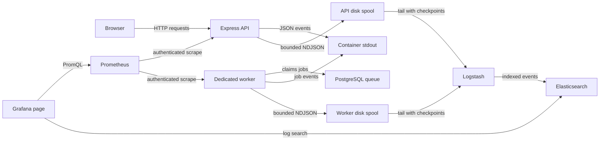
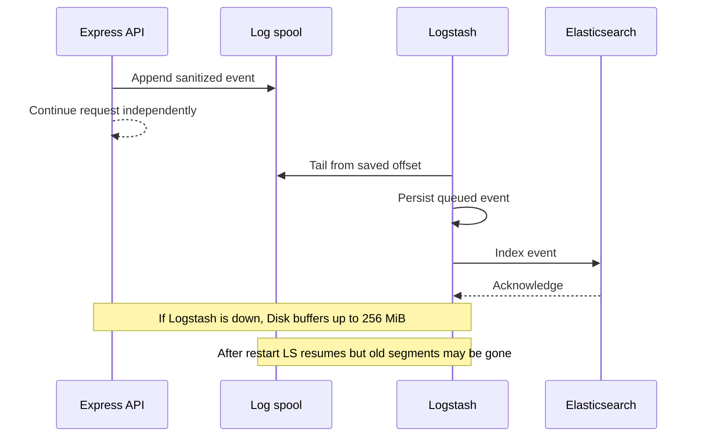

# API observability with Prometheus, Grafana, and Logstash

Status: implemented locally
Date: 2026-10-16

## Context

Before this change, ChalkTalk's Express API assigned an `X-Request-Id` but had no latency metrics, structured request logs, or monitoring UI. Background jobs and digest scheduling already ran in a dedicated worker process. The local Compose stack contained PostgreSQL, Mailpit, SeaweedFS, and an optional API/web profile, but no observability services. The existing system design called for metrics sampled every 60 seconds, API latency at or below 200 ms, and one year of request/result logs in a future managed deployment.

This phase is **local-only** and intentionally narrower than that deployment target. It instruments the Express API and dedicated background worker, adds an opt-in Compose observability profile, and provides an operator-facing Grafana dashboard. It does not instrument browser interactions or the separate Hocuspocus collaboration service, introduce an in-app ChalkTalk monitoring route, implement production AWS deployment, or add paging/notifications.

The user approved sanitized, allowlisted request/response fields rather than unrestricted body logging; seven-day age retention for Elasticsearch-indexed logs and both disk spools; size/count-bounded Docker stdout that may contain older events; a 15-day metrics retention period; and a finite 256 MiB on-disk log spool that may discard its oldest records rather than impede the API.

## Decision

The API emits low-cardinality Prometheus metrics and privacy-constrained structured JSON logs. Prometheus scrapes the API and worker every 60 seconds. Grafana provides a localhost-only, credential-protected dashboard for latency, traffic, errors, worker activity, and log search. Each process writes JSON logs to stdout and, when observability is enabled, to its own bounded local spool; Logstash tails both spools, processes events through a persistent queue, and indexes them in Elasticsearch. Observability failures do not prevent the application from serving requests or jobs.

Grafana has two provisioned data sources: Prometheus for metrics and Elasticsearch for logs. Elasticsearch stores only sanitized events in daily event-date indices; ILM parses the origination date from each index name so delayed ingestion does not extend the seven-day lifecycle from the date of index creation. Docker stdout is separately size/count-bounded and has no seven-day age guarantee. This local policy does **not** satisfy the documented one-year production retention target; that remains an explicit future deployment decision.

## Structure

### Instrumentation boundary

Request instrumentation starts before JSON parsing and finishes on response completion or connection close. A completed request records its method, matched Express route **template**, status class/status, elapsed seconds, and request ID. An aborted request is classified separately. Unknown routes receive a fixed `_unmatched` label, never their raw URL. Health checks and metrics scrapes are excluded from application-latency calculations or reported separately so periodic probes do not distort user traffic. The existing response `X-Request-Id` remains the correlation key.

The API records a request counter and histogram with fixed buckets including **0.2 seconds**. Grafana derives request rate, error rate, p50/p95/p99 estimates, and the share finishing within the documented 200 ms target. These are _observations_, not a guarantee that every request will meet the target. Labels may include only a bounded method, route template, status class, and static job kind/outcome. Never label metrics with paths containing IDs, query parameters, request IDs, user IDs, course IDs, emails, or other unbounded values.

The dedicated worker records attempted runs and duration by fixed job kind and outcome. The API also exposes process/Node metrics and counters for spool write errors and events/segments discarded at capacity. Each metrics registry belongs to its own process, not PostgreSQL; counters reset on process restart and Prometheus handles their rate calculations.

`/metrics` is registered in each process only when observability is enabled and requires an operator-only bearer token. A missing or invalid token receives no metric data. The API remains healthy when Prometheus is absent. In the full Compose app profile, neither API nor worker metrics has a host-published port and Prometheus reaches both over the private Compose network. The Grafana UI binds only to `127.0.0.1`; Prometheus, Logstash, and Elasticsearch expose no host ports. A developer running the API directly must still supply the token to scrape its local port.

### Logging and privacy

Each request emits one structured completion/abort event. Worker starts/outcomes and unexpected server errors have distinct event names. The implemented event fields and route-specific request/response allowlist are documented in the [local API observability reference](../../documentation/api/observability.md). Unknown routes default to metadata only. Auth, account, and file-resource endpoints are metadata-only.

The logger must never serialize arbitrary request/response objects or an entire exception. It must not record post/answer/followup titles or bodies, anonymous content or identities, raw URL/query values, user/course/resource identifiers, cookies, authorization or CSRF headers, passwords, tokens, email addresses, uploaded file bytes, or unsanitized exception messages/stacks. Every allowed value and entire event have size bounds. A deliberately small allowlist, not an expanding list of redaction patterns, is the privacy boundary. Existing ad hoc `console.error` sites that could emit raw errors should be routed through this safe logger or otherwise sanitized.

The same already-sanitized event is written to stdout for normal `docker compose logs` and to the optional spool. API and worker containers use Docker's `local` logging driver with five rotating files of at most 20 MiB each per container. This bounds the stdout copy by size/count, not age; it may contain events older than seven days. Each process has a separate named spool volume readable by Logstash, with append-only NDJSON files rotated by opening a fresh segment at roughly 16 MiB. Logstash's file input tails active and completed files and stores its offset checkpoints (`sincedb`) on a persistent volume. Its own bounded persistent queue buffers accepted events while Elasticsearch is unavailable. Elasticsearch lifecycle policy uses the daily event date in the index name as its origination date and retains indexed logs for seven days from that date; Prometheus retains metrics for fifteen days. Spool files are temporary transport, not an independent long-term archive: they are removed when older than seven days or when the 256 MiB cap requires eviction, oldest first.

Neither spool writer may synchronously wait for Logstash or Elasticsearch in a request. It should bound its in-process write queue as well as its disk footprint. The transport can lose the newest in-memory tail on an abrupt process crash and can lose old segments when an outage exceeds the spool cap. Logstash's checkpointing can cause duplicate indexing after a crash or replay; events are therefore at-least-once _within the surviving spool_, not exactly once. The dashboard and documentation must distinguish confirmed drops from capacity evictions with unknown delivery status rather than claiming lossless collection.

### Operator page

Grafana is the requested monitoring page, not a ChalkTalk frontend feature. Its local admin credential comes from the ignored development environment, never a checked-in default password. Provisioned dashboards show request rate, error rate, p50/p95/p99 and 200 ms compliance, worker duration/failure, API and worker scrape health, definite spool drops and at-risk capacity evictions, and a request-ID-filterable log view. The dashboard is read-only for ordinary inspection; no alert delivery or autoscaling control is added in this phase.

## Technology choices

| Concern             | Choice                                                    | Why                                                                       | Runner-up                                                                                      |
| ------------------- | --------------------------------------------------------- | ------------------------------------------------------------------------- | ---------------------------------------------------------------------------------------------- |
| Node metrics        | Official `@prometheus-io/client`                          | Maintained Prometheus Node client, histograms and default process metrics | The former `prom-client` name is superseded                                                    |
| Structured logging  | Pino plus a bounded rotating NDJSON spool                 | Consistent JSON event schema with stdout fallback and disk outage buffer  | Direct Logstash HTTP output loses events while collector is down                               |
| Local metrics store | Prometheus                                                | Native scraping/PromQL and 15-day retention                               | Database rows would duplicate telemetry and complicate queries                                 |
| Dashboards          | Grafana                                                   | One operator page for Prometheus metrics and Elasticsearch logs           | Custom ChalkTalk page needs platform-admin auth and frontend maintenance                       |
| Log pipeline/store  | Logstash file input and persistent queue to Elasticsearch | Explicit Logstash requirement, disk-backed replay and Grafana log search  | Rotated files alone lack indexed search; Loki output adds a less-standard Logstash integration |

Maintenance/API facts checked against upstream documentation on 2026-10-16: [Prometheus Node client](https://github.com/prometheus/client_js), [Prometheus instrumentation/cardinality guidance](https://prometheus.io/docs/practices/instrumentation/), [Pino releases](https://github.com/pinojs/pino/releases), [Logstash file input/sincedb](https://www.elastic.co/docs/reference/logstash/plugins/plugins-inputs-file), [Logstash persistent queues](https://www.elastic.co/docs/reference/logstash/persistent-queues), [Grafana Elasticsearch data source](https://grafana.com/docs/grafana/latest/datasources/elasticsearch/configure/), and [Elasticsearch lifecycle management](https://www.elastic.co/guide/en/elasticsearch/reference/current/ilm-concepts.html). Compose images use versioned tags, while `package-lock.json` records exact dependency versions.

## Alternatives rejected

- Synchronous API-to-Logstash writes: ties request latency and availability to a logging service.
- Docker syslog/GELF remote logging driver: its endpoint must be reachable from the Docker daemon, not simply the Compose network; unavailable endpoints can prevent container startup even with non-blocking delivery settings. It also complicates Docker Desktop operation.
- Docker-socket or host log-file scraping: grants the collector broad container/host visibility unrelated to this scope.
- Raw request/response bodies: would duplicate private course content, anonymous contributions, passwords, tokens, and uploaded files in an operator-visible store.
- Raw URL or user/course labels in Prometheus: creates unbounded cardinality and may reveal identities.
- An in-app ChalkTalk monitoring page: current course roles are not platform-operator roles; embedding Grafana would create a new authorization and UI boundary.
- CloudWatch replacement or managed production deployment now: the user requested a local first phase. Production retention, security, and scaling require a separate design.

## Trade-offs and failure modes

| Failure                                        | Behavior                                                                                                                                                                                     |
| ---------------------------------------------- | -------------------------------------------------------------------------------------------------------------------------------------------------------------------------------------------- |
| Prometheus or Grafana unavailable              | API and worker continue. Scrapes/dashboards are unavailable for the gap; no request is delayed.                                                                                              |
| Logstash unavailable                           | API continues, stdout remains, spool retains events until age/cap limits. On recovery Logstash resumes from persisted offsets.                                                               |
| Elasticsearch unavailable                      | Logstash's bounded persistent queue absorbs events until full; backpressure eventually leaves events in spool.                                                                               |
| Spool full or disk write error                 | Evict oldest segments at 256 MiB or stop spool writes on I/O error, count/report loss where possible, keep serving and logging to stdout. No claim of losslessness during prolonged outages. |
| Abrupt API or Logstash crash                   | Some newest unflushed events may be lost; already read events may be replayed and duplicated. Request data and application state are unaffected.                                             |
| Unrecognized route or unexpected payload shape | Log only safe metadata; do not fall back to dumping raw content.                                                                                                                             |
| Operator credential or metrics token absent    | Grafana/metrics access fails closed; the application itself remains available.                                                                                                               |

## Reversibility

Cheap to change: histogram buckets, dashboard panels, scrape interval, local retention settings, and internal logging library. More expensive: published metric names/label semantics and log event field names once dashboards or alerts depend on them, and the persistence/collector topology if extended to production. Preserve a small versioned schema to make such a move deliberate.

## Open questions and assumptions

- **Assumption:** one API process writes the local spool. A future multi-replica deployment requires per-instance spools or an independent collector; this design does not silently share one active log file among replicas.
- **Assumption:** local-only monitoring permits internal Compose-network plaintext transport, while external access is blocked and Grafana uses non-default credentials. Production would require TLS, hardened service-to-service credentials, backups, capacity planning, and reconciliation with the one-year log requirement.
- The exact allowlist of safe request/response fields belongs in the OpenSpec contract and tests before implementation. Any field that might carry free text, identity, or course-private content defaults to omission.
- The monitored 200 ms target is the observed server-side HTTP duration. A later production SLO must define its percentile, traffic exclusions, and alerting policy; this phase reports the distribution rather than asserting a universal guarantee.
