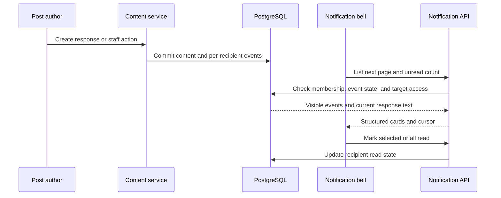

# Notification bell events and previews

Status: agreed
Date: 2026-10-27

## Context

ChalkTalk already renders a global `NotificationBell`, stores per-user notifications in PostgreSQL, exposes a paginated list and unread count, and refreshes the count while the page is visible. The panel scrolls, but it currently loads only its first page and displays a single-line activity label. Answers, followups, and replies notify followers, while explicit unfollow prevents future follower notifications. The merged response-email feature can link to an exact answer or followup and shows up to three nonblank lines of its current text, but its response reference exists only in the email job payload—not in the notification row. Merge email is a separate job; there is no existing staff-edit or staff-delete email to copy.

The user wants the existing bell enhanced, not a second button. Cards should include a lead-in such as “X replied to your message,” a short response preview, and notices when a TA or instructor edits, merges, or deletes the recipient's post. Existing announcements, mentions, endorsements, and other follower activity remain. The owner-specific response wording does not override an explicit unfollow. Only a meaningful staff change to post title or body—not metadata or the staff member's own post—produces a staff-edit notice. A confirmed **question** merge notifies its original author. Staff deletion notifies the original author without retaining deleted title or body. A merge notice links to the canonical post and disappears if the merge is undone. The panel offers visible “Load more” pagination.

A response card previews the response's **current** text; if that response is later deleted, the card keeps a text-free “Response no longer available” fallback. The earlier email decision limits excerpts to three nonblank lines and 360 characters. No new email kinds or email-delivery behavior are implied by this in-app request.

## Decision

Keep the existing notification system as the single authority for the bell. Extend its event record with an optional typed answer/followup reference and moderation event kinds, written in the same transaction as the content action. Do not derive in-app cards from email jobs, and do not persist response-body excerpts. The notification API, not the browser, resolves the currently authorized response text and returns structured card fields and an authorized destination. Maintain the existing follower fan-out and actor-anonymity rules.

The projection has two visibility paths. Ordinary response and edit notices require a current course membership and a currently readable active post. A merge notice requires the source to remain confirmed to a readable, active, public canonical post; it navigates to that canonical post. A deletion notice requires current course membership and its recipient-specific event record, but no live post join: deletion scrubs the source post's title, body, and author. It uses generic wording, has no old-content preview, and navigates to the course feed. Course deletion removes the notices with the course; leaving the course hides them.

## Structure

The content services own emission: answer/followup creation records a response reference alongside its existing follower notification; post edit, confirmed merge, and delete record one author-targeted moderation event when their stated conditions hold. This is one atomic database transaction, so a failed write cannot leave a ghost notice and a failed notice insert rolls back the content action. Notification rows own recipient, actor/anonymity, course, source post, kind, read state, and optional response/canonical target. They do **not** own copies of message bodies or deleted post text. A constrained kind/target combination prevents nonsensical cards. Email jobs remain a separate delivery concern and are not generated for the new moderation kinds.

The API owns projection and authorization on every list/count request. It applies the same visibility predicate to list pagination and unread count, so hidden events never inflate the badge or create empty pages. It resolves the current answer/followup only when the post remains readable and the response belongs to that post. It returns plain text, limited to three nonblank lines and 360 characters, plus a target kind and ID for the existing `#answer-…` / `#followup-…` browser navigation. A deleted answer/followup yields no body and a text-free fallback; a subsequent click opens the parent post without trying to reveal deleted content. Actor display follows the existing anonymous-name projection, including a generic label if the actor account was deleted. The API never returns raw Markdown as executable HTML.

For a confirmed merge, the API validates both the source's current merge relationship and canonical target on each read. It can show the still-present source title and directs the user to the canonical post; an unmerge, deletion, or inaccessible canonical target removes the stale event from the visible list and unread count. For deletion, the event created before scrubbing remains attributable to the author via `notifications.user_id`; the projection returns no source title/body and directs the user to the course feed. A removed course membership hides even that generic event. The deletion card does not offer a dead post link.

The browser keeps the bell's existing focus/Escape/outside-click behavior and 60-second count refresh. It renders rectangular, keyboard-accessible cards in the bounded scroll region, with lead-in, optional preview, course/time, and unread state. The first page loads on opening; visible “Load more” follows `nextCursor` until exhausted and preserves existing cards. Selecting a card marks that notification read and follows its API-provided destination. Mark-all-read keeps its existing behavior; a fetch failure shows a retryable error without clearing loaded cards. The card renderer switches on the event kind and typed destination, not server-provided HTML or client-constructed URLs from arbitrary text.

## Technology choices

| Concern | Choice | Why | Runner-up |
|---|---|---|---|
| Event and read state | Existing PostgreSQL `notifications` table | Atomic with content writes; one badge/list authority | Separate moderation inbox adds duplication |
| Delivery to UI | Existing REST list/count/read endpoints and polling | Already deployed, adequate for course scale | WebSocket adds a new lifecycle for no stated latency requirement |
| Response preview | Resolve current text in notification projection | Avoids retaining text after edit/deletion and rechecks access | Persisted excerpt can leak scrubbed content |
| Panel pagination | Existing cursor plus visible “Load more” | Makes all events reachable and predictable | Infinite scroll obscures loading/errors |
| Styling | Existing React and CSS patterns | No dependency or design-system split | New notification UI package is unnecessary |

These choices rely only on technology already in the repository; no new library version or maintenance claim is made.

## Alternatives rejected

- **Build another notification button:** the global bell already exists; a second button would split read state and confuse navigation.
- **Read previews from email-job JSON:** activity-email opt-out means no job exists for many in-app notices, jobs are transient, and response IDs are not present on notification rows.
- **Store response or deleted-post text snapshots:** this conflicts with deletion scrubbing and may reveal historical private content after access changes.
- **Reuse the ordinary active-post visibility join for all kinds:** it necessarily hides deleted and merged posts, making the requested moderation notices impossible.
- **Always notify the author regardless of follow:** this would reverse the explicitly chosen unfollow semantics and could duplicate follower notices.
- **Add WebSocket delivery now:** the existing count polling and fetch-on-open already meet the requested interaction without more operational state.

## Trade-offs accepted

The bell is near-real-time rather than instantaneous: the badge refreshes on the existing visible-page interval/focus, while opening the panel fetches current items. A preview may differ from the text as originally posted if the author later edits it; this is deliberate to avoid retaining stale content. The generic deletion notice cannot quote the deleted title and opens the course feed, not the removed post. A single transaction makes notification persistence part of content-write success; if notification insertion is unavailable, the content action fails instead of succeeding silently without its promised notice.

## Failure modes

| Condition | Result |
|---|---|
| Notification API is slow/down | Existing page remains visible; panel reports retryable loading error; content writes are unaffected unless the database itself fails. |
| Response edited/deleted after event | Preview reflects current text or becomes a text-free unavailable fallback; no deleted text survives in the event row. |
| Private-post access or course membership revoked | List and count omit the event; direct post APIs still enforce their own access checks. |
| Merge undone or canonical target unavailable | Merge card disappears from list/count; no dead or private canonical link is emitted. |
| Browser has a stale card during access revocation | The destination API denies access; the panel refresh drops the card. The UI must not cache private excerpts beyond its in-memory session. |
| Pagination data changes between pages | Existing cursor order may omit or shift a concurrent event; reopening refreshes the panel. This is acceptable for an inbox, not an audit log. |

## Reversibility

Adding typed target fields and event kinds to the persisted notification contract is the expensive decision: future consumers and migrations will depend on it. The single-authority visibility rules are similarly security-critical. Card copy, layout, preview length, and whether the next page is loaded by button or scroll are cheap to change. No new service or dependency creates an operational one-way door.
