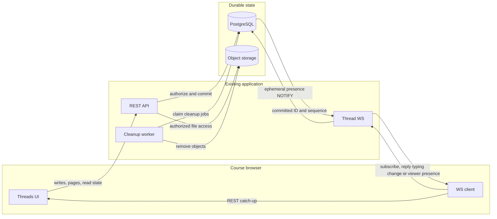
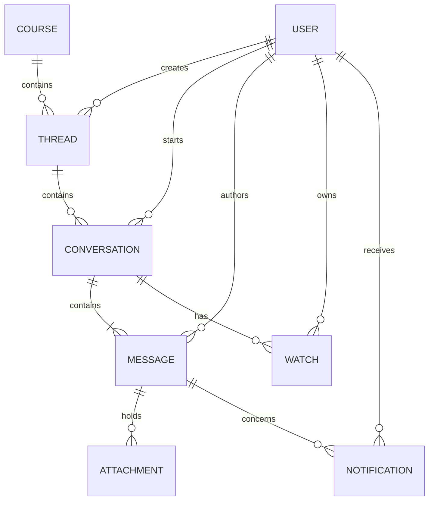
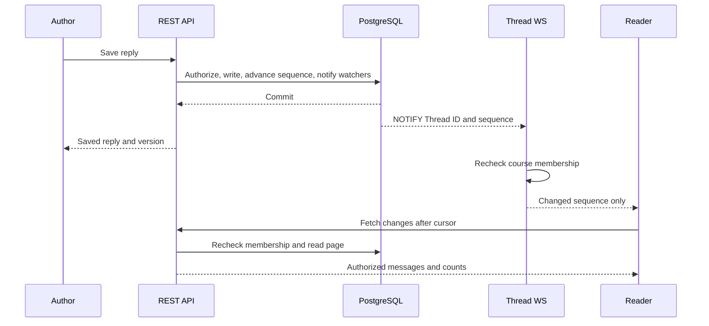

# Public course Threads for group formation

Status: proposed
Date: 2026-10-27

## Context

ChalkTalk needs a course-visible place where members can find teammates and coordinate other informal requests without turning each request into a structured Q&A Post. The earlier, unmerged Course Threads proposal on `codex/threads-revised-plan` described categories, member-created public/private conversations, invitations, participation grants, and 30-day archiving. Those are **not** the product now agreed. This document replaces that design; its old, unmerged artifacts remain historical material, not an implementation contract. No environment has historical Channels data to migrate.

The existing system has an Express API, PostgreSQL, current course-membership/role checks, an in-app notification bell, a worker, an S3-compatible SeaweedFS attachment store, and a WebSocket-capable runtime. The deployment is a small single-host Docker Compose installation. Reuse these boundaries rather than add a chat service, Redis, or a team-membership system. Threads remain separate from Posts, the Posts feed, and the daily email digest. The course main page links to **Threads** beside **Course resources**.

## Decision

A **Thread** is a public, staff-created topic board within one course, such as “Find a project team.” Every current course member may discover and read every Thread. A current instructor or TA may create, rename, or delete a whole Thread. Deletion immediately hides its conversations and files and starts retryable object cleanup. There are no categories, private Threads, invitations, joins, bans, automatic expiration, or manual archive. Staff do not gain a special notification subscription merely by creating or moderating a Thread.

Each Thread contains independent **conversations**, not one shared chat timeline. Any current course member, including staff, starts a conversation by saving one required, nonanonymous opening Markdown message. A conversation has no separate title. Members may add flat, chronological replies. A conversation is a request and discussion, **not** a tracked team: ChalkTalk does not record team membership, approval, or formation status. Thread and conversation messages do not inherit Posts anonymity settings.

Message authors may edit or delete their own messages. Current staff may edit or delete a **student-authored** message, determined by the author's role at creation, but staff role alone does not permit editing or deleting another staff member's contribution. Deleting an opening message leaves a bodyless placeholder while preserving its replies and conversation position. V1 has no whole-conversation delete or message revision-history UI. Staff-only whole-Thread deletion is deliberately broader and requires a clear confirmation of the loss of others' contributions.

## Structure and ownership

PostgreSQL owns Threads, conversations, messages, attachment metadata, watches, per-message read state, notification records, and a durable change sequence. The API is the only authority for writes and viewer projections. It checks current course membership on every list, detail, message, file, and catch-up request; membership loss revokes subsequent access to all Thread history. Archiving a course retains member reads but blocks Thread and message writes and attachment mutations. Course deletion also removes Threads and their dependent records. An already downloaded file cannot be recalled, so the API does not issue long-lived public object URLs.

The opening message and its conversation are one atomic write. Replies are chronological within that conversation, not nested under other replies. Every message has a current version/ETag so edits and deletes cannot silently overwrite concurrent changes. A deleted message has no body, author projection, or downloadable files; its placeholder keeps chronology and reply context. Attachment upload occurs after its message has been saved, using the existing validated upload pattern; each subsequent download is authorized against current course membership and content state. Failed upload does not erase a saved message.

### Watches, unread state, and notifications

A conversation watch records a member's interest and notification preference; per-message read state is stored separately. It is **not** an access grant. Starting a conversation, replying, or explicitly following creates a watch with new-reply notices enabled. Any current course member may explicitly follow a conversation without posting. An explicit unfollow disables future reply notification cards but keeps the watch and read state. Posting again does not silently re-enable notices. Passive public readers have no watch and accumulate no unread count. A member may re-follow.

A new reply creates in-app notification cards for **other** current watchers with notices enabled. Starting a new conversation sends no course-wide alert. The existing global bell displays these cards; no Thread activity email is sent. The Threads navigation badge sums unread messages across the member's watched conversations, **including unfollowed watches**. A Thread list entry shows the corresponding unread subtotal, and a conversation entry shows its own unread count. Thus unfollow stops active notices, not the read-state indicator. Opening a conversation marks only its loaded messages as read; older unloaded messages and concurrently arriving replies stay unread. Dismissing a notification in the global bell does not itself mark messages read. A direct notification link clears that card only after the referenced reply loads. All counts and links are recomputed against current course membership, so stale notifications cannot expose a former member's content.

### Live delivery and catch-up

Authenticated REST owns all content writes, pagination, attachment transfer, unread changes, and durable catch-up. For **persisted changes**, the API-owned WebSocket and PostgreSQL `LISTEN/NOTIFY` send only a changed Thread identifier and highest committed sequence, never message bodies or attachment metadata. An authenticated client subscribes only to courses it currently belongs to. Every persisted-change signal prompts an authorized REST refresh. The initial page and its high-water sequence must be a consistent snapshot; on reconnect the client subscribes before fetching changes after its last durable cursor. A missed or duplicate wake-up therefore cannot lose committed content. The socket rechecks membership before forwarding and periodically revalidates sessions, while REST checks authority independently. A stale socket cannot authorize a read.

**Typing presence is a separate, ephemeral WebSocket event, not a persisted change.** Only the reply composer in an already open conversation sends a debounced typing pulse; creating a conversation or editing a message does not. The API authenticates the socket, checks current course membership and the conversation's active Thread, derives the sender's identity from the session rather than the payload, and relays a small presence event through PostgreSQL `NOTIFY`. Only other connected clients **currently viewing that same conversation** receive it. The UI displays the member's real display name (for example, “Alex is typing”); it sends no draft text, keystrokes, or attachment details. A bounded heartbeat refreshes presence while the member types, a stop event on send or blur clears it when possible, and every receiver expires stale presence after a short lease of approximately ten seconds. Leaving the conversation or disconnecting clears the local indicator. Presence is neither stored in PostgreSQL nor surfaced in the global notification bell, Threads unread counts, REST catch-up, or email. Lost or reordered presence events may briefly omit or prolong an indicator, but cannot affect saved messages. Rate limits and bounded payloads prevent an active typist from flooding the relay.

The browser shows connection loss and reconnecting state, preserves unsent text, retries with capped backoff, and offers manual refresh. It does not poll in the background. REST writes remain available if only the live listener fails. History and catch-up pages remain bounded; older-page loading preserves the reader's scroll position. There is **no search bar** for Threads or conversations in v1; board discovery uses course browsing and recent activity.

## Technology choices

| Concern                 | Choice                                                     | Why                                                                                                  | Runner-up                                    |
| ----------------------- | ---------------------------------------------------------- | ---------------------------------------------------------------------------------------------------- | -------------------------------------------- |
| State and authorization | Existing PostgreSQL and Express API                        | One transaction can save content, watches, counts, and notifications under current membership checks | Separate chat service duplicates authority   |
| Live updates            | Existing `ws` runtime with PostgreSQL `LISTEN/NOTIFY`      | Durable-content invalidations use REST recovery; short-lived typing presence needs no stored state   | Redis Pub/Sub adds an operational dependency |
| Files                   | Existing S3-compatible store through authorized API routes | Reuses validation and prevents new downloads after membership/content loss                           | Public object URLs outlive authorization     |
| Message rendering       | Existing Markdown/LaTeX rendering and sanitization         | Consistent with Posts and no new editor dependency                                                   | Rich-text chat editor adds complexity        |

These choices use packages and services already present in this repository, checked on 2026-10-27. The exact WebSocket adapter and PostgreSQL listener integration are implementation details to verify during planning; the design does not require a new runtime dependency.

## Alternatives rejected and trade-offs

- Keep the old category → public/private Thread → message structure: rejected because the user now wants staff-created public boards containing separate member-started conversations.
- Add team roster or acceptance workflows: rejected; coordination occurs through messages, and no authoritative team state is required.
- Notify every course member about every new conversation: rejected to avoid alert fatigue. New conversations are discoverable in the board list.
- Use a Thread join or participant table as a read gate: rejected; every current course member may read public boards. A watch affects alerts and unread tracking only.
- Automatically archive, expire, or delete quiet Threads: rejected. Staff explicitly manage board lifetime.
- Add search in this release: rejected by the user; browsing and recent activity suffice for this version.
- Put messages in the Posts feed, Posts search, or digest: rejected to preserve the boundary between informal group coordination and structured Q&A.

Deleting a whole Thread can remove other people's contributions from view; the staff-only permission and destructive confirmation are deliberate. Unfollowed conversations still contribute to unread counts, which favors honest read state over a completely silent navigation area. PostgreSQL `NOTIFY` is best-effort, so another open browser may not update until reconnect or manual refresh if a signal is lost; persisted content is never dependent on signal delivery.

## Failure modes

| Failure                            | Behavior                                                                                                                                                                |
| ---------------------------------- | ----------------------------------------------------------------------------------------------------------------------------------------------------------------------- |
| PostgreSQL unavailable             | Authoritative reads, writes, counts, and catch-up fail with retry/error; no mutation is acknowledged before commit.                                                     |
| Listener or WebSocket unavailable  | REST remains usable when database connections work. Browser shows disconnected state and repairs durable gaps through REST; typing indicators are absent, not replayed. |
| Object storage unavailable         | Text remains readable; uploads and downloads fail independently and can be retried.                                                                                     |
| Concurrent edit/delete             | Version precondition rejects a stale mutation rather than replacing newer content or resurrecting a tombstone.                                                          |
| Course membership revoked          | New API reads/downloads fail; socket stops sending Thread identifiers; old notification links cannot recover content.                                                   |
| Thread deletion races with a reply | Serialize on the Thread: either the reply commits before deletion and is hidden with it, or the reply fails after deletion. Retryable cleanup removes files later.      |
| Duplicate or missing live signal   | Client deduplicates by durable sequence or catches up after reconnect/manual refresh.                                                                                   |
| Typing stop or pulse lost          | Receiver expires presence after its short lease; no draft text, notification, or stored message is affected.                                                            |

## Reversibility and open questions

Expensive decisions are the public board → conversation → message API and data shape, staff-only board lifecycle, author/staff message permissions, and watch/read semantics. They become observable user expectations and stored data. WebSocket envelope, page size, reconnect cadence, and presentation of counts are easier to change.

No unresolved **structural** product decision blocks planning. Planning should specify exact REST shapes, bounded cursor semantics, notification/read-state transactions, attachment limits, WebSocket origin/session handling, object cleanup retries, and a nonconflicting migration number without changing these decisions. The old plan-only branch must not be rebased as the implementation because its private-audience, category, and archive contracts conflict with this design.
