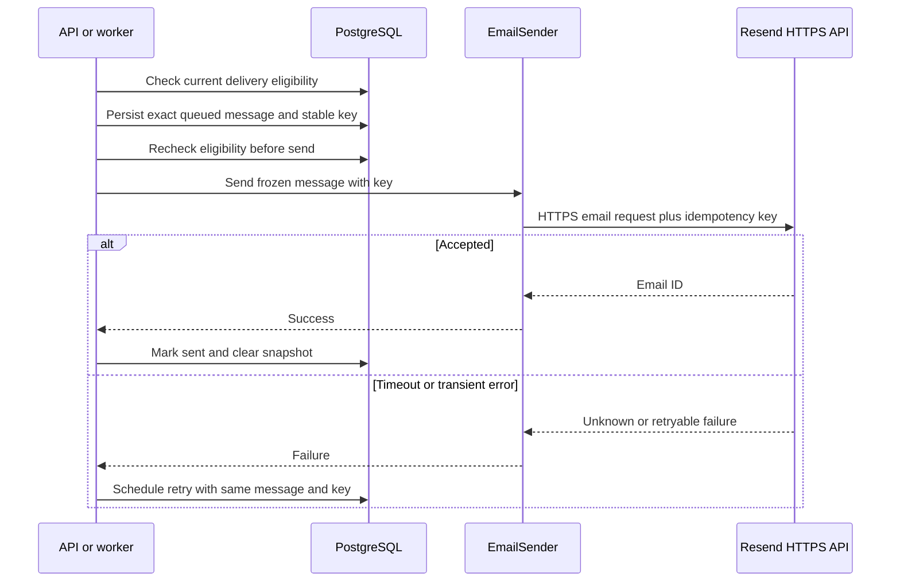

# Resend HTTPS delivery for application email

Status: approved for implementation
Date: 2026-10-30

## Context

ChalkTalk sends authentication, announcement, followed-post activity, live-session invitation, duplicate-question, and daily-digest email through one `EmailSender` interface. Its current implementation uses Nodemailer over SMTP. Railway's lower-tier outbound-SMTP restriction makes that transport unsuitable for the intended Railway deployment. The user selected Resend's HTTPS Email API, while retaining Mailpit for local development. This is a transport change, not a change to which events generate mail or who may receive it.

The API process sends some authentication mail directly. A separate worker sends queued mail and rich daily digests. PostgreSQL owns queued delivery state and current recipient/content eligibility. Rich digests can contain up to 5 MiB of inline PNG images and generate random Content-IDs; rendering the same digest twice does not necessarily produce an identical API request. That matters because Resend's idempotency key requires an identical request payload on retry.

The intended deployment is a small course project, with Railway hosting the application and Resend handling email. The operator will verify a sending domain and configure a sending-only Resend API key as a Railway secret. No provider fallback or inbound-mail feature is requested.

## Decision

Retain the existing application-level `EmailSender` contract, with a small optional idempotency-key extension, and select one transport explicitly by environment: local Mailpit SMTP or production Resend HTTPS. The API and worker select the same provider and sender identity. Use the official maintained `resend` Node SDK for API shape, inline attachments, cancellation, and idempotency options; do not bypass it with raw `fetch` or add Resend-specific calls to domain services.

For each queued email, persist the exact composed outbound message before the first external send and reuse it with a stable key derived from its queue item identity. Store the snapshot in PostgreSQL, including HTML, plain text, and inline image bytes/CIDs for digests. Clear the snapshot after confirmed success or cancellation. Delivery still checks current recipient, preference, audience, and content eligibility immediately before each attempt; a snapshot is **not** permission to send. If content becomes deleted, private to someone else, or otherwise inaccessible, cancel the pending send. A harmless title edit may leave the already-composed wording stale on retry; this is accepted to preserve an identical idempotent request. Existing lifecycle guards and send-time database locking remain authoritative.

Resend idempotency is only a 24-hour duplicate-suppression window, not an exactly-once guarantee. An accepted send whose database acknowledgment fails and is retried after 24 hours can still duplicate. Synchronous authentication sends retain their present timeout/abort and failure semantics; they do not acquire a new durable queue as part of this change.

## Structure

The snapshot and key must commit before the network call. Otherwise a timeout or worker crash could lose the original request body and make a later retry differ. A retry that finds the recipient or content no longer eligible cancels without calling Resend. PostgreSQL remains the sole delivery-state owner; Resend's response confirms API acceptance, not final inbox delivery.

Local Compose continues to route both API and worker to Mailpit. Railway config selects Resend with `RESEND_API_KEY` and a verified-domain `EMAIL_FROM` value; `SMTP_*` values are not required there. The exact environment-variable names and validation rules are implementation details for planning, but configuration must fail fast if Resend is selected without a usable key or sender. No automatic SMTP fallback is permitted: a timeout followed by fallback could send two messages.

## Technology choices

| Concern | Choice | Why | Runner-up |
| --- | --- | --- | --- |
| Production transport | Resend Email API over HTTPS | Works on Railway without outbound SMTP and supports text, HTML, inline CID images, and idempotency keys | SES HTTPS requires AWS credentials and signing, contrary to the user's provider choice |
| Client | Official `resend` Node SDK | Typed API and first-party support for request options and inline images | Hand-written `fetch` duplicates API mapping and error handling |
| Local email | Existing Nodemailer to Mailpit | Keeps current fast, inspectable development and test flow | Sending every developer email through Resend costs quota and risks real delivery |
| Queue-state owner | Existing PostgreSQL jobs and digest outbox | Preserves retry, cancellation, and lifecycle policy | Resend scheduling would split delivery ownership |
| Frozen payload | PostgreSQL snapshot on queue row | Atomic with existing queue state; simple at expected course scale | Object-store snapshot adds a second durable dependency and cleanup path |

Provider facts checked on 2026-10-30 against [Resend's official Node SDK](https://github.com/resend/resend-node), [idempotency documentation](https://resend.com/docs/dashboard/emails/idempotency-keys), and [inline-CID documentation](https://resend.com/changelog/embed-images-using-cid). Resend retains keys for 24 hours and rejects reuse of a key with a different payload. Its API supports CID inline attachments. Package-lock should pin the exact installed SDK version at implementation time.

## Alternatives rejected

- Replace local Mailpit with Resend: increases setup friction and risks sending test mail to real addresses.
- Automatic Resend-to-SMTP failover: ambiguous timeout outcomes can create duplicate mail.
- Re-render queued mail on each retry with a stable key: rich digest CIDs and mutable content change the request; Resend then rejects it.
- Derive a new key from each changed payload: avoids API rejection but can duplicate an earlier accepted send after a lost response.
- Store digest snapshots in object storage: avoids large PostgreSQL rows but creates a cross-store consistency and cleanup problem for a small deployment.
- Migrate all mail to a new generic email queue: broader than the transport change and risks changing existing authentication response behavior.

## Trade-offs accepted

- Pending rich digests may temporarily place several MiB of image data per recipient in PostgreSQL. Existing rendering caps limit this, and snapshots are removed after success/cancellation; a long Resend outage can still grow the database. Operations should monitor queue age and database size.
- Frozen visible wording can become stale after a harmless edit. Privacy/lifecycle changes cancel delivery rather than sending stale restricted content.
- An HTTP success means Resend accepted the request, not that a recipient received it. No webhook/bounce-state feature is added.
- Resend's 24-hour key window does not guarantee exactly-once delivery after a prolonged outage or delayed retry.

## Failure modes

| Failure | Behavior |
| --- | --- |
| Missing/invalid key or unverified sender | Fail configuration/startup or surface a non-retryable provider error; do not silently fall back to SMTP. |
| Resend slow, down, or 429 | Bound the HTTP call; leave the durable queue item retryable with its identical snapshot/key. Honor provider retry guidance where available without unbounded request blocking. |
| Network drops after Resend accepted | Retry the same snapshot/key. Resend suppresses duplicates inside its 24-hour window; beyond that, a duplicate remains possible. |
| Provider returns malformed success/error | Treat as failure and retain the queued item; never mark sent without an identifiable accepted response. |
| Recipient unsubscribes or loses access before retry | Recheck current eligibility and cancel; never rely on the frozen snapshot as authorization. |
| Worker crashes after snapshot commit, before send | Reclaimed job sends the saved snapshot/key. |
| Worker crashes after provider success, before DB mark-sent | Reclaimed job retries the same snapshot/key, subject to the 24-hour limit. |
| Local Mailpit unavailable | Existing local SMTP failure remains visible; no production Resend fallback in development. |

## Reversibility

The transport selection and SDK are cheap to reverse because domain services depend on `EmailSender`. Persisted snapshots and queue-state changes are a more expensive schema decision, but they are scoped to existing delivery rows and can be retired after queued records drain. The externally visible email content and triggers remain unchanged.

## Open questions

- Planning should confirm the exact Resend SDK attachment and abort-option types against the lockfile version before implementation.
- Operations must provide a verified sending domain, DNS records, and a sending-only API key; these are deployment prerequisites, not application-owned setup.
