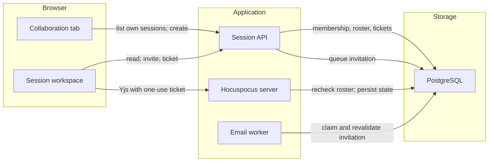

# Course-level collaboration sessions

Status: proposed
Date: 2026-11-01

## Context

ChalkTalk's live code and whiteboard sessions are currently attached to a post. The database requires `collaboration_sessions.post_id`; creation, listing, authorization, and the Hocuspocus server join the post; deleting or merging a post ends its sessions. The web UI starts a session from a post, links back to that post, and can copy session work into its answer or followup. A course page already has Discussion, Threads, and Course resources tabs, while session links open `/courses/{courseId}/sessions/{sessionId}`.

The product decision is to make collaboration an independent course activity: a **Collaboration** tab immediately after Threads, where members see sessions in which they participate, any current course member can start a session, and any current participant can invite another current course member. These are private sessions, not a second public Threads feed. Existing session IDs, documents, invitations, and permissions must survive the move. No new collaboration technology or separate persistence service is needed.

## Decision

Make the course, not a post, the session's owner and authorization boundary. The existing PostgreSQL session, participant, ticket, and Yjs document records remain authoritative. A session has a creator participant and zero or more invited participants. Only current course members who are current participants can list, open, or obtain a connection ticket. Staff have **no implicit read or write override** merely because of their role. Any participant can grant immediate View or Edit access to another current course member; the invitation email remains. A View invitation is read-only even for invited staff. The creator always has Edit permission. The creator or participating course staff may rename or end a session and remove invitees; this metadata/roster authority does not turn a staff member's View ticket into a write ticket. Ordinary participants may invite but not remove or change session settings. After participant removal commits, unused tickets are revoked and live connections close promptly. The creator cannot be removed.

Retain active/ending/ended lifecycle, the existing idle end, course archive behavior, persisted final snapshots, one-use WebSocket tickets, Hocuspocus/Yjs synchronization, and the existing session URL. Sessions no longer end because their former post is edited, merged, or deleted. When a creator leaves the course, end the session and leave a read-only snapshot for remaining current participants. Course departure still revokes that person's access. The course's archive/active state continues to govern editing. If the collaboration server cannot confirm a final flush during creator departure, show a clear **last saved version** warning alongside the snapshot rather than presenting it as complete.

Creation requires an explicit session title and language; the old fallback from post title and tags no longer applies. The Collaboration tab lists the viewer's active and ended sessions for that course with pagination and a create action. Opening a session retains the code editor, whiteboard, presence, participant list, View/Edit indicator, and end control. Replace **Back to post** with **Back to Collaboration**. Remove **Post to discussion** because no particular post is associated with a session. The existing home-page own-session summary may remain as a shortcut; it must use the same participant-only access rule. No unrelated discussion or Threads behavior changes.

## Structure



The API owns session metadata, participant authorization, invitation and lifecycle mutations, and ticket issuance. A thin Node HTTP/WebSocket transport owns admission buffering around the existing Hocuspocus connection handler; Hocuspocus and Yjs continue to own document synchronization. Admission consumes a valid one-use ticket while PostgreSQL locks the session and relevant membership, participant, and login rows through document load and socket registration. Until admission succeeds, no document, awareness, or broadcast frame leaves the transport. Inbound frames arriving with authentication wait in a bounded buffer and are forwarded in order only after admission succeeds. Failed or timed-out admission drops both buffers and closes the socket before releasing locks. Every forwarded inbound message, including SyncStep1, awareness, awareness queries, and stateless messages, receives a bounded, fail-closed authorization check. PostgreSQL owns both the session roster and the durable Yjs state. It must also durably record whether an ended session's final snapshot was confirmed or is only the last saved version; the read API projects that state so the client cannot infer completeness from the mere presence of a snapshot. A live manual end confirms completeness only after previously authorized in-flight messages drain and the final Yjs snapshot commits durably; direct lifecycle ends, failed or timed-out drains and flushes, and legacy ended sessions remain last-saved-only. `pg_notify` continues to carry access and lifecycle changes to connected collaboration workers; it is a signal, never an authority or a durable queue. The email worker rechecks current session, course, and invitee state and holds eligibility locks through provider acceptance. It must not claim that all staff can open the session.

```mermaid
sequenceDiagram
  participant Creator as Course member
  participant API as Session API
  participant DB as PostgreSQL
  participant Invitee as Invitee
  participant Socket as Hocuspocus
  Creator->>API: Create course session
  API->>DB: Insert session and creator participant
  DB-->>API: Commit session ID
  Creator->>API: Invite current course member
  API->>DB: Insert participant and email job
  DB-->>API: Commit immediate access
  Invitee->>API: Request one-use ticket
  API->>DB: Check course and participant permission
  API-->>Invitee: Ticket with View or Edit permission
  Invitee->>Socket: Connect with ticket
  Socket->>DB: Lock authorization rows and consume ticket
  Socket->>Socket: Load document and register connection; buffer outbound frames
  Socket->>DB: Commit admission and release locks
  Socket-->>Invitee: Deliver buffered frames and synchronize Yjs document
```

The database migration removes the required post association without replacing it with a Threads or post foreign key. Existing rows retain their IDs, course IDs, titles, languages, states, documents, participant rows, and permissions. The old post reference is dropped after the migration; it is not used to continue gating access. An old private-post session does **not** become public: its exact roster remains the only non-course access grant, and no staff member is automatically added. A session already removed by a historical post-deletion cascade cannot be recovered. The session's original URL stays valid. Session list responses, create requests, and API documentation should describe course-scoped sessions without an `anchor` or post filter; callers should not need a synthetic post ID.

## Technology choices

| Concern           | Choice                                                                                               | Why                                                                                                  | Runner-up                                                            |
| ----------------- | ---------------------------------------------------------------------------------------------------- | ---------------------------------------------------------------------------------------------------- | -------------------------------------------------------------------- |
| Durable authority | Existing PostgreSQL session, participant, ticket, and document tables                                | Keeps authorization and Yjs state in one transactional system                                        | New service or store adds operational complexity                     |
| Live editing      | Existing Hocuspocus 4.x, Yjs 13.x, one-use tickets, and a thin Node HTTP/WebSocket admission adapter | Keeps the established document protocol while withholding private frames until authorization commits | Replacing the collaboration protocol would duplicate tested behavior |
| Change signals    | Existing PostgreSQL notifications plus database recheck                                              | Propagates revocation and ending without trusting ephemeral signals                                  | Redis adds another runtime dependency                                |
| Invitations       | Immediate participant row plus existing email job                                                    | Matches current invitation behavior and avoids a new acceptance state                                | Acceptance workflow adds state and recovery paths not requested      |

Versions above reflect the repository's `origin/main` manifests inspected on 2026-11-01; no new library is proposed.

## Alternatives rejected

- **A course tab that still creates a hidden post anchor:** keeps the old schema superficially but leaves session lifetime, ACL, and deletion coupled to unrelated Q&A content.
- **A course-wide public session list or staff read override:** violates the agreed participant-only visibility, including for sessions formerly associated with private posts.
- **Invitation acceptance before access:** safer against unsolicited invitations, but changes the established immediate invitation model and adds pending/rejected states.
- **Transferring an orphaned creator role:** can silently grant management rights to another participant; ending on creator departure is predictable for short-lived live sessions.
- **Migrating existing sessions to new IDs/documents:** risks broken invitation links and Yjs data loss without offering a product benefit.

## Trade-offs accepted

- A participant can invite another current course member without creator approval. The creator or participating staff can remove that invitee; no nonparticipant staff moderation override is provided.
- The Collaboration tab is not a discoverable course-wide directory. A member must create or be invited to a session.
- Sessions still auto-end after the existing inactivity window; this change does not redefine them as persistent group workspaces.
- Removing the post association removes the one-click path to insert code or a whiteboard image into an answer/followup. Users can still copy code or export a board manually.

## Failure modes and security

- **API or database unavailable:** creation, listing, invitations, and new tickets fail; do not fall back to trusting cached client-side participants. Admission and all inbound message checks fail closed on database error or timeout. Existing sockets may briefly receive outbound frames after a revocation commit while closure is in progress; notifications initiate prompt closure, and the 15-second periodic sweep recovers missed signals without providing a hard closure bound.
- **Hocuspocus unavailable or disconnects:** metadata and lists still load; editors reconnect with fresh one-use tickets. Persisted snapshots remain readable for ended sessions. Never claim unsaved in-memory edits are durable.
- **Invitation email delayed or failed:** the committed participant row already grants access. A retry revalidates that the invitee is still a current course member and participant before sending. An in-flight provider send holds eligibility locks, so participant removal or creator departure may wait before committing; no invitation send is accepted after that commit. A provider may deliver an email it accepted before commit later.
- **Concurrent removal, departure, or ending:** serialize lifecycle and participant changes with ticket issuance; revoke outstanding tickets and active connections. A WebSocket ticket is not a permanent access grant. Ending must persist the final document before exposing its read-only snapshot when the collaboration server is healthy. If the server is unavailable or the final flush is unconfirmed, expose only the last durable state and visibly warn that newer edits may be missing. A late acknowledgement must not silently remove that warning without a verified durable final state.
- **In-flight edit at removal:** a Yjs edit authorized before a participant-removal transaction commits may finish after that commit. New edit authorizations and tickets must be denied after commit, and prompt closure of the open socket begins then. An already established socket may briefly receive outbound frames before that closure; a socket whose admission is still pending must receive none if removal commits first. Strict linearization of a previously authorized in-flight edit or immediate outbound revocation of established sockets would require a different collaboration protocol and is not required here.
- **Privacy of migrated sessions:** never use old post visibility as a substitute for participant ACL, and never broaden the roster during migration. Return the same not-found behavior for nonparticipants so session existence is not exposed.

## Reversibility

Removing `post_id` and the public `anchor` contract is the expensive, one-way data/API change; preserve all existing session identities and documents and coordinate migration with API/UI deployment. The tab label, list layout, and invitation email wording are cheap to revise. Replacing Hocuspocus or PostgreSQL is out of scope.

## Verification implications

The implementation plan should cover migration of existing active and ended sessions (including private-post sessions), old session URLs, creator departure, post deletion no longer cascading, participant-only list/get/ticket access for every role, immediate invites by noncreator participants, View/Edit enforcement on WebSocket writes, removal while connected, delayed invitation mail, course archive/read-only behavior, and code/whiteboard reconnection and final snapshots. Browser flows should start from the new course tab rather than a question. Run isolated authenticated full-stack tests with a real database and collaboration server, not only mocked API/browser tests: exercise connection and reconnection after network drops, one-use/expired tickets, View write rejection, membership and invitation revocation while connected, concurrent invite/remove/end/departure operations, and failure or timeout of the final flush. Assert that a creator-departure snapshot is visibly marked **last saved version** whenever completeness cannot be proven, including when an authorized edit is still in flight during final capture. These are acceptance boundaries, not file-level implementation steps.
