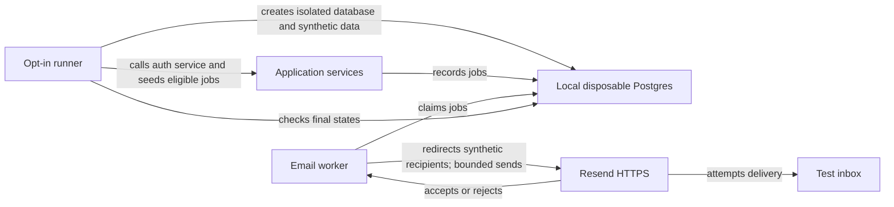

# Resend live validation

Status: approved and implemented — manual live validation only
Date: 2026-11-02

## Context

ChalkTalk's Resend transport serves two immediate auth messages (verification and password reset), four queued job families (duplicate/merge, collaboration invitation, announcement, activity/mention), and the daily digest. Existing deterministic integration tests cover PostgreSQL state, privacy invalidation, retries, mocked HTTP faults, and SMTP regression. The manual suite adds real-provider acceptance checks for these paths; it does not claim inbox delivery.

## Decision

Add an explicitly invoked live validation suite, separate from routine CI, using a new disposable local PostgreSQL database, synthetic course/users/posts, and the approved test inbox. Exercise immediate auth through AuthService and queued/digest delivery through the real worker services. Seed queued job fixtures directly so each provider path can be checked without a running application or contacting real students. Preserve mocked provider tests as the authoritative failure/race suite. A successful Resend API response means provider acceptance, not inbox delivery.

## Structure

The live runner owns fixture isolation, recipient address and message budget. Application producers own queue eligibility; workers own final privacy checks and frozen snapshots; Resend owns API acceptance and downstream delivery. The runner must not print API keys or token-bearing verification/reset links.

## Coverage boundary

| Family                   | Live seam                                                                             | Note                                                                      |
| ------------------------ | ------------------------------------------------------------------------------------- | ------------------------------------------------------------------------- |
| Verification             | Auth request for synthetic `.edu`, test-only sender redirects to approved Gmail inbox | Proves app composition and provider acceptance, not `.edu` inbox receipt. |
| Password reset           | Auth request with isolated synthetic account                                          | Public response intentionally hides whether account exists.               |
| Duplicate/merge          | Seed confirmed duplicate, drain matching job                                          | Canonical link and author recipient.                                      |
| Collaboration invitation | Seed isolated participant, drain job                                                  | Keep session active and recipient eligible.                               |
| Announcement             | Immediate queued email and scheduled publication, drain jobs                          | Same delivery family, two triggers.                                       |
| Activity/mention         | Representative answer response and mention                                            | Other notification variants retain deterministic database tests.          |
| Daily digest             | Schedule prior-day synthetic post, answer and followup, deliver outbox                | Require an inline image in the accepted payload.                          |

Bound sends per run and report a unique run ID without logging subjects or token-bearing links. Check Resend acceptance and durable job/outbox status; inbox arrival requires explicit inbox observation or an API with read access. Network drops, timeouts, HTTP 4xx/5xx, idempotency retries, stale content, changed addresses, revoked access, and cancellation remain deterministic mock-plus-PostgreSQL tests rather than deliberately disrupting a real provider.

## Technology choices

No new provider or test framework: reuse Vitest, application services, PostgreSQL integration harness, and existing `EmailSender`. Configure the live suite solely through ignored environment variables; never add live secrets to CI or screenshots by default. This is cheap to reverse and avoids production behavior changes.

## Alternatives rejected

- Run against production data: risks notifying real users and exposing private content.
- Make real-provider sends routine CI: requires shared secrets, creates mail/quota noise and flaky delivery assertions.
- Treat API `200` as inbox delivery: Resend can accept then bounce or defer.
- Force real network drops: nondeterministic and risks duplicates; mock them at the HTTP seam instead.

## Failure modes

- Missing secret, wrong inbox, or sender outside the allowed ChalkTalk domain: fail preflight before creating test data or sending. An unverified sender is rejected by Resend during the run.
- Resend rejection or timeout: fail the run without leaking response details or credentials; always remove the disposable database during cleanup.
- Partial run: the unique run ID distinguishes attempts and the send cap bounds each run; the disposable database is removed during cleanup.
- Recipient loses eligibility: existing worker cancellation logic must win; no send.

## Reversibility

The live test runner is additive and removable. It does not change production data ownership, public API, or queue schema. Using a real inbox in automated CI would be a more consequential policy change and is not recommended.

## Agreed boundaries

The approved recipient is kept in the operator's private environment, not in committed docs or logs. Live sends are manual-only and redirect only synthetic `.edu` recipients at the injected test transport seam. Provider acceptance plus durable app state is automated; inbox receipt is checked separately. A genuine `.edu` signup-to-inbox flow is not claimed.
