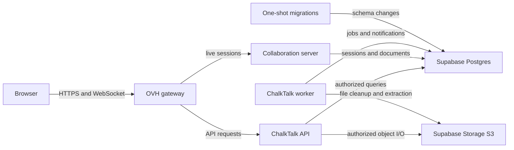

# Supabase-backed production data services

Status: approved for implementation
Date: 2026-11-03

## Context

Before this change, ChalkTalk ran PostgreSQL and SeaweedFS beside the application in the VM deployment Compose stack. The API, worker, collaboration server, migrations, and optional seed all use PostgreSQL through the existing `DATABASE_URL`; file services use the AWS S3 client through `S3_ENDPOINT`, `S3_BUCKET`, `S3_REGION`, and server-side S3 credentials. The ordinary development Compose stack should continue to work locally. Production will instead use managed Supabase Postgres and Supabase Storage while the web gateway and application processes stay on one OVH VM. The user also requires separate, named production Dockerfiles for the frontend, API, Hocuspocus collaboration service, and worker, plus a deployment README.

The user requested explicit `LOCAL_DATABASE` and `LOCAL_FILE_STORE` switches. These are **mode selectors**, not a second set of connection secrets: the user chose to keep the existing canonical `DATABASE_URL` and `S3_*` variables for whichever services are selected. This avoids competing `DATABASE_URL` and `SUPABASE_DATABASE_URL` values. In production, both switches are `false` and the canonical values point to Supabase; in local development they are `true` and point to local containers. No new Supabase Auth or browser-to-Supabase data path is introduced.

The deployment is fresh: the user confirmed that **no existing application data or objects need transfer**. ChalkTalk's SQL schema migrations still run against the new, empty Supabase database; this is distinct from migrating old user data.

## Decision

Keep application authorization and data access in ChalkTalk's API. Use Supabase only as hosted PostgreSQL and S3-compatible object storage. The browser never receives the database password or S3 access keys. The file bucket is private; all user downloads and uploads continue through ChalkTalk's existing access checks. Supabase S3 access keys bypass Storage RLS, making server-only custody essential.

Build four independently named production images from the same pinned source commit: a public frontend/Caddy image, a private Express API image, a private Hocuspocus collaboration image, and a private job-worker image. The frontend image serves compiled static assets and is the only container exposing host ports; it proxies `/api` and the live WebSocket routes to private services. Each backend image starts only its own process. The one-shot SQL migration job reuses the API image with a different command rather than requiring a fifth production Dockerfile; it must complete successfully before API, collaboration and worker start. The Dockerfiles may share ordinary build-cache layers but should not depend on mutable image tags or another service's startup order to build correctly. Include a deployment README for a pinned-commit build, required secrets and flags, startup, health checks, and rollback limitations. Keep the repository-root development Compose setup unchanged.

Parse `LOCAL_DATABASE` and `LOCAL_FILE_STORE` as strict `true`/`false` values, defaulting to `true` for compatibility with local development. `false` makes the corresponding canonical endpoint and credentials mandatory and fails startup rather than falling back to localhost or SDK ambient credentials. The production deployment configuration explicitly sets both to `false`, supplies Supabase values, and omits PostgreSQL and SeaweedFS containers. Development Compose explicitly selects local services. The flags are independent so either store can be moved separately; there is no requirement to migrate both at once.

For the persistent VM application, use the Supabase direct PostgreSQL connection where IPv6 is available. If the VM cannot reach it over IPv6, use Supabase's IPv4 session pooler rather than transaction pooling: ChalkTalk migrations use session-level advisory locks, and services use transactions. Obtain connection strings from the Supabase dashboard rather than constructing them. Migrations remain a one-shot prestart step and must be tested against a disposable Supabase project before production. The storage client uses Supabase's documented S3 endpoint, region, bucket and server-side S3 key pair, without replacing the existing file-service abstraction.

## Structure

At deployment, `Gateway` is the frontend/Caddy container; `API`, `Live`, and `Worker` are separate containers with distinct Dockerfiles. `Migrate` runs the API image once with the migration command. No Supabase credential is baked into any image; Compose injects it at runtime.

The data connection choice is resolved once per process from the environment, before constructing a PostgreSQL pool or S3 client. API, worker, collaboration, migration and seed entry points must all use the same resolved mode. This prevents the production API from reaching Supabase while a migration or worker silently reaches a local database. Compose is responsible only for starting the selected local dependencies and passing a coherent environment; it is not an alternative authorization layer. The production migration container must have outbound network access to Supabase: the current deployment places it only on an internal Compose network, which would make a remote database unreachable.

## Technology choices

| Concern                     | Choice                                                                                              | Why                                                                                           | Rejected alternative                                                                      |
| --------------------------- | --------------------------------------------------------------------------------------------------- | --------------------------------------------------------------------------------------------- | ----------------------------------------------------------------------------------------- |
| Production relational store | Supabase Postgres via existing `pg` pool                                                            | Retains SQL, transactions, migration runner and application authorization                     | Supabase Data API would require rewriting database access and security policies           |
| Production file store       | Supabase Storage S3 interface via existing AWS client                                               | Retains current object keys and file-service boundary                                         | Direct browser Storage SDK would split authorization and expose a new client access model |
| Production images           | Separate named frontend, API, Hocuspocus, and worker Dockerfiles                                    | Matches process isolation while keeping the migration job a command override of the API image | One all-purpose image obscures which service needs which runtime tools                    |
| Deployment selection        | Strict `LOCAL_DATABASE` and `LOCAL_FILE_STORE` booleans with canonical `DATABASE_URL`/`S3_*` values | Explicit operator intent without duplicate secrets                                            | Separate `SUPABASE_*` values duplicate connection configuration                           |
| Persistent DB connection    | Direct connection, or IPv4 session pooler where necessary                                           | Compatible with long-running app processes and session-level migration lock                   | Transaction pooler may break session-dependent behavior                                   |

Supabase's S3 compatibility, connection modes, and extension catalogue were checked against its official documentation on 2026-11-03. Compatibility of the actual ChalkTalk migrations and object operations still requires integration testing; documentation alone is not proof.

## Alternatives rejected

- Keep PostgreSQL and SeaweedFS on the VM: cheaper and more self-contained, but contradicts the chosen managed-data deployment.
- Add `SUPABASE_DATABASE_URL` and `SUPABASE_S3_*` alongside existing connection variables: creates two competing sources of truth and more opportunities to deploy against the wrong data.
- Let the frontend use Supabase directly: would bypass ChalkTalk's current course, staff, private-post and file-access checks unless a second authorization model were built.
- Add a fifth migration Dockerfile: the migration runner already uses the API's compiled code and SQL files; a command override avoids an unnecessary image build.

## Trade-offs accepted

The application now depends on network access from OVH to Supabase for every database operation and file transfer. This adds latency and exposes the app to provider outages. The two flags are redundant with endpoint values in principle, but deliberately make production/local intent explicit and allow fail-fast validation. Managed Postgres and Storage do not remove the need for application-level backup/restore planning or deployment smoke tests.

## Failure modes

| Failure                                                      | Required response                                                                                                                                                             |
| ------------------------------------------------------------ | ----------------------------------------------------------------------------------------------------------------------------------------------------------------------------- |
| Missing or malformed remote database URL                     | Fail the affected process and migration before serving requests; never use a local fallback.                                                                                  |
| Supabase database slow or unavailable                        | API/live features fail visibly; worker retries durable jobs. Do not treat an unsuccessful migration as completed.                                                             |
| Missing S3 credentials, endpoint or bucket in remote mode    | Fail startup; never use ambient AWS credentials or SeaweedFS defaults.                                                                                                        |
| Supabase Storage unavailable or returns an incomplete object | Existing upload/download error handling applies; no metadata should claim a successfully stored file when the object write failed.                                            |
| Wrongly public bucket or exposed S3 keys                     | Private course files could be disclosed; keep the bucket private and credentials server-side, and validate both before launch.                                                |
| VM lacks IPv6                                                | Select the dashboard-provided IPv4 session pooler URL; verify migration and runtime connections before cutover.                                                               |
| Migration exits nonzero                                      | Keep API, worker, collaboration and public gateway from serving the new release; inspect logs and repair the migration rather than starting a partially upgraded application. |

## Reversibility

Changing the flags and connection endpoints is cheap; changing the backing stores after real data has accumulated is not. A rollback to local containers requires restoring PostgreSQL data and every object, not merely changing `false` to `true`. Preserve object keys and avoid provider-specific schema dependencies to keep future migration feasible.

## Open questions for implementation planning

- Determine the exact Supabase project connection mode and verify network reachability from the chosen OVH VM; the design supports direct IPv6 and IPv4 session-pooler options.
- Confirm the production bucket has been created as private and test every S3 operation used by ChalkTalk, including uploads, downloads, deletion and worker extraction.
- Test all migrations, especially extensions and advisory locking, against an isolated Supabase project before pointing deployment at production data.
