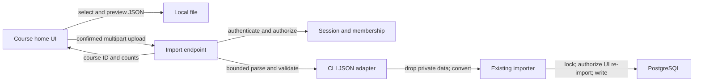

# Piazza JSON import from the course home page

Status: implemented
Date: 2026-11-16

## Context

ChalkTalk already has a developer CLI that reads a saved `PiazzaExport` JSON file, converts Piazza content, and imports it in one PostgreSQL transaction. The CLI-generated file is the **only** input format for this first UI release. Native instructor exports have not been examined and may have a different shape. The user wants an import action beside Create course and Join a course, without asking ChalkTalk to sign in to Piazza. They decided that private Piazza posts do not need to be retained. The application is small-scale today; introducing durable job infrastructure for this operation is not justified yet.

The existing importer creates historical people as ChalkTalk accounts with non-disclosed, unguessable credentials and `.piazza.invalid` addresses, enrolls them in the imported course, preserves authorship and anonymity, and uses deterministic IDs to update rather than duplicate content on re-import. These semantics remain for retained public content. The UI path excludes private posts **and people referenced only by those posts**; it must not pass the raw file's entire `users` array to the importer. A ChalkTalk permission establishes who may create or update a ChalkTalk course; it does **not** establish rights to copy Piazza content. The import UI should ask the uploader to affirm that they are authorized to migrate the selected file, but that affirmation is not a substitute for any Piazza, institution, or author permission required outside ChalkTalk.

## Decision

Treat the file's `selfUid` as an unverified, file-reported historical Piazza identity on the UI path. It is not evidence that the authenticated uploader is the exporter: the uploader owns the ChalkTalk course, while retained exporter-authored content belongs to a separate synthetic historical account. This applies equally on first import and re-import. The CLI path keeps its existing `selfUid`-to-owner mapping.

Use a single, bounded, synchronous import request. The browser locally reads the selected JSON to show a non-authoritative preview: course name, post and user counts, and the number of private posts that **will be omitted**. The user confirms the omission and that they have permission to migrate the remaining content, then uploads the original file once. The server authenticates the request, checks CSRF, derives the owner from the session rather than a client-supplied email, validates the JSON structure and resource bounds, excludes private posts and private-only people, converts the retained data with the existing converter, and calls the transactional importer. On success the API returns the imported course ID and counts; the UI opens that course. A malformed, oversized, or timed-out import fails without presenting a partially imported course as successful.

The initial UI action can be used by an authenticated user who may create a course in their organization. For a re-import of a Piazza class already present in that organization, only an existing instructor of that **specific ChalkTalk course** may update it. The UI-specific check belongs **inside the importer's transaction, after its class advisory lock and before any owner enrollment or content write**. Lock the existing course and relevant instructor-membership row as needed so concurrent role removal or membership revocation cannot invalidate the decision between check and write. A route-only precheck would be vulnerable to that time-of-check/time-of-use race, and the current CLI importer adds its named owner as an instructor. The trusted CLI retains its existing operator behavior; the HTTP route selects the restrictive policy internally and cannot let the browser choose or bypass it. Import into a different organization remains rejected. The API must not accept an arbitrary `ownerEmail`, Piazza credentials, or a destination course ID from the browser.

Set an endpoint-specific JSON file-size limit (recommended initial bound: 20 MiB) and bound nested collection sizes and depth during validation. This is intentionally lower than the general 100 MiB media-upload limit: the JSON must be parsed and converted in memory. If a real authorized file exceeds the bound or the request time budget, keep the CLI available rather than silently raising the web limit; that evidence would justify a later background-job design. Do not retain the uploaded source in S3 or the database. Delete the temporary file on every outcome and do not log post bodies, names, private content, or the source JSON.

## Structure

The browser preview is for informed consent and usability only; it is never trusted as validation or authorization. The server's adapter is the boundary between an external file and the existing `ImportCourse` model. It makes the source format explicit so a future instructor-export adapter can be added without changing the importer or the course-home interaction. The existing transactional importer remains the sole writer of imported course data and owns the atomic re-import authorization decision for UI callers. The upload endpoint owns request identity, CSRF, format validation, filtering, and temporary-file cleanup; it passes the authenticated actor and an internal restrictive UI policy to the importer, not a client-controlled authorization flag.

## Technology choices

| Concern         | Choice                                                                         | Why                                                                                      | Runner-up                                                                                     |
| --------------- | ------------------------------------------------------------------------------ | ---------------------------------------------------------------------------------------- | --------------------------------------------------------------------------------------------- |
| Transport       | Existing authenticated Express API with multipart upload                       | Reuses session, CSRF, and upload conventions; avoids the 128 KiB JSON-body limit         | Direct S3 upload adds storage and cleanup for a one-shot file                                 |
| Execution       | Bounded synchronous request                                                    | Smallest operational change for current scale; existing importer is transactional        | Background queue would survive long imports but adds job state, polling, retries, and cleanup |
| Source contract | Strict runtime validation of CLI `PiazzaExport` JSON                           | TypeScript casting alone does not protect the API from malformed files                   | Assuming `JSON.parse` output matches the type risks errors and excessive work                 |
| Data write      | Existing converter and importer                                                | Preserves current Markdown, authorship, idempotency, and transaction behavior            | A second UI-specific writer would drift from the CLI                                          |
| Private content | Filter private posts and people referenced only there before conversion/import | Matches the user's decision and prevents private Piazza data being copied through the UI | Importing all CLI content would retain data the user explicitly does not need                 |

No new framework or infrastructure dependency is recommended. Existing Node, Express, multipart parsing, and PostgreSQL facilities suffice; a focused validator may be written against the known shape. There is no third-party library choice whose version needs to be verified for this design.

## Alternatives rejected

- **Piazza sign-in from the UI:** asks ChalkTalk to handle credentials and relies on an unpublished Piazza interface; the user chose a local JSON file for this phase.
- **Native Piazza ZIP/CSV or instructor JSON import now:** no verified sample or mapping exists; a future adapter can be designed when an authorized sample is available.
- **Background job and upload staging:** more robust for very large courses, but unnecessary state and failure paths at the current scale.
- **Client-side conversion and database writes:** exposes the import rules to browser tampering and splits authorization across layers.
- **Server-side staging for a preview/confirm round trip:** durable storage, token lifecycle, and cleanup are not needed when the browser can preview the local file before sending it once.

## Trade-offs accepted

- The web path has a hard size/time ceiling; unusually large classes still require the CLI until measured need justifies jobs.
- A browser preview can differ from final validated counts if the file changes between selection and upload; the server response is authoritative.
- Re-import refreshes retained public content rather than representing a frozen historical archive, matching the existing importer. Previously imported private posts, if any, are **not** removed merely because a later UI re-import omits them; making an existing course public-only requires a separate reviewed cleanup operation.
- Historical users are represented by synthetic ChalkTalk accounts and course memberships, not by real Piazza credentials or automatically linked ChalkTalk identities.

## Failure modes

| Failure                                                                                           | Required response                                                                                                        |
| ------------------------------------------------------------------------------------------------- | ------------------------------------------------------------------------------------------------------------------------ |
| Invalid JSON, unknown format, excessive nesting, or invalid field values                          | Reject before any database writes with a clear file/format error; never treat a TypeScript cast as validation            |
| Oversized file or request timeout                                                                 | Return an actionable limit error; clean the temporary file; do not report partial success                                |
| User lacks a valid session or CSRF token                                                          | Reject without reading/importing content                                                                                 |
| Existing imported course is not owned by this organization or uploader is not an instructor there | Reject inside the locked import transaction before any enrollment or write; never auto-promote the uploader              |
| Concurrent import of the same class                                                               | Existing advisory transaction lock serializes writes; each request gets its own result                                   |
| Database failure during import                                                                    | Roll back the existing transaction and return an error; do not navigate to a course as though it succeeded               |
| Source contains private posts                                                                     | Count them in preview and server summary, but omit their bodies, descendants, and private-only people from the UI import |

## Reversibility

The UI placement, preview wording, and size limit are easy to change. The `PiazzaExport` adapter can later coexist with an instructor-export adapter. Importing historical people and posts is a one-way data operation in practice: it creates course membership and visible authorship, so authorization and private-post omission must be settled before upload. Re-import authorization is a security boundary and should not be loosened casually.

## Open questions for implementation planning

- Confirm the endpoint's practical timeout and choose the exact file and collection bounds from measured fixture sizes; 20 MiB is an initial cap, not a promise of unlimited course size.
- Define whether a UI re-import should show an explicit “update existing course” confirmation distinct from first import. The authorization rule is settled either way.
