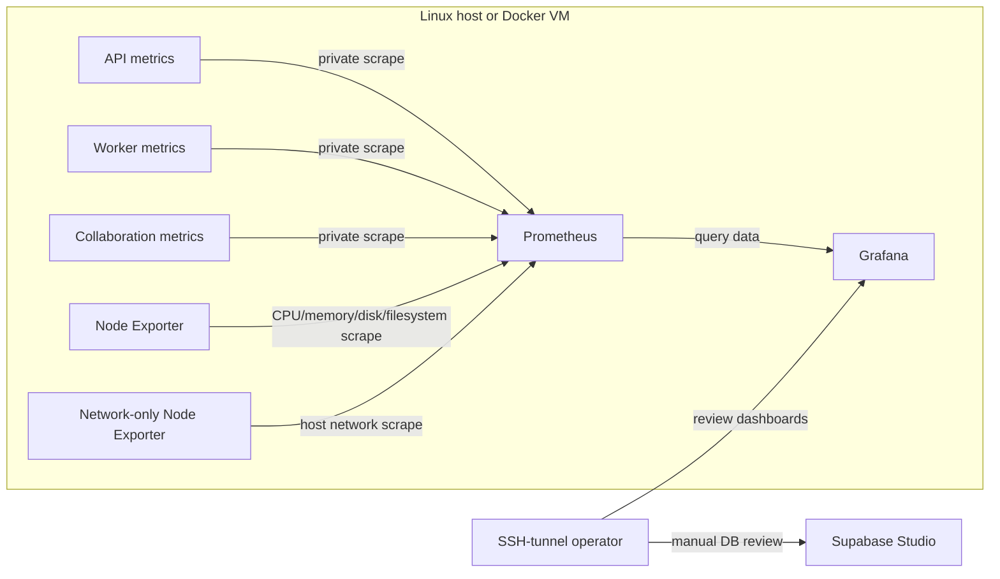

# Production and local host system metrics

Status: implemented; actual production VM verification remains post-deployment
Date: 2026-11-16

## Context

At the time of this decision, ChalkTalk's production Prometheus scraped only the Express API, background worker, and collaboration service at `/metrics`, once per minute. Those jobs expose application request latency, **client-observed** database query and pool-acquisition latency, jobs, and process-level metrics. The provisioned Grafana dashboard charts API p50/p90/p95/p99, 5xx fraction, database attempt/failure rates, and selected endpoint database totals. It does **not** collect host-wide CPU, memory, network, filesystem, or disk load. The user wants those metrics in **both production and local Compose stacks**, in a separate PR before interpreting a k6 production test.

Supabase PostgreSQL runs outside the VM. The user chose to **leave Supabase Metrics API scraping out for now**. Prometheus will therefore not measure Supabase server CPU, memory, connections, or I/O. Application DB timing must not be presented as those resource metrics. The operator will inspect Supabase Studio manually for memory commitment, connection pressure, CPU, and other provider warnings before and during a load test.

## Decision

Add an internal-only Prometheus Node Exporter to **both production and local Compose deployments** to expose Linux host CPU, memory, disk I/O, and filesystem capacity. It uses read-only host views required for those collectors, has no published host port, and has **no Docker socket**. Each stack's Prometheus scrapes its exporter on its private Compose network once per minute. On the production Linux VM this measures the VM host, including the overhead of the application and observability containers. On macOS Docker Desktop, it measures the **Docker Linux VM**, not the physical Mac; do not label it as macOS host telemetry. It is not a per-container attribution tool.

The ordinary exporter stays responsible for CPU, memory, disk, and filesystem. Its isolated Compose network namespace cannot report host network-device counters. Add a second `prom/node-exporter:v1.9.1` network-only service in each stack with `pid: host`, read-only `/proc:/host/proc`, `--path.procfs=/host/proc/1`, `--collector.disable-defaults`, `--collector.netdev`, and `--no-collector.netdev.netlink`. A runtime experiment confirmed this reads Linux host PID 1 network counters while the ordinary exporter reads its own namespace. The new service remains on the private Compose network without host networking, a published port, or a Docker socket. The shared Prometheus configuration scrapes it every minute as `chalktalk-vm-network`; network traffic/error panels and freshness checks use that job.

Provision a separate Grafana **VM System Load** dashboard in both stacks rather than making the existing application-latency dashboard dense. Show host CPU, memory available/used, network receive/transmit and errors, disk I/O, and filesystem free capacity. Retain the existing application latency and database client-latency dashboard unchanged. Keep current Prometheus fifteen-day retention and one-minute cadence unless measured storage or resolution demands a change. Do not add cAdvisor, Docker API access, or a Supabase scrape for this request.

## Structure

Application metrics answer “how long did ChalkTalk observe this request/database operation?” Node Exporter answers “how much of the VM is occupied?” Supabase Studio supplies a separate, manual view of managed database load. None is a substitute for another. Prometheus owns collection and fifteen-day storage; Grafana owns visualization.

## Verification boundary

Before publication, verify collection in local Compose and an isolated production-topology stack, not merely valid configuration. Verify collection on the actual production VM after deployment, before a load test. In each running stack, verify `up=1` for API, worker, collaboration, and both Node Exporters, then find at least two recent one-minute samples for representative application HTTP duration buckets, database query and pool-acquisition buckets, and host CPU/memory/network/disk/filesystem series. Network samples must use the host-PID-1 exporter job rather than the ordinary exporter's container network namespace. Local validation must explicitly confirm the Linux-VM-versus-Mac distinction. Repeat the production preflight before a load test. Warm up API routes first so sparse histograms exist. Query Prometheus itself for freshness and inspect the resulting Grafana panels. Confirm host series change plausibly under a tiny known workload; if absent or stale, block the k6 ramp. Capture the query results and screenshots as evidence.

The operator separately checks Supabase Studio before and during the run, records available database resource views and any warnings, and stops for memory commitment or connection pressure. **Do not claim Prometheus collected Supabase server load.** The initial abort policy is qualitative until baseline headroom is measured: stop for sustained application 5xx, rising client-observed DB pool waits/connection failures, VM memory or disk pressure, or a Supabase warning. Numeric thresholds belong in the later k6 plan, anchored to observed baseline and plan limits.

## Technology choices

| Concern            | Choice                                                  | Why                                                                                     | Runner-up                                                                  |
| ------------------ | ------------------------------------------------------- | --------------------------------------------------------------------------------------- | -------------------------------------------------------------------------- |
| Host telemetry     | Prometheus Node Exporter in both Compose stacks         | Official, maintained Linux host exporter with CPU, memory, network, and disk collectors | `top` is interactive output, not a stable scrapeable time series           |
| Collector/storage  | Existing Prometheus, 60-second scrape, 15-day retention | Reuses current private operational stack                                                | Additional telemetry backend adds cost and complexity                      |
| Visualization      | Separate provisioned Grafana VM System Load dashboard   | Clear distinction between request latency and resource saturation                       | Adding all series to API latency panels obscures both                      |
| Database-side load | Manual Supabase Studio review                           | Respects decision to defer the Supabase Metrics API scrape                              | Scraping would need a privileged Secret API key and more operational setup |

Prometheus Node Exporter documentation was checked on 2026-11-16. No new browser-accessible service or secret is introduced.

## Alternatives rejected

- **`top` or `docker stats` as the telemetry source:** useful interactively, but neither provides retained, queryable Prometheus series or Grafana correlation by time.
- **cAdvisor/Docker socket:** adds broader host privilege and per-container attribution not required to prove VM-wide load.
- **Supabase Metrics API in this PR:** deferred by user; it would require a privileged key and beta metric-name verification.
- **Treating app DB query time as server execution:** those measurements include application pool waits, network travel, and result transfer.
- **Publicly exposing Node Exporter or Prometheus:** unnecessary attack surface; scrapes stay private and Grafana remains SSH-tunnel-only.

## Trade-offs accepted

Node Exporter exposes host-level rather than per-container resource use. In local Docker Desktop it sees the Docker Linux VM, not native macOS load. One-minute samples can show sustained pressure and correlate with the ten-minute k6 run, but may hide brief spikes. The two exporters and scrapes consume some VM resources; measure overhead before declaring the baseline. Supabase server-side load is not retained in this Prometheus; interpretation depends on manual Studio inspection during the run.

## Failure modes

| Failure                                                                | Required response                                                                                                   |
| ---------------------------------------------------------------------- | ------------------------------------------------------------------------------------------------------------------- |
| Node Exporter cannot see host `/proc`, `/sys`, or filesystem correctly | `up` may be 1 but host series misleading; compare a known host reading before trusting graphs                       |
| Prometheus scrape stalls or data goes stale                            | `up`/freshness gate fails; no k6 ramp until restored                                                                |
| Supabase Studio is inaccessible or shows memory/connection warning     | Do not start or continue the load test; report the monitoring gap or pressure                                       |
| VM storage pressure from extra series                                  | Retain the fifteen-day cap, watch Prometheus disk use, and narrow high-cardinality series before increasing storage |

## Reversibility

The Node Exporter containers, scrape jobs, and dashboard are removable without changing application or database data. No production schema, public API, or new secret is required. A later Supabase Metrics API integration can be designed independently if manual review proves insufficient.

## Open questions for planning

- Verify the Dockerized Node Exporter sees Linux host rather than container data in production, and Docker Linux VM rather than physical macOS data locally.
- Set numeric VM warning/abort thresholds from actual baseline headroom; the existing Supabase memory warning makes a pre-load Studio review mandatory.
