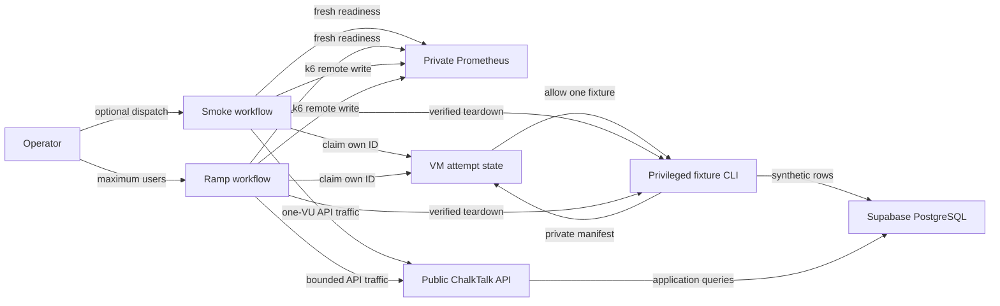

# Independent bounded Ramp with session-like user flows

Status: historical design; Ramp profile and traffic mix superseded by the [multicourse design](2026-11-17-multicourse-journey-load-test.md). Current operator procedure: [load-test runbook](../../deployment/load-test/README.md).
Date: 2026-11-17

## Context

The current production k6 workflow requires a successful Smoke fixture before Ramp. Ramp discovers that fixture within 30 minutes and requires an identical profile fingerprint. It uses one `ramping-vus` scenario whose VU 1 both reads and writes, with four Environment-configured stages and a two-second pause after each five-read iteration. A successful Smoke intentionally leaves a fixture behind. This coupling makes Ramp dependent on a prior run and makes a changed load profile fail to claim the fixture.

The user instead wants a **self-contained Ramp**: one manual GitHub Actions input for maximum concurrent users, with its stage schedule and read-heavy behavior owned by the script. The run ID remains automatic. There are **no TPS inputs**. Preserve the production URL, 20-user ceiling, ten-minute ceiling, one writer, at most 17 write attempts, at least 30 seconds between writes, selected-core-flow disclosure, private metrics path, and fail-closed cleanup. Smoke remains available but optional and must not leave a fixture for Ramp. Direct database access remains limited to privileged fixture administration; load traffic uses the public ChalkTalk API.

The observed `EMAXCONNSESSION` cleanup failure is a separate connection-capacity problem. Removing the Smoke dependency does not increase Supabase session-pool capacity. Supabase documents independent client and backend connection limits and session-mode pool restrictions in its [pooling guide](https://supabase.com/docs/guides/database/connecting-to-postgres/pooling-and-limits) and [troubleshooting guide](https://supabase.com/docs/guides/database/prisma/prisma-troubleshooting).

## Decision

**Ramp is a fresh, singleton fixture lifecycle.** Its manual workflow has exactly one required input, `max_concurrent_users`, a strict integer from 2 through 20. Neither Ramp nor Smoke accepts a run ID. Ramp derives its ID from the trusted first-attempt GitHub Actions run identity after preflight, claims the VM-owned state atomically, provisions a new synthetic fixture, exercises it, then attempts scoped teardown. Smoke is an independent one-VU, two-minute diagnostic workflow and cleans up its fixture on success as well as failure. It is recommended before Ramp but is not a claim prerequisite.

The Ramp script fixes four total-VU stage targets at `2 → 5 → 10 → 20`, each capped by the manual maximum, and fixes durations at `1, 3, 3, 3` minutes. The final stage reaches the selected maximum. One VU is the sole writer; the remaining active VUs are read-only synthetic users. The writer uses the instructor account and performs at most 17 attempts, cycling question, note, answer, follow-up, poll, and vote, with at least 30 seconds between attempts. Readers log in once and browse courses, posts, post detail, and notifications with bounded think pauses. Every required operation gets a deterministic initial pass before optional reproducible variation, so random route selection cannot silently omit coverage. Actual request throughput and active VUs are measured, not promised by an input.

The stage schedule, write-attempt ceiling, and pauses are **code-owned**, not GitHub `production` Environment variables or dispatch inputs. The old `LOAD_TEST_STAGE_MINUTES`, `LOAD_TEST_RAMP_WRITE_ATTEMPTS`, and `LOAD_TEST_MAX_VUS` values cease to configure these workflows; leaving them as active alternate sources would contradict the one-input interface and could change a run without the operator seeing it. Only the validated manual maximum changes Ramp's effective profile. Smoke's fixed profile needs no Ramp settings.

## Structure and lifecycle

1. **Before claim:** trusted `main` and first Actions attempt, pinned VM host identity, exact deployed SHA, same-project GitHub/VM Supabase target, operator-reviewed Supabase baseline, and two fresh healthy application/VM scrapes. An idle API need not have HTTP/DB latency samples before traffic. Missing readiness creates no new fixture state.
2. **Claim and provenance:** under the existing VM lock, reject any active, stale, failed, or cleanup-uncertain fixture. Derive a unique `load-YYYYMMDD-gh<ACTIONS_RUN_ID>` ID; reject reused Actions run identities and reruns. Persist a consumed attempt containing source workflow run ID/URL, deployed SHA, project and database identity, normalized effective profile, profile fingerprint, claim timestamp, and status. Ramp's profile includes its selected maximum plus the code-owned schedule and write ceiling; Smoke has its own fixed profile. There is no cross-run Smoke/Ramp profile equality.
3. **Provision:** privileged VM CLI creates exactly one isolated organization/course and 20 verified synthetic users. The manifest stays owner-only on the VM and is copied transiently to the runner over pinned SSH. Validate manifest identity, size, owner-only permissions, reviewed dependencies, and a SHA-256 digest against the claimed attempt before traffic. No password or database URL enters logs or artifacts.
4. **Traffic and evidence:** k6 uses the fixed public HTTPS origin, ordinary session/CSRF authentication, and per-VU synthetic accounts. One monotonic `ramping-vus` scenario starts at two users: VU 1 is the dedicated writer-only path and retains the instructor account; VUs 2 through the selected maximum run read-only session flows with their own accounts. At least one successful checked response is required for each selected read and all six mutation types. Any missing type makes the result incomplete rather than extending the run or adding attempts. The runner waits for and verifies fresh run-tagged k6, API HTTP, DB-client query/pool, and VM system series. Grafana aligns these with the same UTC window; Supabase server metrics remain a manual Studio check.
5. **Teardown:** after k6 traffic stops, inventory and transactionally delete only manifest-owned rows and approved semantic dependents within existing row caps. Verify zero residue before marking `cleaned` and removing private manifest/database URL files. A failed, cancelled, interrupted, or successful Ramp all take this path; successful Smoke does too. No failed attempt becomes retryable under its old ID.

### Bounded connection-exhaustion recovery

If inventory or teardown cannot **acquire a database connection** because of a recognized session/client-limit error, wait for traffic to quiesce and make at most two additional attempts within two minutes. Before each teardown retry, repeat inventory and its dependency checks. Retry only when the previous attempt is known not to have committed or partially mutated data; an ambiguous transaction outcome is not an automatic retry. A continued connection error, changed inventory, unknown reference, or uncertain commit leaves the attempt consumed and cleanup-uncertain, blocks every new Smoke/Ramp, and requires reviewed VM-side recovery. Do not reserve a long-lived database connection across the test or treat an Actions success/failure as proof of zero residue.

## Safety and failure modes

| Failure                                                                                 | Behavior                                                                                 |
| --------------------------------------------------------------------------------------- | ---------------------------------------------------------------------------------------- |
| Invalid or missing maximum input; stale deployed SHA; unhealthy preflight               | Fail before claim and before traffic                                                     |
| Other active or cleanup-uncertain fixture; reused workflow run                          | Reject claim under VM lock                                                               |
| Provision fails after claim or manifest is absent                                       | Attempt narrow recovery; never infer zero rows from a missing file                       |
| 429, unexpected response, ambiguous mutation, sustained 5xx, missing required operation | Stop/fail or mark incomplete within existing limits; never compensate with extra traffic |
| Stale k6/API/DB/VM telemetry                                                            | Fail verification; do not claim successful correlation                                   |
| Supabase memory/connection warning or VM pressure                                       | Operator cancels or withholds dispatch; automated limits do not replace Studio review    |
| Connection limit during cleanup                                                         | Bounded safe retry as above; otherwise consumed state and manual recovery                |
| Runner disappears                                                                       | VM state and fixture remain authoritative; reviewed cleanup is required                  |

The singleton rule means an old successful Smoke fixture from the previous workflow **must be reviewed and cleaned** before an independent Ramp can claim a fresh one. State scanning accepts valid historical `cleaned` records but treats active legacy or malformed records as blockers. The new design does not silently migrate or reuse them.

## Alternatives rejected and trade-offs

- **Keep Smoke-to-Ramp handoff:** rejected because it contradicts the requested independent Ramp and keeps a time-sensitive profile coupling.
- **Allow arbitrary stage, duration, or TPS inputs:** rejected for this phase; a single maximum-user input is easier to review and leaves the production safety envelope in code.
- **Separate writer scenario:** rejected for this version because one monotonic VU scenario with VU 1 writing preserves the existing one-account-per-VU mapping and a hard total VU cap without an additional credential-allocation protocol. The writer's path is dedicated even though it shares the executor.
- **Random-only browsing:** rejected because a bounded run might never hit a required endpoint. Deterministic initial coverage followed by bounded variation gives both evidence and session-like behavior.
- **Indefinite cleanup retries or a reserved connection:** rejected because either can hide a saturated pool or consume scarce capacity. Bounded retries do not claim that the underlying connection shortage is fixed.

The primary trade-off is that VU-constrained traffic has **emergent**, not configured, requests per second; slow responses reduce iteration throughput. This is appropriate for the user's concurrent-session question but cannot establish a fixed arrival-rate capacity. The number of active readers is one fewer than the total maximum because the writer occupies one slot. Both are cheap to change later; fixture state and cleanup provenance are safety-critical and must remain explicit.

## Open questions

No material design decision remains. Before a production dispatch, an operator must confirm the intended Supabase project and acceptable memory/connection headroom, and resolve any previous active fixture through reviewed cleanup.
