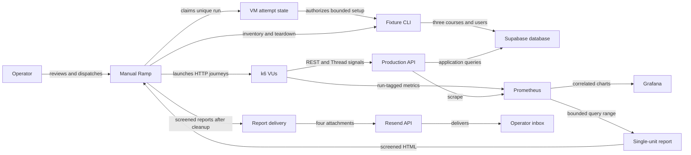
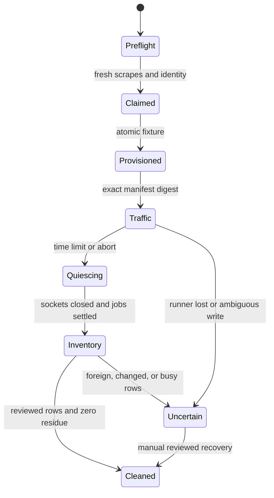

# Multi-course user-journey load test

Status: implemented in feature branch; production dispatch remains operator-controlled
Date: 2026-11-17

## Context

The existing production Ramp is a fixed loop of five reads plus one instructor VU cycling at most 17 mutations in one synthetic course. It demonstrates bounded API capacity, but it does not resemble navigation, Thread conversation, or resources browsing. The requested change is to exercise **ordinary course-member activity**, not every product operation: three synthetic courses; more question/note/poll generation; answers, follow-ups and votes; public Threads and their live signals; and resource metadata reads/search. The user explicitly removed collaboration sessions from this load-test scope. Signup/email, course administration, uploads/OCR/download bytes, Piazza import, account settings, destructive moderation, and collaboration remain outside this workload.

The existing production guardrails remain authoritative: manual `main`-only Actions dispatch; exact deployed SHA/project identity; one VM-owned fixture at a time; bounded run and mutations; fresh k6/API/DB-client/VM telemetry; no retry of an ambiguous write; and transactionally reviewed zero-residue cleanup. Smoke stays the one-user readiness probe **with its existing one-course, 20-account fixture and one-vote behavior**; its login and vote starts are now separated by at least five seconds. the three-course/30-account fixture is Ramp-only. No production run is authorized by this design.

The same PR will also deliver the sanitized report to `darrenh1134@gmail.com` as **individual, unzipped attachments**. Email is a secondary delivery channel, not the source of truth for test or cleanup status. The four screened files—`report.html`, `summary.json`, `coverage.json`, and `scope.json`—are emailed individually. The fixture manifest, raw reports, logs, credentials, and other files must never enter the email payload. The user also wants the downloaded/emailed HTML report's graphs separated by measurement unit, without combined panels or multiple Y axes; this is a report-presentation change, not a Grafana dashboard change.

The current fixture assumes one course, exactly 20 users, one instructor, one seed question/poll, and an allowlist that excludes `thread_*` and `course_resource_*` tables. Its cleanup would **correctly refuse** rows from the requested journeys today. The observed Supabase session-mode connection cap previously starved teardown. Raising that cap is an operator action, not evidence of sufficient headroom at 30 active simulated users.

## Decision

Keep one manually dispatched, bounded **Ramp** with one `max_concurrent_users` input, now 10–30. It has deterministic minimum coverage followed by reproducible, role-aware navigation among three isolated courses. Its fixed ten-minute schedule starts below the selected maximum and rises gradually; the selected number is a hard ceiling, not a promised TPS or an exact constant active count. A first production run should use a low maximum with an operator watching Supabase and Grafana; the workflow must fail closed on missing readiness or uncertain cleanup.

Use three course cohorts with one instructor and multiple students each **for Ramp only**. The mode-aware fixture provisions 30 distinct synthetic accounts for Ramp and maps each account to exactly one course and role; active account ordering is interleaved so even a ten-user run reaches all three courses. Smoke retains its existing fixture shape and limits. The exact per-course IDs, seeded posts/polls, one public Thread board, and one synthetic external-link resource are in an owner-only Ramp manifest. Readers choose a post/conversation from their course's returned feed, rather than repeatedly requesting one fixed ID. Each selected operation must succeed at least once **per Ramp run**, with post and Thread activity in all three courses; repeating every operation in every course is not required.

The first expanded write envelope is code-owned: at most **12 new posts** (four per course), **six answers, six follow-ups, six votes**, and **six Thread conversations and 12 replies**. Thread watch/read-state updates receive separate explicit caps rather than being hidden inside a generic request count. The three boards and resource links are pre-seeded, not repeatedly created under load. Preassigned per-actor quotas sum to each global ceiling without requiring a shared mutable k6 counter; writers are staggered across courses and retain a minimum per-account mutation interval rather than bursting together. Reserve attempts before sending; an unknown response never becomes an automatic retry. A 429 or unexpected status aborts. New limits are safety ceilings, not throughput goals.

The JSON `thread-events` protocol can be exercised with k6's built-in WebSocket support; no Node sidecar, Hocuspocus/Yjs client, or new production service is needed. Every active simulated user is one k6 VU, so the selected maximum remains directly comparable to the VU series.

Use the existing Resend sending key from the GitHub `production` Environment and the checked-in default `RESEND_EMAIL_FROM` (`ChalkTalk <notifications@joinchalktalk.com>`), subject to verifying that domain for the production Resend account. GitHub's `production` Environment does **not** currently define `EMAIL_FROM`; none is required if the checked-in default is used. A small Actions-side report-delivery component reads only the exact four allowlisted files from the sanitizer's private output directory after teardown has been verified. It sends one email with four attachments; it does not download or unzip a GitHub artifact. The artifact is still uploaded and retained when email fails. The mail result is a separately reported `delivered`, `failed`, `unknown`, or `not-attempted` status and must not overwrite the actual k6/coverage/cleanup result.

Replace the emailed/downloaded `report.html` with a **self-contained, project-owned HTML report** whose time-series panels each have one explicit unit and one Y axis. It obtains bounded, run-ID-scoped k6 time series from Prometheus `query_range` through the existing private SSH tunnel after traffic stops and after the final remote-write samples settle; `summary.json` supplies aggregate values. Group percentiles on one latency panel only because they share milliseconds; request rate, maximum tagged failure fraction, active VUs, and other families get separate panels rather than an overview with multiple Y axes. Render local SVG/HTML with no external assets or remote scripts. Preserve the original screened k6 web-dashboard export in the GitHub artifact as `k6-original.html` for comparison, but do not email it. The custom report must say when a series has no data rather than drawing an empty zero line; a missing required series makes report generation incomplete, leaving the original export and independently reported failure.

## Structure

The VM fixture/state pair owns identity, isolation, budgets, and cleanup, with explicit Smoke and Ramp fixture profiles under the same singleton-state contract. k6 owns authenticated HTTP journeys and bounded `thread-events` connections, not privileged database access. The API remains the authority for membership and data writes. The runner must close traffic sockets before fixture inventory/teardown; a hung socket is a failure, not a reason to delete active Thread state underneath it.

### Journey behavior

Each HTTP actor logs in once, retains its cookie/CSRF, and follows a course-aware state machine: course home → feed → a returned post → optional answer/follow-up/vote; or Thread board → conversation → messages → optional reply/read-state; or resource catalog → metadata/search. Unread-count is a background poll roughly on the UI's 60-second cadence; the full notification list is fetched only when the synthetic user chooses to open the bell. Bounded think time occurs **between actions**, not in a rapid repeated five-request burst. A deterministic schedule spreads course-aware reads and exact bounded write slots across all three cohorts. The service's request duration lengthens the closed-loop journey rather than causing more requests to compensate.

Three bounded Thread sockets subscribe to one course, receive committed change signals and close. Separate read journeys perform REST catch-up for their course; REST remains the content authority and the socket carries signals only.

### Report delivery boundary

The report generator queries an exact allowlist of known k6 metric names and labels (`testid` equals this generated run ID), within the measured UTC window at a bounded resolution. It rejects unexpected result types, labels or unbounded point counts, strips all Prometheus labels from serialized chart data, and converts documented base units (duration seconds to display milliseconds) exactly once. Each panel has a declared unit on one Y axis; the self-contained static SVG does not use hover. The HTML uses a strict content-security policy. No raw query response, API URL, synthetic identifier, or user-controlled string is interpolated into HTML. The generated report states its source, window and metric units.

The safe sequence is: stop k6 traffic and close Thread sockets → wait for remote-write/scrape settlement → verify fresh telemetry → query the bounded run time series **while the private Prometheus tunnel is still alive** → render the custom report or record a separate rendering failure → close the tunnel → inventory and teardown → verify zero residue → sanitize available reports → upload artifact → conditionally email only after the cleanup receipt. A renderer failure cannot skip teardown. Missing required telemetry still fails the load validation as before; a mere layout/rendering failure does not recast an otherwise valid load measurement as a failed test, but leaves the requested report deliverable incomplete.

The sanitizer atomically emits owner-readable `report.html`, `summary.json`, `coverage.json`, `scope.json`, and evidence-only `k6-original.html`, screening raw files for fixture IDs, email addresses, passwords, session tokens, and other private data. Three-course fixture IDs may be nested in the manifest: screening must traverse the entire manifest recursively, not only top-level `*Id` fields, before **any** report, original export or email is considered safe. The mailer accepts **only** the four named delivery files, each a regular non-symlink file within the sanitized directory, and validates scope/run identity, MIME type, per-file and aggregate size before reading them. Use a conservative aggregate attachment cap (15 MiB of raw files, subject to a lower verified provider cap) to account for Base64 expansion. If files are absent, malformed, too large, or fail revalidation, do not send; leave the downloadable artifact and a conspicuous delivery failure. Do not silently truncate or zip the reports.

The runner finalizer must produce a machine-readable, job-local cleanup receipt only after reviewed inventory, teardown, VM `cleaned` state, and zero-residue verification succeed. The email step gates on this receipt, **not** merely on runner exit code or the existence of a report directory. This allows a failed traffic/coverage run to email its diagnostic report once cleanup succeeds, while preventing delivery after uncertain cleanup. The workflow summary records **test**, **cleanup**, **report generation/sanitization**, **artifact upload**, and **email delivery** outcomes independently. If the custom chart report cannot be generated or screened, `report=failed` and `email=not-attempted`; the original screened k6 HTML and any safe JSON/scope files remain available as the artifact fallback. Do not silently substitute the original combined-axis HTML under the `report.html` name. Report failure must not hide a successful cleanup or rewrite a failed load result; conversely, a load run is not complete evidence of the requested report deliverable until the report is produced. An email failure does not turn a passed load test into a failed test or justify rerunning production traffic. A failed test remains failed even if the email is delivered.

The mailer uses a deterministic Resend idempotency key derived from the trusted Actions run identity and report type, so an uncertain HTTP response cannot cause a duplicate within Resend's documented 24-hour key window. Do not automatically retry uncertain sends; report `unknown` and leave the artifact for inspection. The recipient is fixed in reviewed configuration rather than taken from workflow input or a fixture. No attachment bytes, API key, raw provider response, or temporary paths appear in logs; a provider message ID and non-sensitive failure category are sufficient. A send-only key and verified domain are prerequisites, not a reason to expose a public email endpoint. Resend and the recipient mailbox will retain a copy of performance data; the user's explicit request authorizes this secondary copy, but sanitization remains mandatory.

## Safety and telemetry

- **Fixture scope:** one isolated organization, three courses, 30 verified synthetic users, exact membership/role assignment, seeded posts/polls/boards/resources. Keep all user/course identifiers and credentials in an owner-only manifest; no real course or account is eligible. Resource seed is an external-link metadata row pointing to a non-routable synthetic URL, never an object-storage upload or server-side fetch.
- **Teardown:** extend the explicit table allowlist and deletion order to Thread boards/conversations/messages/watches/reads/notifications/changes/counters and resource catalog/link rows. `thread_changes` carries board/entity UUIDs without full foreign-key protection, so inventory must explicitly prove ownership for those IDs rather than infer it from cascades. Inventory every manifest-owned root and dependency, reject cross-course/foreign references, cap each family of rows and queued jobs, verify unchanged inventory across a retry, and require zero residue before `cleaned`. The current seven-indexable-post limit is too low for the new three-course seed plus 12-post budget; raise it only to a reviewed ceiling derived from the allowed post mix and keep semantic-job quiescence checks. Thread notification fan-out can exceed reply count, so give notification and change-ledger rows separate reviewed caps. Do not rely on broad `ON DELETE CASCADE` as proof of ownership. Thread sockets must close before the transaction. Any unexpected email or other job kind blocks teardown pending review.
- **Capacity:** 30 active users can produce enough traffic to exhaust application pools or the Supabase session-mode client cap even though users are not one-to-one with database connections. The privileged CLI needs a database connection for teardown; a manual pool-size increase does not prove sufficient free slots. Require operator-reviewed Studio memory/connection headroom and fresh API/worker/collaboration/VM scrapes before dispatch; stop on rising pool waits, acquisition failures, 429, sustained 5xx, runner pressure, stale telemetry, or Studio warning. Keep connection-exhaustion cleanup retries bounded and fail closed.
- **Evidence:** report per-operation successful checked responses, per-course distribution, attempted versus completed mutations, active VUs, Thread WebSocket subscribe/signal/catch-up/close outcomes, k6 percentiles/rate/errors, API/DB-client latency, VM load, and fixture cleanup state under the generated run ID and UTC window. Prometheus/Grafana panels are time-aligned; application/VM series include background production traffic. Supabase server metrics remain a manual Studio observation.

## Technology choices

| Concern                     | Choice                                          | Why                                                                         | Runner-up                                                     |
| --------------------------- | ----------------------------------------------- | --------------------------------------------------------------------------- | ------------------------------------------------------------- |
| HTTP and Thread signal load | Existing k6 runner plus `k6/websockets`         | One bounded VU profile and low-cardinality metrics; Thread protocol is JSON | Browser automation scales poorly in Actions                   |
| Course isolation            | One manifest with three explicit course cohorts | Exact ownership and role mapping under the existing VM singleton            | Three independent fixtures complicate global cleanup          |
| Budgets                     | Code-owned per-actor and per-object quotas      | A mathematical maximum without a shared mutable k6 counter                  | Global coordination service adds another production component |
| Report email                | Actions-side Resend HTTPS send after cleanup    | Reuses existing sending credential and avoids a VM mail service             | GitHub artifact links alone are not the requested attachments |
| HTML charts                 | Bounded Prometheus `query_range` → local SVG    | Uses already-collected time series and prevents mixed-unit axes             | Raw k6 JSON is large and can carry private request labels     |

No new production service or public test endpoint is proposed. k6's current [WebSocket documentation](https://grafana.com/docs/k6/latest/using-k6/protocols/websockets/), [web-dashboard export options](https://grafana.com/docs/k6/latest/results-output/web-dashboard/), and Resend's [attachment support](https://resend.com/features/email-api) and [idempotency-key behavior](https://resend.com/changelog/idempotency-keys) were checked on 2026-11-17. The built-in export documents no panel-layout configuration. Resend documents a 24-hour idempotency-key window; no provider attachment-size ceiling was established from an authoritative source, so the conservative local cap still needs an integration check against the actual sending account.

## Alternatives rejected

- **Every product feature in one production run:** signup/email, uploads/OCR, account administration, and destructive actions have different side effects and teardown contracts; they need separate isolated tests if desired.
- **Only more writes in the existing single-course loop:** raises volume without improving navigation or cross-course realism.
- **Add collaboration to this Ramp:** explicitly declined by the user; its Hocuspocus/Yjs protocol and invitation-email side effects need a separate safety contract if load testing is revisited.
- **Treat Thread WebSocket as a content writer:** it carries only hints and presence; REST commits messages.
- **Use cascading deletes as cleanup:** masks foreign references and asynchronous jobs, and cannot prove zero residue.
- **Email the GitHub artifact ZIP or a link:** violates the requested individual, unzipped attachments; the existing artifact remains a fallback, not the delivery mechanism.
- **Send from the production VM or API:** unnecessarily places report delivery on the application path and gives production services access to runner-generated reports.
- **Make email success a load-test success condition:** conflates transport failure with performance or cleanup and invites unsafe reruns of production traffic.
- **Patch k6's exported minified HTML or parse its embedded gzip event stream:** ties the safety-sensitive artifact path to an undocumented format and is brittle across a pinned k6 upgrade.
- **Stream a second raw k6 JSON output:** captures individual request tags and potentially private URLs at much greater volume, requiring another complex privacy scrub and size budget.
- **Keep the original combined charts as the only report:** does not meet the user's single-axis graph requirement, although the original stays in the artifact for evidence.

## Trade-offs and reversibility

The traffic mix, per-actor quotas, report-panel layout, and email recipient are cheap to tune after a measured baseline. The three-course manifest shape and cleanup allowlist are safety-critical and expensive to get wrong. Sending a sanitized report to an external mailbox is reversible for future runs, but an already-delivered email cannot be recalled. The custom HTML report adds a small maintained renderer and depends on the availability/retention of Prometheus time series; `summary.json` and the original screened k6 export remain independent evidence. This is still backend-only traffic, not browser rendering, JavaScript execution, collaboration, or true user analytics. Without anonymized production operation frequencies, the branch weights are engineering assumptions rather than a measured reproduction of real users.

## Open questions

No material structural decision remains. The operator must still review the actual Supabase pool setting, live connection/memory baseline, and stop criteria before any production dispatch. Implementation planning should verify the exact Thread and resource dependency inventory against the current database schema before naming deletion order or row caps. Email integration must verify that the actual Resend account accepts the conservative attachment size and checked-in sender; a rejection affects only delivery, not test/cleanup truth.
