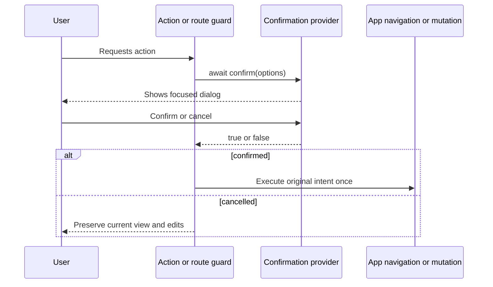

# ChalkTalk confirmation dialogs

Status: agreed design
Date: 2026-11-18

## Context

The frontend has 18 in-app `window.confirm` calls across posts, answers, threads, and live sessions. ChalkTalk already has styled dialogs for account deletion and posting session content, but no reusable confirmation mechanism. The user chose to replace **all** in-app native confirmations, including unsaved-change and navigation prompts, while leaving browser-controlled tab-close prompts alone. No `beforeunload` prompt currently exists.

## Decision

Use one app-level, accessible confirmation dialog with a promise-based `confirm(options): Promise<boolean>` interface. Callers await the decision before executing the action. Route guards and other synchronous callbacks that currently return `boolean` become asynchronous or defer their intended action until confirmation resolves. Keep this frontend-only and add no dependency.

## Structure

The provider owns exactly one active dialog request, including message, optional title, action label, destructive tone, and resolver. It renders above the app, using ChalkTalk's current backdrop, surface, typography, and button styles. Call sites retain ownership of their business action and pending/error state; the dialog returns only the user's choice. The dialog restores focus to the triggering control, traps focus, closes on Escape as Cancel, and labels its purpose for assistive technology. Cancel must never execute the guarded action.

For in-app navigation, the guard returns `Promise<boolean>`. Click handlers prevent default browser navigation, await the guard, then navigate once if allowed. On `popstate`, preserve the current route immediately while a guard is pending; if confirmed, continue to the requested history destination, and if cancelled, retain the current route and URL. A single pending-intent policy prevents double-clicks or repeated back presses from launching stacked dialogs or executing stale intents. Existing save-in-progress guards remain hard denials without opening a dialog.

## Technology choices

| Concern                | Choice                                 | Why                                                         | Runner-up                                                                                       |
| ---------------------- | -------------------------------------- | ----------------------------------------------------------- | ----------------------------------------------------------------------------------------------- |
| Dialog                 | Local React provider and component     | Reuses current React/UI conventions without dependency      | Native `<dialog>` could handle some focus behavior but does not solve async guard orchestration |
| Confirmation interface | Promise of boolean                     | Preserves simple call-site control flow for async mutations | Callback registry spreads action ownership into the provider                                    |
| Styling                | Existing CSS tokens and button classes | Matches ChalkTalk dialogs                                   | New UI library is unnecessary                                                                   |

## Alternatives rejected

- Per-feature styled dialogs: duplicates accessibility and styling work across four feature areas.
- Monkey-patching `window.confirm`: cannot make the synchronous API wait for an asynchronous React dialog.
- Converting every guarded action into a global command bus: centralizes unrelated business actions and increases coupling.

## Trade-offs accepted

The async route-guard contract touches more call sites than a visual-only dialog swap. This is necessary to preserve cancellation semantics. Browsers cannot replace a tab-close prompt with a custom page modal; that case remains browser-controlled if introduced later.

## Failure modes

- Provider unmounts during a pending confirmation: resolve the promise as Cancel, not Confirm.
- Repeated action or navigation requests while a dialog is open: do not stack dialogs or execute the action twice.
- Guarded mutation fails after confirmation: keep existing local error handling; the dialog is not an error surface.
- Back/forward navigation races with a pending dialog: retain the current route until a single intent is accepted, then resume only that intent.

## Reversibility

The provider API and styling are cheap to change. The async navigation-guard contract is broader but still internal to the frontend; no public API, persistence, or migration is involved.
