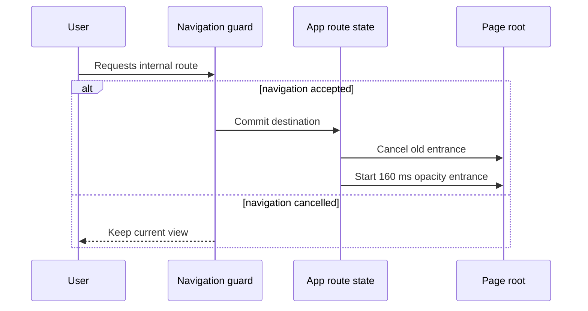

# Whole-page entrance on internal navigation

Status: agreed design
Date: 2026-11-18

## Context

The user wants the subtle entrance seen when posts load or are selected to apply to the whole page on every internal navigation. The current checkout has no page-entry keyframes, but the deployed stylesheet contains `content-appear`: opacity 0 → 1 over 160 ms with `ease`, applied to post-list items and discussion articles. Thus the reference effect is real in production, though absent locally. Routing is custom React state in `App`: in-app `move()` calls and browser back/forward both update `route`; external website and file links leave the app in a new tab.

## Decision

Use the production `content-appear` timing and opacity curve for one entrance of the entire rendered app on each accepted internal navigation, including initial ready-state load and browser back/forward. Do not animate cancelled navigation, external/new-tab links, or same-page search/filter URL updates made with `replaceState`. Disable the entrance entirely under `prefers-reduced-motion: reduce`.

## Structure

The App route boundary owns the entrance trigger. It observes accepted navigation events after guards complete—internal route moves and browser back/forward—not raw URL or search-parameter changes. Same-page `replaceState` updates for search and filters do not trigger it. The trigger starts an opacity animation on the existing app root without remounting route components. The animation does not gate data loading or navigation: destination UI appears and can be used immediately. If a second navigation occurs before the first entrance completes, cancel the old animation and start the newest one. At initial load, animate when the session restoration/loading shell gives way to the first route view.

Use a lightweight DOM/Web Animations API effect at the route boundary rather than keying and remounting the entire React tree. The opacity keyframes and `ease`/160 ms timing match the production `content-appear` effect; the CSS source can keep the named keyframes for the existing post-level behavior when reconciled. Check reduced-motion preference before starting and cancel an in-flight animation if that preference changes.

## Technology choices

| Concern            | Choice                                     | Why                                                                                                      | Runner-up                                                |
| ------------------ | ------------------------------------------ | -------------------------------------------------------------------------------------------------------- | -------------------------------------------------------- |
| Transition trigger | Accepted `App` navigation events           | Covers click, programmatic, and back/forward navigation while excluding same-page `replaceState` updates | Raw location changes would animate search/filter changes |
| Animation engine   | Native Web Animations API on app root      | Restarts without remounting feature state or adding a dependency                                         | Keyed wrapper would remount editors and refetch data     |
| Visual effect      | Production `content-appear` opacity/timing | Matches the user-identified reference                                                                    | Translation/scale would create a new motion language     |

## Alternatives rejected

- Key the entire route subtree: easy CSS replay, but remounts course and discussion state on post selection.
- Animate every link: misses programmatic and history navigation and would animate external destinations incorrectly.
- Use the browser View Transitions API: more complexity and uneven support for a simple opacity entrance.
- Reproduce `loading-appear`: its delayed skeleton timing conveys loading, not a whole-page route entrance.

## Trade-offs accepted

The whole page fades in, including persistent navigation chrome; this is what “whole-page” requests, but it briefly makes controls less visible. Keep the duration short and do not block interaction. Subsequent asynchronous content can still use its own local loading behavior.

## Failure modes

- Rapid route changes: cancel the prior animation so stale completion cannot affect the new page.
- Reduced-motion preference changes mid-flight: cancel the animation and leave the page fully opaque.
- Navigation guard declines: do not change route or run an entrance.
- Browser lacks Web Animations API: show the page normally, without delaying navigation.

## Reversibility

This is a frontend-only internal effect. The route-boundary hook and duration are cheap to change; no data model, public API, or dependency changes.
