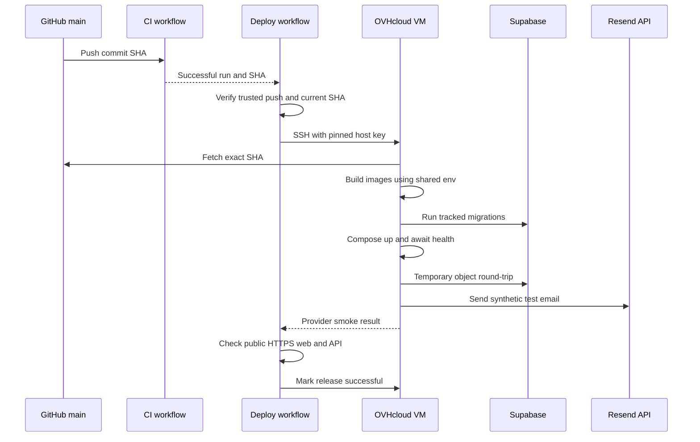

# Automatic single-VM deployment

Status: implemented
Date: 2026-11-10

## Context

ChalkTalk runs one production Docker Compose project on an OVHcloud Ubuntu VM. The public Caddy frontend, Express API, Hocuspocus collaboration process, worker, and one-shot migration job are built from one source commit. Supabase owns PostgreSQL and private object storage; Resend delivers email. The manual Ansible bootstrap prepares Docker, UFW, release directories, and `/srv/chalktalk/shared/production.env` from GitHub's `production` environment settings. It does not deploy the app.

The user wants subsequent commits to `main` deployed automatically after CI passes. This is a course-project, single-VM deployment; a container registry, blue-green fleet, and automatic database rollback would add complexity disproportionate to the current scale. The first automatic deployment must wait until bootstrap succeeds and the Supabase Data API is confirmed disabled, the bucket is private, DNS/ports work, and the Resend sender is verified. Merging the deployment workflow itself can trigger its first release.

## Decision

Use a separate GitHub Actions deployment workflow triggered by **successful completion of CI for a push to this repository's `main`**. The privileged workflow must reject PR/manual CI runs, foreign repositories, non-`main` branches, unsuccessful CI, and stale commit SHAs before it reads production credentials or connects to the VM. It deploys the exact tested CI `head_sha`, not whatever `main` happens to point to later. A second freshness check before changing running services skips an obsolete release.

The workflow uses the existing `production` environment's SSH private key, pinned VM host key, and host address. The VM fetches the public repository into `/srv/chalktalk/releases/<sha>` and checks out that SHA detached. It builds production images on the VM, then invokes the existing Compose project using `/srv/chalktalk/shared/production.env` for both Compose interpolation and service-level `env_file`. The workflow never transfers database, Storage, or Resend secrets from GitHub; the bootstrap owns that file. Only Caddy publishes ports. The existing Compose migration dependency must complete before app processes start.

On every new deployed SHA, the workflow verifies the public HTTPS frontend and API health, application service states, migration ledger, a uniquely named temporary private Supabase Storage object write/read/delete round-trip, and one synthetic Resend API-accepted email to `chalktalk602@gmail.com`. It checks provider acceptance, not inbox receipt. The smoke operation cleans up its temporary object even when a later check fails, and does not expose secrets or user data in logs. A repeat run of an already successful SHA may skip deployment and smoke to avoid duplicate test email.

Serialize production deployments so one is never interrupted halfway through Compose or migration. Share the production concurrency boundary with manual bootstrap, or use an equivalent VM-side lock, so the production env cannot be rewritten during deployment. Re-check the source SHA after waiting on that boundary. Do not automatically roll back after migrations or health/smoke failures: schema changes may not be reversible. Mark the workflow failed, retain the previous release checkout, report the phase and current container state, and require operator-led diagnosis/recovery. A failed build or preflight leaves running containers unchanged; a failure after Compose starts may leave the new version serving and must not be reported as a successful release.

## Flow

## Alternatives rejected

| Alternative                                              | Reason                                                                                                               |
| -------------------------------------------------------- | -------------------------------------------------------------------------------------------------------------------- |
| Deploy on every `push` before CI finishes                | A failing commit could reach production.                                                                             |
| Run deployment inside the general CI workflow            | Would couple PR validation and privileged production access; a guarded post-CI workflow makes the boundary explicit. |
| Build/push images to a registry                          | Extra credentials, cost, and release plumbing for one VM; exact-SHA builds on the VM are sufficient.                 |
| Automatically revert code or database after failed smoke | A migration may be irreversible; a code-only revert could worsen the outage.                                         |
| Clone a moving `main` branch                             | A later commit could be deployed without being the one whose CI passed.                                              |

## Failure modes and trade-offs

| Failure                                                | Behavior                                                                                                                                            |
| ------------------------------------------------------ | --------------------------------------------------------------------------------------------------------------------------------------------------- |
| CI fails, is canceled, or came from a PR               | No production connection or deployment.                                                                                                             |
| A newer `main` commit appears while a deployment waits | Skip the stale SHA rather than release it out of order.                                                                                             |
| SSH, host-key validation, or VM prerequisite fails     | Stop before Compose; never disable host-key checking.                                                                                               |
| Git fetch, env validation, or image build fails        | Keep current containers; preserve logs without printing secrets.                                                                                    |
| Migration fails                                        | Stop the release; inspect Supabase state before any retry or manual rollback.                                                                       |
| Compose, HTTPS, Storage, or Resend smoke fails         | Mark deployment failed and report that containers may already have changed; do not silently switch back. Clean the temporary object where possible. |
| Runner/network drops after remote work                 | A rerun checks the exact SHA and observed service state; it must not assume that a failed Actions job means the VM is unchanged.                    |

In-place Compose recreation can cause brief downtime. On-VM builds consume VM CPU, RAM, disk, and network during release. Sending a synthetic email and temporary Storage operation on every new SHA consumes small provider quotas; this is intentional for deployment verification. The production env remains a mode-0600 VM file and is never printed by `docker compose config` or uploaded as an artifact.

## Reversibility

Workflow triggering and smoke scope are cheap to revise. Supabase schema migrations and data writes are the one-way door: preserve backups and inspect migration compatibility before merging a release. Retain at least the prior source checkout for operator-led recovery, but do not promise that checking out old code reverses the schema.
