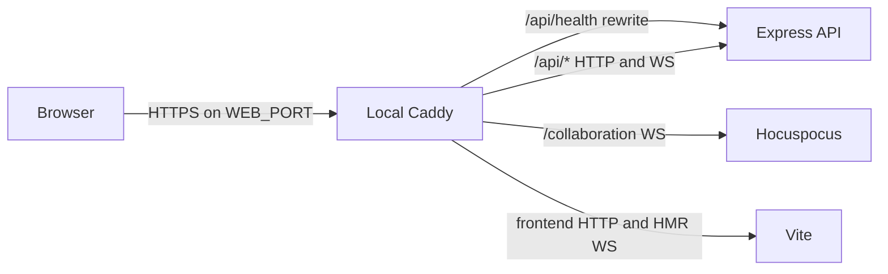

# Local Caddy gateway

Status: agreed
Date: 2026-11-10

## Context

The local stack currently exposes Vite over HTTPS and delegates API and collaboration routing to Vite. Production instead exposes Caddy, which routes `/api/health`, `/api/*`, and `/collaboration` before serving the frontend. This difference makes local testing less representative of production. The requested parity is **routing parity**, not automatic scaling of Compose containers.

The existing local browser URL, `https://localhost:5173` by default, and the `WEB_PORT` override used by CI must continue to work. Local development must retain Vite hot-module replacement. The user chose Caddy-managed local certificates instead of the existing mkcert certificate setup. This change must not alter production routing or application data.

## Decision

Make Caddy the browser-facing gateway in local Compose. Caddy terminates HTTPS with `tls internal`, publishes the existing `WEB_PORT` (default 5173), and forwards the same URL paths as production. Keep Vite as a private HTTP development server behind Caddy, including its hot-module-reload WebSocket. Keep Express and Hocuspocus private to the Compose network.

This is not an attempt to make development and production frontend serving identical: development still runs Vite, while production serves a compiled static bundle. The browser-visible route ownership and proxy behavior are the aspects intentionally aligned.

## Structure

- Caddy is the sole published **application-browser** ingress. Existing local database, object-store, and monitoring ports are outside this gateway decision. Caddy sends `X-Forwarded-*` headers; the API trusts exactly this one local proxy hop so per-client rate limits do not collapse to Caddy's address. Neither the API nor collaboration server gains a host-published port.
- Caddy uses the same path precedence as production: rewrite `/api/health` to the API's `/health`, route `/api/*` to Express (including the Threads WebSocket), route `/collaboration` to Hocuspocus, then send all remaining paths to Vite. The fallback includes Vite's HMR WebSocket upgrade. The browser connects to HMR through the same Caddy origin using WSS, not directly to Vite's private port.
- Vite listens on private HTTP inside Compose. Its configured allowed-host list contains only the selected local `DOMAIN` and normal localhost/IP development access, never a wildcard. Direct `npm run dev:web` remains available outside Compose and may retain its existing standalone TLS/proxy behavior.
- The Compose-facing Vite process must not accidentally inherit the old `VITE_TLS_*` values from a developer's env file; local Compose explicitly selects HTTP for Vite. Caddy creates a local CA and leaf certificate on startup, persisting its CA state in a named volume so the browser's trusted root does not rotate on ordinary restarts. A teammate performs a one-time local trust step by exporting **only the CA public certificate** and trusting it on the host/browser. Caddy's CA private key remains in its private volume and is never mounted to the host or committed. Until the root is trusted, the browser warns about the certificate rather than falling back to HTTP.
- The browser-facing port remains `WEB_PORT`, including CI's alternate port. API origin and email-link configuration continue to use that exact external HTTPS origin.

## Technology choices

| Concern              | Choice                                                         | Why                                                                                              | Runner-up                                                                               |
| -------------------- | -------------------------------------------------------------- | ------------------------------------------------------------------------------------------------ | --------------------------------------------------------------------------------------- |
| Local edge           | Existing production Caddy family, with a local-specific config | Exercises equivalent routing and TLS termination without adding a new proxy technology           | Reusing the production Caddyfile verbatim cannot serve Vite/HMR instead of static files |
| Frontend development | Existing Vite server behind Caddy                              | Preserves source mounts and hot reload                                                           | Static production build slows the edit/test loop                                        |
| Local TLS            | Caddy `tls internal` with persistent CA state                  | Generates certificates automatically at Compose startup; only a one-time host trust step remains | Reusing mkcert files retains a separate certificate-generation step                     |

No new persistence service, external dependency, or public API is introduced. The existing Caddy and Vite versions are reused; their versions should remain governed by the repository's image and package pins.

## Alternatives rejected

- Keep Vite as the exposed reverse proxy: simplest today, but does not exercise the production routing boundary the user wants to mirror.
- Serve a compiled frontend through local Caddy: closest to production's static-serving behavior, but sacrifices Vite hot reload in the normal development stack.
- Publish Caddy on host port 443: changes existing URLs, CI's `WEB_PORT` contract, and may require elevated host privileges.
- Add replica scaling rules: Docker Compose on one developer machine does not provide the production autoscaling implied by that term, and the user clarified that only proxy routes should match.

## Trade-offs accepted

The local stack gains one always-running process and another routing configuration to maintain. The local Caddyfile intentionally differs at its fallback route because Vite, not static files, owns development assets. Route-parity tests are therefore needed to catch drift between the two gateway configurations.

## Failure modes

- If Caddy is down or certificate generation fails, the browser cannot reach the app; it does not bypass TLS to Vite. If the CA volume is deleted, Caddy rotates its root and each developer must trust the newly exported public certificate.
- If Vite is down, frontend pages and HMR fail, while Caddy can still route API health independently. A failed HMR upgrade should be visible as lost hot reload, not hidden by a direct-port fallback.
- If the API or Hocuspocus is down, only its corresponding paths fail. Health checks should distinguish gateway reachability from backend readiness.
- An unapproved `DOMAIN` must not reach Vite's source server through a permissive Host rule; custom local domains must be added explicitly through the configured `DOMAIN`.
- If the API trusts more than Caddy's one proxy hop, a client could spoof forwarded addresses; if it trusts none, local per-IP limits would treat users as one client.

## Reversibility

This is a reversible development-topology change: no database migration, stored URL rewrite, or external contract is required. The browser URL is deliberately stable. The trust-proxy and Host-allowlist settings are security-sensitive but configuration-local.

## Open questions

None at the structural level. Planning should specify the route/HMR/CI checks and configuration ownership without changing the decisions above.
