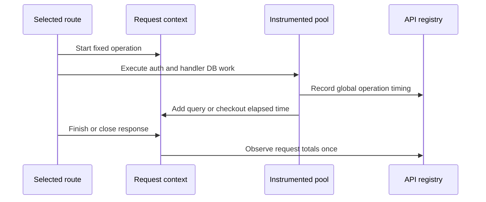

# Endpoint-attributed database latency

Status: implemented
Date: 2026-11-13

## Context

The API dashboard now overlays global HTTP, PostgreSQL query, and pool-acquisition latency. Operators also want comparable charts for login, course creation, notification listing, and unread-count fetching. Existing database histograms have only an outcome label: they cannot attribute work to an HTTP endpoint. The user chose to include **all** database operations performed during each selected request, reported as **totals per HTTP request**, rather than identifying particular SQL statements or plotting per-operation distributions.

## Decision

Add bounded, request-scoped database timing aggregation in the API process only. Use four fixed operation keys: `login`, `course_create`, `notifications_list`, and `notifications_unread_count`. Start the operation context for only the four selected method/path patterns before body parsing and authentication, so parser rejections receive zero-work samples and session lookup is included. At the existing instrumented pool boundary, accumulate successful and failed query durations and pool checkout durations in the current request context. Continue emitting the existing global, per-operation metrics unchanged.

At response `finish` or `close`, observe one query-total and one checkout-total histogram sample for that request, including zero when no database operation occurred. Label by only the fixed operation key and request outcome (`completed` or `aborted`). Observe once, even if both events fire. The dashboard filters to completed requests, and shows HTTP p50/p95, query-total p50/p95, and pool-total p50/p95 with explicit legends and seconds units for each selected operation. The notification panel distinguishes list and unread-count. These are three related latency measures, not an additive decomposition of HTTP time.

Query-total and checkout-total are **sums of elapsed durations of all relevant operations**. Parallel queries can overlap, so a total can exceed HTTP wall-clock latency. This expresses database work consumed by a request, not the wall-clock critical path or PostgreSQL server execution. Keep this explanation in panel descriptions and operator documentation.

## Structure

Use Node's `AsyncLocalStorage` to propagate the request context through asynchronous service calls without altering service interfaces. A mutable context accumulates query and acquisition seconds, then seals at response completion. The pool observer captures attribution at operation start and adds elapsed time at settlement only while the context is open; late work after response completion is omitted from request totals but remains in global metrics. Any telemetry failure is swallowed and never changes database results or HTTP responses. No SQL text, query parameters, user IDs, course IDs, raw URL, or error messages enter the context or metric labels.

## Alternatives rejected

- Adding an endpoint label to all database operations: labels many unrelated routes, enlarges cardinality, and makes a request-level total harder to interpret.
- Manually tagging selected SQL statements: misses transitive authentication/transaction work and couples instrumentation to service implementations.
- Correlating only in Grafana/PromQL: global histograms have no request association, so correlation would be false.
- Tracing backend or SQL logs: disproportionate for four aggregate charts and risks sensitive content.
- Union-of-overlapping-intervals wall time: closer to critical-path time but adds interval bookkeeping and still does not isolate database causality from concurrent application work.

## Failure modes and trade-offs

- Zero-query requests contribute zero to both distributions; this keeps the denominator aligned with HTTP requests and exposes changes in query frequency only indirectly. Existing global query-rate charts remain available.
- Failed SQL and failed checkouts still contribute their elapsed duration. A 4xx/5xx HTTP response that completes is included; aborted responses are recorded separately and excluded from the dashboard's completed-request series.
- Late or unawaited database work is not attributed after the request context seals. Global histograms still record it. This prevents an abandoned request from receiving subsequent work but can undercount badly structured handlers.
- Summed duration can exceed wall-clock request latency when operations overlap; labels and descriptions must not call it the database _portion_ of a request.
- Four operation values times two outcome values bound series growth; no dynamic route template or identifiers are accepted. Histogram buckets should match the current database timing scale, extending as necessary for multi-query request totals.

## Reversibility

The internal context and dashboard layout are easy to change. Metric names and label semantics become a monitored contract once deployed; choose names that explicitly say `request_db_query_total` and `request_db_pool_acquire_total` rather than reusing the per-operation histogram names.

## Open questions

None that redirect the architecture. Implementation should test concurrent requests and overlapping queries, zero-query and failed operations, abort/finish races, and telemetry-disabled behavior.
