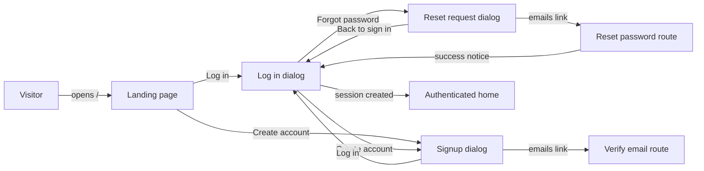

# Landing page and authentication dialogs

Status: implemented
Date: 2026-11-15

## Context

Before this redesign, ChalkTalk presented a split landing page with a permanently visible authentication card. The approved redesign made the public page a full-width introduction to the product, with authentication opened from compact header actions. The existing API and email-link authentication flow had to remain intact. The user approved the supplied landing, login, and signup mockups, a hero with no dialog by default, automatically opening Log in with the completion notice after a successful password reset, a native modal dialog for the request forms while retaining dedicated email-token routes, and preventing dismissal during pending sign-in. The user explicitly chose to remove the existing email-domain/course-listing privacy note from the landing and signup dialog.

## Decision

Make `/` a public, full-width landing page. Its header owns Log in and Create account buttons, and its body owns a centered hero and a five-card feature section. Keep ordinary login, verification-request signup, and password-reset-request forms in a single modal shell controlled by landing-local state. No authentication dialog is open on normal arrival. A successful password reset navigates back to `/` and opens Log in to display its existing success notice.

Keep emailed `/verify-email?token=...` account completion and `/reset-password?token=...` password completion as dedicated public routes. Do not turn an emailed token into modal state or add query parameters for ordinary dialogs. The current router strips tokens from the visible URL; retain that behavior.

Use a native modal `<dialog>` for the shell, without adding a dependency. It supplies browser-level modal focus containment and makes the background inert. The dialog must still have an accessible name, initial focus on its first useful field, a labelled close control, Escape and backdrop dismissal, and focus restoration to the header action that opened it. Changing between login, signup, and reset-request keeps the same shell but focuses the new form. Closing clears transient form values and notices; the post-reset completion notice is consumed when the user dismisses or leaves Log in. While sign-in is pending, prevent dismissal by close button, Escape, or backdrop; re-enable it when the request resolves. This avoids a server-created session arriving after a dismissed dialog and leaving the visible client in an inconsistent logged-out state.

## Structure

`App` continues to own the route, session, and transient post-reset notice. `Landing` owns only which authentication dialog, if any, is open. The three existing forms own their inputs, pending state, validation errors, and generic success messages. The dialog shell owns modal semantics and focus behavior. Existing auth-client methods and server contracts are unchanged.

The [web-auth-entry specification](../../openspec/specs/web-auth-entry/spec.md) owns the approved copy and feature-card contract. The hero uses centered Fraunces with a DM Sans ampersand; the ChalkTalk wordmark is approximately 30% larger. The full-width hero replaces the old two-column layout at all breakpoints; the dialog remains viewport-contained and scrollable on small screens.

## Technology choices

| Concern        | Choice                                | Why                                                             | Runner-up                                                                          |
| -------------- | ------------------------------------- | --------------------------------------------------------------- | ---------------------------------------------------------------------------------- |
| Modal behavior | Native HTML `<dialog>`                | Focus containment and inert background without a new dependency | Existing custom `role="dialog"` pattern needs manual background and focus handling |
| Dialog state   | `Landing` component state             | Transient UI state does not warrant a URL contract              | URL/query-driven dialogs add navigation semantics not requested                    |
| Typography     | Existing Fraunces and DM Sans imports | The approved mockup uses fonts already loaded by the app        | A new font adds a dependency and changes the visual design                         |

These are existing browser primitives and project assets; no third-party version or maintenance check is needed.

## Alternatives rejected

- Keep the inline authentication card: preserves the current layout but contradicts the approved full-width landing page and modal interaction.
- Put login, signup, and reset-request on new routes: deep-linking is unnecessary for these transient forms and complicates notice/focus behavior.
- Move emailed token completion into the landing dialog: would couple security-sensitive token handling to transient UI state and weaken the existing URL token-scrubbing flow.
- Add a modal library: unnecessary for this single interaction and introduces a dependency.

## Trade-offs accepted

Ordinary dialog state is not bookmarkable and resets on refresh. The requested deletion of the privacy note removes an existing disclosure of organization grouping from this entry surface; the grouping behavior itself is unchanged.

## Failure modes

- If a login or email request fails, the active dialog stays open and displays the existing error; the hero remains available after dismissal.
- While sign-in is pending, the dialog remains visible and indicates progress rather than permitting dismissal; success navigates to the authenticated home, while failure restores dismissal. An indefinitely stalled request leaves the dialog waiting, and page refresh remains the recovery path unless request timeouts are added separately.
- Signup and reset-request confirmations remain generic, avoiding account-existence disclosure.
- An invalid or missing email-link token continues to render the existing dedicated link-problem page, not an empty dialog.
- If session restoration succeeds while viewing `/`, the existing redirect to `/home` takes precedence over the public landing page.
- At narrow viewports or with large text, the dialog must scroll within the viewport without hiding its close control or trapping access to form actions.

## Reversibility

Landing copy, visual layout, and the choice of native versus custom dialog are cheap to change. Preserving the public email-link routes and their token-scrubbing behavior avoids a costly change to issued links and authentication semantics. No data model, API, or persistence decision changes.

## Open questions

None that redirects the structural design. Implementation should verify the approved card wording and responsive appearance against the mockups, and test focus restoration, Escape/backdrop dismissal, post-reset notice display, and existing authentication outcomes in a real browser.
