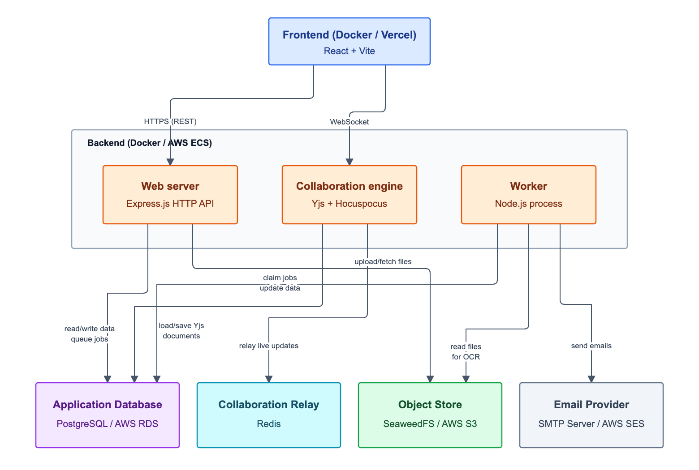

# **ChalkTalk Project Proposal**

# **Problem**

Existing course discussion platforms such as Piazza and Ed Discussion become harder to navigate as a semester progresses. Large classes accumulate hundreds or thousands of posts, many repeating earlier questions about assignments, deadlines, policies, or lecture material.

These platforms provide search, but students and TAs consistently report that it fails to surface posts they know exist, leading to duplicate questions and repeated answers. The deeper problem isn't just clutter: important information can go unseen even when it's already been posted. A single reply correcting a homework grading error, for instance, is easy to miss if a student doesn't happen to read that exact thread, no matter how much engagement or how many upvotes it gets. Existing platforms have no mechanism to surface what actually matters as a course progresses.

**ChalkTalk** is a course discussion platform designed to make course communication easier to search, organize, and surface within a course.

#

# **User Stories**

“One last point to add \- Piazza has a terrible search feature. Right before the break, I was in OH and the TA said they had seen a Piazza post with a similar problem to the one I was facing and we had difficulty finding it. Both my TA and another in the same room were very clear that they thought Piazza is a terrible application because it is so hard to find anything.”([Reddit](https://www.reddit.com/r/UWMadison/comments/r5ne8t/opinion_piazza_is_a_terrible_application_and/))

“A part of this, as you point out, is that it is hard to find/manage posts (which leads to the problem of repeat posts, which leads to frustration on our end and potential confusion on the student end if two different people answer slightly differently). This is exacerbated by the fact that we also see all the private posts (which add a considerable number of posts to the feed and can lead to additional confusion as we might remember or reference a post that no one else has seen \- potentially the explanation of why your TA and you could not find the post they remembered).”([Reddit](https://www.reddit.com/r/UWMadison/comments/r5ne8t/opinion_piazza_is_a_terrible_application_and/))

“The UI of Piazza isn't the best, and there are some bugs here and there \- for instance, sometimes the app crashes, or redirecting/linking to other questions doesn't work correctly. It would also be better if students were able to delete their own posts and archive classes that are over.”([G2](https://www.g2.com/products/piazza/reviews))

#

# **Users**

ChalkTalk serves two audiences: courses running on a hosted or self-hosted instance, and the people responsible for running that instance in the first place.

**Within a course:**

- **Students**, who ask questions, search existing discussions, and access course resources.
- **Teaching Assistants**, who answer questions, moderate discussions, and help maintain course information.
- **Instructors**, who manage the course, publish resources, and oversee course-wide content and moderation.

**Running an instance:**

- **Institutional or self-hosting administrators** — university IT staff, department admins, or independent instructors and open-courseware maintainers — who deploy ChalkTalk (hosted or self-managed), configure AI provider settings, and manage organization- and course-level access.

ChalkTalk is designed to serve both traditional university courses and independent or open-courseware contexts, such as a self-hosted course with no institutional affiliation.

#

# **Nature of the Product**

ChalkTalk's complexity comes from four areas of genuine engineering difficulty, with an AI layer built on top of them rather than as a substitute for them.

- **Real-time collaboration**: Office-hours sessions require a shared code editor / whiteboard where a student and TA edit simultaneously, with changes merging live and without conflict.

- **Search and retrieval**: Keyword matching alone is insufficient at scale; search must reliably surface existing answers and related questions in a large, growing course, addressing one of the most consistently reported failures of existing platforms.

- **Document processing**: Course resources such as lecture notes and slides must be processed so that specific sections are individually searchable and directly referenceable, not just uploaded as opaque attachments.

- **Knowledge surfacing over time**: The system must track engagement and content changes to identify information that matters as a course progresses.

Underlying all four, visibility and anonymity rules apply across nearly every read path in the system, including search results and AI-assisted answers, and must be enforced consistently as those rules change.

An AI assistant layer is built on top of this infrastructure, but the platform is designed to remain fully functional without it, consistent with the project's open-source, self-hostable goals.

#

# **Rough Architecture**

ChalkTalk is designed as a single application that can be deployed in two ways, so that the same codebase serves both our own production usage and any external adopter's needs.

Two deployment models, one system

- **Managed (Cloud) deployment:** Hosted and operated by the ChalkTalk team (us) on AWS. Instructors sign up and use the platform directly, with no infrastructure of their own. The team provides the AI provider key and is responsible for uptime, backups, and cost.
- **Self-managed deployment:** The full application, published as open source, runnable by any instructor, department, or open-courseware maintainer on their own infrastructure via Docker. A setup script provisions the application together with its database, collaboration relay, and file storage in containers. The self-hoster supplies their own AI provider key (or runs without AI features), so operating cost and data ownership stay with them.

Both deployments run the identical application image; only the infrastructure underneath differs (managed cloud services vs. equivalent containers). This means a feature or fix built once benefits both deployment paths automatically, rather than requiring two maintained versions of the app.

Why two models  
A single hosted platform would commit the team to open-ended cost and liability well past the class project, while a self-host-only model has too much setup friction for most instructors to actually adopt it. Supporting both lets ChalkTalk run as a real, dogfooded deployment for our own course, while staying genuinely free and adoptable by anyone else, without their use depending on the team continuing to operate it indefinitely.

**Tenancy**  
The data model is multi-tenant from the outset, with every course scoped to an organization even in single-course deployments. This lets the same schema serve many institutions on the managed cloud deployment, while a self-hosted instance can default to one course for simplicity or opt into hosting several, with no changes to the underlying data model.

#

# **Functional Requirements**

**Account Creation and Management**  
To create an account, a user submits an email address in a deployment-allowed school domain. The server sends a deployment-configured HTTPS verification link to the web client with a short-lived, single-use token; clients cannot choose the redirect destination. The user supplies that verified token, a display name, and a password meeting the 12-to-128-character length rule. Account creation atomically associates the user with the organization for the verified school domain. Changing the account email requires verification of the replacement address in the same school domain; the user's organization association and course memberships remain unchanged. Users can change or reset their passwords and delete their accounts. See the [account design](design.md#account-creation-and-management) and [authentication API](api/auth.md) for details.

**Classes**  
Users can create classes, which function as independent, isolated forums. When a class is created, the creating user becomes the instructor of that class.

Classes can be archived or deleted. Archiving a class makes it read-only, preventing new posts, replies, and new users from joining. When a class is deleted, all data stored under the class is deleted.

**Posts**  
Users can create posts on the main page. There are three types of posts: questions, notes, and polls.

Questions  
Questions can be posted by any user. When a user creates a question, similar existing posts are surfaced automatically. Each question has a shared students' answer and a shared staff answer. Students, TAs, and instructors can edit the students' answer. The first contributor's role sets the staff answer's editing threshold: TAs and instructors can edit a TA-started answer, while only instructors can edit an instructor-started answer.

Responses can be endorsed by a TA or instructor. Authorized editors can correct an endorsed response; editing clears its current endorsement while retaining the historical endorsement event.

Followups belong to questions and can themselves be responded to, forming a nested discussion.

Notes  
Notes can be posted by any user. Responses cannot be posted to notes.

Polls  
Polls can be posted by instructors or TAs. A poll contains a list of options that any user can vote on. Polls cannot be responded to.

Posts, responses, and followups support LaTeX and Markdown formatting, as well as image and document upload.

Posts, responses, and followups each have an author and timestamp; timestamps update on edit. Collaborative responses record every user who has edited them.

Users can mark individual posts, responses, or followups as anonymous. When marked anonymous, the author is displayed as "Anonymous" to other students, while remaining visible to TAs and instructors.

**Channels**  
A channel is a group of discussion spaces called subchannels. Channels can only be created by instructors and TAs, and contain a title and description. Subchannels can be created by any user and contain a title and introductory message.

Channels can be manually archived or deleted by an instructor or TA. When archived, all subchannels become read-only and new subchannels cannot be created. Channels are automatically archived after a configurable period of inactivity, defined as no new subchannels being created and no new activity within any subchannel.

**Search**  
Posts are indexed for full-text and fuzzy search. Matching, ranking, and filtering rules are documented in the [course posts API reference](api/posts.md).

When a user drafts a new question, related existing posts are surfaced live through course post search. Any user can mark a post as a duplicate of another; a TA or instructor can confirm the merge, consolidating engagement onto the canonical post.

**Course Resources**  
Instructors can upload or link resources relating to the course, such as syllabus documents, lecture notes, assignments, course policies, and external links.

Uploaded documents can be divided into instructor-defined regions, such as a diagram or paragraph on a given page. Each region is independently searchable and can be directly linked to from posts, responses, and followups. Text within a defined region is extracted via OCR to support search.

**Live Collaborative Sessions**  
Any user can start a live, shared code editor session, linked to a post or channel, for use during office hours or collaborative debugging. Multiple participants can edit the same session concurrently, with changes merging in real time without conflict.

**Statistics**  
Course statistics are compiled per course in a statistics tab. These statistics include:

- Daily activity
- Questions and answers per student
- Posts viewed
- Average response time

Response time is defined as the time between when a question is posted and when an endorsed answer is posted in response.

**Knowledge Surfacing**  
Knowledge surfacing operates within each course; see the [knowledge-surfacing design](design.md#knowledge-surfacing) for the engagement signals and per-course digest.

#

# **Nonfunctional Requirements**

Security  
The system must prevent:

- unauthorized course access,
- privilege escalation,
- malicious uploads,
- account hijacking,
- cross-site scripting,
- unauthorized resource modification.

#

# **Individual Contributions**

**Nicholas Smirnov**  
Primary responsibilities:

- authentication
- account creation
- account deletion
- account modification
- authorization and role management
- application security
- security testing
- course permission model
- session management
- security review of APIs

**Khai Hern Low**  
Primary responsibilities:

- database design
- semantic search
- session management

**Jackie Lee**  
Primary responsibilities:

- frontend UI
- course resource management
- notification interface
- case testing
- UI component design and reusability (shared component library)
- responsive design
- cross-browser compatibility

**Darren Hamilton**  
Primary responsibility:

- project management
- sprint planning
- task tracking
- integration coordination
- testing coordination
- documentation

**AI Tools**  
AI tools may be used as development assistants for:

- UI prototyping,
- boilerplate code generation,
- debugging assistance,
- test generation,
- code review,
- documentation.

All AI-generated code will be reviewed and verified by members of the development team before being incorporated into the project.
