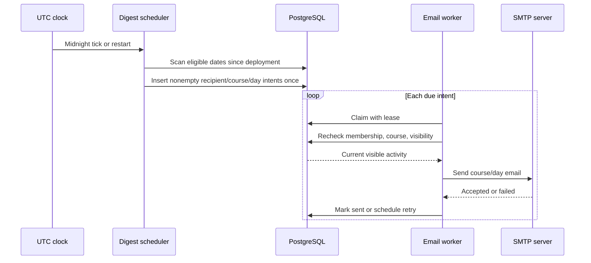

# Daily course email digest

Status: agreed
Date: 2026-10-14

## Context

ChalkTalk needs a backend-only email digest for questions, shared answers, and followups created by other people during the previous UTC calendar day. Dispatch becomes due at 00:00 UTC. Every active member receives a **separate email for each active course** with qualifying activity; empty course-days send no email. This is distinct from the ranked `GET /api/v1/courses/{courseId}/digest` view.

The user revised the original account opt-in design: digests are always enabled for active members. There is no profile preference, and the rollout must not mail historical activity. The UTC date of migration deployment is the first eligible activity day; for deployment on October 14, the first email is due at 00:00 UTC October 15 for October 14 activity. Later outages catch up missed eligible dates.

## Decision

PostgreSQL owns a durable scan cursor and one outbound record per `(recipient, course, activity_date)`. Migration initializes the cursor to the UTC day before deployment. The separate worker process scans from that cursor through yesterday, inserts only nonempty per-course intents, and wakes at midnight and periodically for recovery. Multiple worker instances coordinate using row locks and the unique outbox key. A worker claims due rows with leases and sends through the existing Nodemailer/SMTP transport. It rechecks active membership, course status, and content visibility before sending.

SMTP delivery is **at least once**, not exactly once: a crash after SMTP accepts a message but before PostgreSQL records success can cause a duplicate on retry. The user accepted that risk. There is no new queue service or provider dependency.

## Structure

## Ownership and boundaries

The outbox owns the unique recipient/course/day key, dispatch state, attempt count, due time, lease, and last error—not post content or a permanent email body. The activity query uses half-open UTC boundaries `[day 00:00, next day 00:00)`. It includes question, shared-answer, and root/reply followup creation by someone other than the recipient. Edits, notes, votes, endorsements, deleted content, confirmed duplicates, tombstones, and hidden parent questions are excluded. The email contains plain-text counts and links, never raw user HTML or hidden anonymous-author identity.

Recipients are current active accounts with membership in an **active** course. A user who leaves, a deleted account, or a course archived before send receives no delayed email. A pending intent is canceled if no visible external activity remains. Content and access are rechecked immediately before SMTP handoff; the database locks relevant rows through the send so a revocation cannot race past that handoff. Coordinated creation writes cannot commit late behind a completed date scan. Canceled historical intents are not resurrected when membership returns.

The worker runs as a separate process alongside the API, wakes at 00:00 UTC, and polls for overdue work. The scan cursor begins at deployment day minus one and advances atomically with intent insertion; dates before deployment are never scanned. Claims use expiring leases; failed SMTP sends retain the same intent and retry with backoff. Completion timestamps use actual completion time, not claim time. SMTP success and PostgreSQL cannot share a transaction, hence the accepted rare duplicate risk.

## Trade-offs and failure behavior

- Dispatch starts when a worker is available at or after midnight; inbox arrival at precisely midnight cannot be promised.
- Multiple active courses can produce multiple emails per member per day.
- An outage can produce catch-up emails for each missed eligible date after deployment.
- PostgreSQL outage delays intent creation/claims; recovery resumes after database access returns.
- SMTP failure leaves an observable retryable intent; a crash after acceptance can duplicate a delivered email.
- Course archive, membership loss, or content hiding before handoff cancels or filters an unsent digest.

## Alternatives rejected

- Account opt-in: the user explicitly chose automatic delivery for all active members.
- One cross-course email: the user explicitly requested a separate email per course.
- Backfill from historical data: the user limited first delivery to deployment-day activity.
- Reuse the ranked course digest view: it does not represent previous-day events or recipient filtering.
- In-memory midnight timer without a durable outbox: outages would lose dates and SMTP failures could drop mail.
- A new provider solely for idempotent sends: it adds deployment complexity beyond this phase.

## Reversibility

The unique `(recipient, course, UTC date)` identity and deployment-day cutover determine historical delivery meaning and are costly to change after sending. Templates, polling cadence, and retry backoff can evolve without changing that identity. A future provider with idempotent send keys could reduce the accepted SMTP duplicate window.
