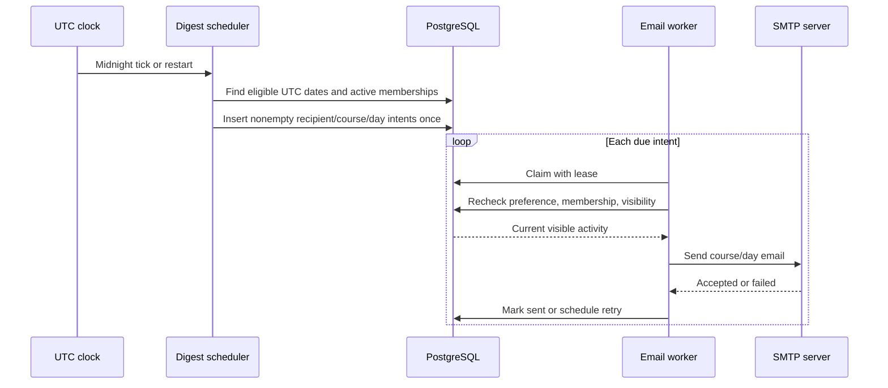

# Daily course email digest

Status: agreed
Date: 2026-10-14

## Context

ChalkTalk needs a backend-only email digest for new questions, shared answers, and followups created by other people during the previous UTC calendar day. Dispatch becomes due at 00:00 UTC. Each opted-in user receives a **separate email for each course** with qualifying activity, and receives no email for an empty course/day. If the worker was unavailable at midnight, it catches up missed eligible UTC dates after recovery.

The existing `GET /api/v1/courses/{courseId}/digest` reference describes a ranked course view with manual inclusions. That is a different product: the daily email is chronological activity for a recipient and UTC day, not a rendering or delivery of the ranked course view. An earlier paused draft proposed one email across courses; the user's new per-course decision supersedes it. Shared answers and question-level followups are now present in the database and API.

The user chose account-wide opt-in, skip archived courses, first dispatch at the next 00:00 UTC, and cancel unsent digests when opt-in is disabled. The UTC date on which opt-in is enabled is the first eligible activity day, including activity earlier that day. For example, enabling on October 14 allows the first email at 00:00 UTC October 15, covering October 14. Re-enabling after a disable starts a new eligibility period; earlier dates are not backfilled.

Assumption: the existing PostgreSQL and SMTP deployment serves a modest number of courses/users. No throughput target or delivery deadline beyond starting dispatch at midnight was supplied. SMTP acceptance and inbox arrival can occur later.

## Decision

Use PostgreSQL as the authority for the account preference, due UTC dates, and one durable outbound record per `(recipient, course, activity_date)`. A scheduler in the existing API process discovers eligible dates after the durable scan cursor through yesterday, creates only nonempty per-course records, and starts dispatch at or after 00:00 UTC. Workers claim records with leases and send through the existing Nodemailer SMTP sender. A unique key prevents duplicate queued records; failures are retried. Before each send, the worker checks current opt-in, active course membership/status, and content visibility, then builds the email from current visible records.

SMTP delivery is **at least once**, not exactly once. If the SMTP server accepts an email and the process crashes before PostgreSQL records success, a retry may send a duplicate. The user accepted that rare risk in exchange for durable recovery. The system should never claim that the database key alone guarantees one delivered email.

## Structure

### Ownership and boundaries

The account preference belongs to `users` or a one-to-one preference record, with an enabled flag and the UTC date on which opt-in was enabled. The authenticated profile API exposes the preference and allows the user to change it; the default is off. Its update uses the existing session, origin/CSRF, and profile version conventions. Disabling immediately prevents new intents and cancels all unsent records for that user. An in-flight SMTP operation cannot be recalled after acceptance; the UI/API contract should not promise recall.

A dedicated digest-outbox record owns the `(user_id, course_id, activity_date)` uniqueness key, dispatch state, attempt count, due time, lease, and last error. It does not own post content or a permanent email body. Records for a deleted user or course are removed with their parent; canceled records are retained only as long as needed for diagnostics. The scheduler's date cursor/watermark must survive restart and multiple API replicas; database uniqueness and row locking resolve concurrent scans and claims. There is no Redis queue or external scheduler requirement.

The activity query uses half-open UTC boundaries `[activity_date 00:00, next_date 00:00)`. Include question creation from `posts`, answer creation from `answers`, and root/reply creation from `followups`; exclude items created by the recipient. Edits, votes, endorsements, notes, and the ranked course digest are outside this phase. Exclude deleted content, confirmed-duplicate question parents, deleted followup leaves/tombstones, and content whose question is no longer visible. Shared answers use their `created_by_user_id` for this creation-only rule. The email may summarize counts and link to visible items, but must apply the existing anonymous-author policy: it never exposes a hidden name, ID, email address, or role. Use plain text and escaped HTML rather than inserting raw Markdown or user-supplied HTML into the email.

Recipients are active accounts with account-wide opt-in, current membership in an **active** course, and at least one qualifying item created by someone else on that date. A user who leaves a course, an archived/deleting course, or a deleted account has no email sent, even if an intent was queued earlier. A course that becomes archived before a delayed catch-up is skipped. Recheck these conditions immediately before handing content to SMTP. The timestamp used to decide inclusion is creation time, not last edit time.

### Recovery and delivery

The scheduler starts on process startup and wakes at UTC midnight. The existing process also polls for overdue work; scheduling is keyed to due dates, not a timer firing perfectly. Recovery scans dates after the durable schedule cursor through the previous UTC date, subject to each account's current opt-in eligibility date. Coordinated question, answer, followup, and opt-in writes cannot commit late across a completed scan; the cursor also prevents canceled historical intents from being re-queued after access returns. Claims use bounded leases: a worker crash returns the record to the retry pool after the lease expires. Retries use backoff and retain the same unique record; operational failures are observable as queued/failed attempts. Empty course/day combinations create no email intent. If all content becomes ineligible before send, the record is canceled without email.

The SMTP operation and PostgreSQL success update cannot share a transaction. Marking sent _after_ SMTP acceptance preserves recovery but permits a duplicate after an indeterminate send. A provider API with an idempotency-key contract would be required to improve this guarantee; changing providers is outside this phase.

## Technology choices

| Concern                    | Choice                                             | Why                                                                  | Runner-up                                                   |
| -------------------------- | -------------------------------------------------- | -------------------------------------------------------------------- | ----------------------------------------------------------- |
| Due work and deduplication | Existing PostgreSQL, unique outbox key, row leases | Survives restarts and multiple API instances with one data authority | In-memory timer alone loses missed dates                    |
| Mail transport             | Existing Nodemailer/SMTP                           | Reuses the deployed transport and Mailpit development path           | New provider API adds an external dependency and operations |
| Activity source            | Current relational rows, queried at send time      | Honors deletion, archive, and membership changes before dispatch     | Stored email snapshots can leak content later hidden        |
| Preference interface       | Existing authenticated profile API conventions     | Gives backend-only opt-in without a second auth model                | Server environment flag cannot express user choice          |

Repository package and runtime dependencies were checked on 2026-10-14. This design adds no third-party library.

## Alternatives rejected

- One cross-course email: the user explicitly requested a separate digest per course.
- Reuse the ranked `course_digest_states` data: it selects posts by engagement/manual curation and does not represent yesterday's question, answer, and followup events or recipient filtering.
- Send directly from the midnight timer without a durable record: process downtime or a failed SMTP call would lose a date.
- Mark a record sent before SMTP: it avoids duplicate attempts but permanently drops mail on an SMTP failure, conflicting with catch-up.
- Require a new provider with send idempotency now: it would change deployment and credentials solely to close a rare SMTP ambiguity.

## Trade-offs accepted

- Midnight means dispatch becomes eligible and starts when a worker is available; it does not guarantee every email reaches an inbox at 00:00 UTC.
- Multiple active courses can produce multiple emails for one recipient on the same date.
- A long outage can produce several catch-up emails per course; no digest coalescing or historical cap is specified.
- Retrying SMTP can rarely duplicate a delivered email after an indeterminate acceptance.
- A user opting in today can receive a digest at the next midnight covering today's activity, including activity from earlier that day.

## Failure modes

| Failure                                               | Behavior                                                                                            |
| ----------------------------------------------------- | --------------------------------------------------------------------------------------------------- |
| API/worker down at midnight                           | Durable eligibility is found after restart; overdue dates are queued.                               |
| PostgreSQL unavailable                                | No intent is created or claimed; restart/poll recovery resumes when available.                      |
| SMTP unavailable or times out                         | Intent remains retryable with backoff and error visibility.                                         |
| Crash after SMTP acceptance                           | Lease expires and retry may deliver a duplicate; the outbox still has only one intent.              |
| User opts out or membership/course visibility changes | Unsent intent is canceled or skipped after a fresh check. Already accepted mail cannot be recalled. |
| Source item is deleted or hidden                      | Rebuilt send-time content excludes it; an empty email is canceled.                                  |

## Reversibility

The durable `(recipient, course, UTC date)` identity and opt-in effective-day semantics are expensive to change after emails have been sent; they determine historical delivery meaning. The email template, polling cadence, retry backoff, and whether the preference occupies `users` or a one-to-one table are cheap to revise behind the same API. SMTP can later be replaced with a provider that supports idempotent sends without changing the digest's recipient/course/date identity.

## Open questions

- No provider-independent SMTP mechanism can prove exactly-once delivery. If a future product requirement demands that guarantee, select and verify a provider API with explicit send idempotency semantics.
- The project has no stated recipient/course scale or SMTP throughput target. Measure backlog and delivery lag before adding batching or a dedicated worker deployment.
