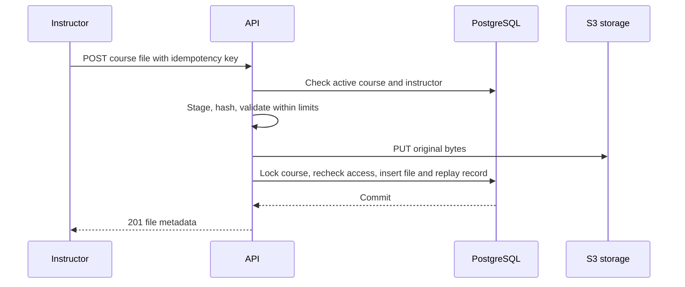
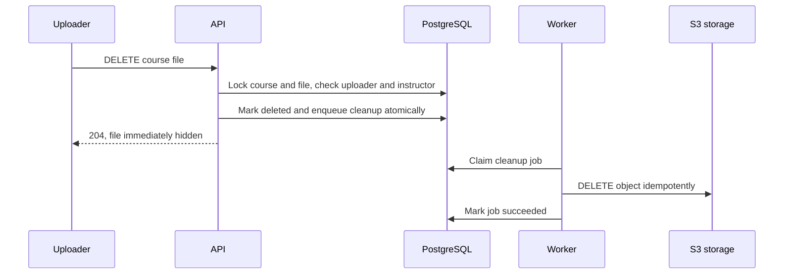

# Course-scoped file backend

Status: agreed
Date: 2026-10-16

## Context

The draft course-resource upload PR implements validated upload and authenticated download, but the broader course-resources product (titles, descriptions, listing, processing, and integration) is deferred. This slice needs immutable files associated with a course, without treating them as course resources. It retains the previously approved 100 MiB ceiling, validated PDF, plain text, Markdown, PNG, JPEG, WebP, DOCX, and PPTX allowlist, structural and active-content checks, bounded-memory processing, upload idempotency, and compatibility with local SeaweedFS and managed S3. It is backend-only.

Only a current instructor may upload to an **active** course. A current course member may download from an active or archived course. Only the original uploader, while still a current instructor, may delete a file from an active course. Archived courses are download-only. Course deletion removes file bytes. There is no file listing, sharing outside the course, file replacement, content extraction, or course-resource integration in this phase.

## Decision

Create a small `course_files` domain rather than publishing the existing `resources` model. PostgreSQL owns authorization, metadata, lifecycle, and cleanup intent; S3-compatible storage owns immutable original bytes. Upload commits a file row only after validation and a successful object PUT. The API streams bytes through an authenticated download endpoint, checking current membership on every request. File deletion immediately hides the row and transactionally queues durable, retryable object deletion. It does not wait for S3 before returning `204`.

The unmerged PR migration can be rewritten rather than adding a compatibility migration. Resource routes, schemas, and terminology introduced solely by that PR should be replaced, not retained as aliases. Future course resources may reference a course file, but that relationship is not designed or implemented here.

## Structure

### Public API boundary

- `POST /api/v1/courses/{courseId}/files`: authenticated multipart upload, one file, instructor in an active course. An optional `Idempotency-Key` provides 24-hour exact replay. Return `201`, `Location`, and minimal file metadata after the database commit.
- `GET /api/v1/courses/{courseId}/files/{fileId}/download`: stream the original bytes to a current member. Set safe `Content-Disposition`, correct media type and length, `nosniff`, and private/no-store caching. No public or presigned storage URL is exposed.
- `DELETE /api/v1/courses/{courseId}/files/{fileId}`: require original uploader and current instructor in an active course. Return `204` once logical deletion and cleanup intent commit; subsequent reads and downloads return `404`. A repeat delete may return `404` because the file is no longer visible.

File IDs must be resolved within the path's course ID. A missing file, wrong-course file, deleted file, or inaccessible membership must not reveal cross-course data. Upload validation distinguishes malformed multipart, excessive size, unsupported or disguised type, and unavailable storage using the existing API error envelope. No metadata GET, content-modifying `PUT`/`PATCH`, or file listing endpoint is published.

### Data ownership

`course_files` owns `id`, `course_id`, `uploaded_by_user_id`, `object_key`, original `file_name`, verified `media_type`, `size_bytes`, SHA-256 checksum, `created_at`, and nullable `deleted_at`. It deliberately omits resource title, description, kind, processing status, version, public URL, and search fields. The uploader ID is retained for delete authorization; if an account is deleted or anonymized, the file remains readable to course members but nobody gains the former uploader's delete privilege. Course deletion can still remove it. The object key is unique and derived from an opaque file ID under the course namespace, not from the supplied filename.

The existing idempotency table owns 24-hour upload replay records scoped to actor and course. The request digest binds the validated upload inputs and file checksum. Identical retry while the file is still live and the actor remains an instructor returns the original `201` response without another S3 PUT; a different payload with the same key returns `409`. A deleted file must never be resurrected by replay: the service checks current file visibility before replay and rejects an otherwise identical stale request. New uploads need a new key after deletion.

A `delete_course_file` job, recorded in the same transaction that sets `deleted_at`, owns durable physical cleanup. The job may carry the immutable object key so cleanup still works if a course-delete transaction removes the metadata row. Workers can retry S3 DELETE safely; a missing object counts as success. A dead job remains visible for operator repair instead of silently losing deletion intent. The existing course-deletion worker must include all file keys, including logically deleted files, and coordinate via the course row lock so upload/delete cannot race its snapshot. Deleting the same object from both jobs is harmless.

### Upload and failure boundaries

Multipart parsing stages to a temporary file with size and part-count limits. Hashing, structural validation, and transfer use file-backed or bounded-memory paths. Validation must reject content-type/extension mismatch, executable or macro-capable packages, active PDF/Markdown content within the agreed validator policy, malformed OOXML relationships, and invalid embedded parts. Validation is not antivirus scanning and cannot establish that accepted bytes are malware-free.

The service checks authorization before costly work, then locks and rechecks active course/instructor status immediately before the final insert. This serializes upload with course archival/deletion. A normal PUT or database failure triggers best-effort object deletion. If database commit outcome is ambiguous, check whether the row exists before deleting the object; if status remains unknown, retain the object rather than risk deleting a committed file. Crash-orphan reconciliation is deferred as previously agreed. Download rechecks current membership but cannot prevent a role change after headers/streaming begin; future stronger revocation would require a different streaming contract.

## Technology choices

| Concern                | Choice                                                              | Why                                                                      | Runner-up                                                                         |
| ---------------------- | ------------------------------------------------------------------- | ------------------------------------------------------------------------ | --------------------------------------------------------------------------------- |
| Metadata and lifecycle | Existing PostgreSQL                                                 | Shares course/membership transactions and durable jobs                   | Storage metadata alone cannot enforce course roles or cleanup intent              |
| Original bytes         | Existing S3-compatible client (SeaweedFS locally, S3 in deployment) | Preserves the PR's validated storage path                                | Database bytea would enlarge backups and transaction load                         |
| Delete cleanup         | Existing PostgreSQL jobs mechanism with a file-delete kind          | Atomic hide plus durable retries without delaying the API on storage     | Synchronous S3 DELETE before DB commit risks a live row pointing to missing bytes |
| Public delivery        | Authenticated API byte stream                                       | Checks membership on each request and avoids leaking storage credentials | Presigned URLs remain usable after membership revocation until expiry             |

Existing project dependencies and service patterns were inspected on 2026-10-16; this design adds no third-party technology.

## Alternatives rejected

- Keep `resources` and strip only the listing route: it would still expose a premature product model and metadata unrelated to immutable file storage.
- Generic uploader-owned files: the user requires course-scoped reads and role-based upload/delete.
- Synchronous physical deletion before `204`: a database failure afterward could leave a visible metadata row whose bytes are gone, and S3 outages would block logical deletion.
- Delete the row first and use only best-effort S3 cleanup: a transient failure could leave bytes permanently orphaned.
- Allow course staff other than the original uploader to delete: contrary to the chosen ownership rule.

## Trade-offs accepted

- `204` confirms access removal and durable cleanup intent, not immediate removal of bytes from object storage.
- There is no discovery/listing API; callers must retain a file ID until future course-resource integration.
- Account deletion may make an individual file undeletable through the file endpoint; course deletion still cleans it.
- The accepted format validators reduce disguised/active content risk but do not replace malware scanning.
- An ambiguous upload commit can temporarily leave an orphaned object; deleting it without knowing commit outcome would risk data loss.

## Failure modes

| Failure                                | Behavior                                                                                          |
| -------------------------------------- | ------------------------------------------------------------------------------------------------- |
| Validation fails                       | No file row or ready object; staged bytes removed.                                                |
| S3 PUT fails                           | No file row; return service unavailable.                                                          |
| Database insert fails after S3 PUT     | Best-effort object cleanup; return service unavailable.                                           |
| S3 GET fails or returns no body        | Return service unavailable before headers when possible; a midstream failure closes the response. |
| File-delete S3 request fails           | File remains hidden; job retries and exposes a dead state for operator repair if exhausted.       |
| Course archival races upload or delete | Course-row lock orders operations; archived state blocks new uploads and user deletes.            |
| Course deletion races file job         | Object deletion is idempotent; locking and durable job key prevent losing cleanup intent.         |

## Reversibility

The course-scoped file API and `course_files` identity are expensive to change after publication. The choice not to publish resource semantics is intentional; future resource records can refer to a file ID without changing original bytes. Validator implementation and object-key prefix are internal and cheaper to revise. The logical-delete plus durable-job contract is a lifecycle guarantee and should not be weakened silently.

## Open questions

No structural decisions remain for this slice. Planning should ensure the existing unmerged migration, OpenSpec change, and tests all describe `course_files` rather than the superseded resource model. A future course-resource design must decide how resources reference files and who may expose or remove those references; this change does not answer that question.
