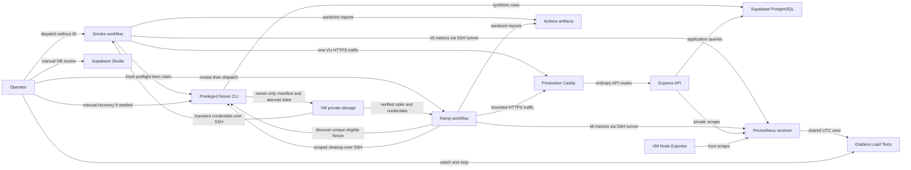

# Bounded k6 load testing against production

Status: historical design; Smoke-to-Ramp handoff was superseded by the [independent Ramp design](../2026-11-17-independent-ramp-user-flow/2026-11-17-independent-ramp-user-flow.md), then its Ramp profile and traffic mix by the [multicourse design](../2026-11-17-expand-multicourse-load-test/2026-11-17-multicourse-journey-load-test.md). Current operator procedure: [load-test runbook](../../../../deployment/load-test/README.md).
Date: 2026-11-16
Amended: 2026-11-17

## Context

ChalkTalk serves public HTTPS from one VM, with Express API, collaboration service, and worker behind Caddy. Supabase supplies PostgreSQL and private object storage; Resend sends email. Prometheus and Grafana already track API latency, 5xx fraction, **client-observed** database query and pool-acquisition latency, process metrics, and selected per-request database totals. The [VM system-metrics design](../2026-11-16-collect-vm-system-metrics/2026-11-16-production-system-metrics.md) added host CPU, memory, network, and disk series before load testing. Supabase server load is **not** collected by Prometheus in this phase; the operator will inspect Supabase Studio manually.

The user accepts production load testing at the application's current small scale, wants simulated concurrent users without creating accounts manually, and wants k6 client metrics correlated with application and VM measurements in Grafana. This is a **backend-only HTTP API load test of selected core flows**, separate from functional browser end-to-end coverage. It is **not** coverage of all application flows, a stress-to-failure exercise, or a production signup campaign. The first run is a bounded ramp from 1 to 5 to 10 to 20 virtual users over approximately ten minutes. Writes are permitted only in a dedicated synthetic course and must be cleaned up. Real user data must not be used as a fixture.

## Decision

Run Grafana k6 on a GitHub-hosted Actions runner against `https://joinchalktalk.com`, not on the VM whose capacity is being measured. This **replaces** the operator-laptop launch path. Two separately named, manually dispatched GitHub Actions workflows are required: a one-VU **Smoke**, followed only after human review by a distinct **Ramp** dispatch. Neither workflow accepts a run-ID input, and neither ordinary CI nor deployment triggers load. Both workflows are available only from trusted `main`, use the existing `production` environment and pinned SSH host key, and serialize with the VM production queue. The runner checks that its checkout is the intended deployed SHA before accessing the fixture or starting k6; a mismatch fails closed. No arbitrary ref or target URL is accepted as an input.

The load profile is configured by a **small allowlist of non-secret GitHub `production` Environment variables**, not by the VM application's `production.env` or arbitrary dispatch inputs. `LOAD_TEST_MAX_VUS` is an integer from 1 to 20. `LOAD_TEST_STAGE_MINUTES` is exactly four comma-separated positive integer minute values whose sum is at most 10; the initial value is `1,3,3,3`. Stage targets are the fixed profile `1 → 5 → 10 → 20`, each capped by `LOAD_TEST_MAX_VUS`, so a smaller ceiling may collapse adjacent stages but never create an unreviewed spike. `LOAD_TEST_RAMP_WRITE_ATTEMPTS` is an integer from **6 to 17**; the six-attempt minimum is needed to exercise all six selected mutation types, while the smoke has one fixed vote attempt, yielding at most 18 attempts across the approved smoke/ramp sequence. These variables are required and validated before fixture access; missing, malformed, or over-limit values fail closed. The production URL, one-writer rule, minimum 30-second mutation spacing, operation set, error/429 stops, and hard maxima remain in reviewed code. Ambient `K6_*` variables cannot override them.

A privileged, one-off VM-side fixture command creates a unique synthetic organization, twenty synthetic accounts, a dedicated course, and prerequisite posts directly in the production database. This bypasses email verification **only for synthetic fixture accounts**, avoiding production mail and anti-abuse limits; it introduces no public provisioning endpoint or permanent bypass. The VM owns the fixture, credential manifest, and a durable attempt/smoke record in owner-only private storage. Smoke automatically derives an opaque fixture ID from its trusted GitHub workflow-run identity; the operator never supplies or copies that ID. The record retains the source Smoke workflow run ID/URL for audit, normalized effective profile and fingerprint, project identity, deployed SHA, and lifecycle timestamps. All claims use a VM-side lock and atomic state replacement, so concurrent workflow jobs cannot both acquire the same attempt. The permitted lifecycle is `new → smoke claimed → smoke verified → ramp claimed → cleaned`; a failed or uncertain claim does not return to `new`. The singleton fixture rule rejects a new Smoke while **any** prior fixture is active, stale, failed, or cleanup-uncertain; reviewed cleanup must resolve it first. The Smoke workflow completes the fresh-target observability preflight **before** claiming or provisioning, and persists `smoke verified` only after a complete smoke and post-traffic observability checks.

The Ramp workflow does not ask the operator for a run ID or search GitHub artifacts for the latest successful run. It re-resolves the Environment variables and, under the VM lock, discovers and atomically claims **exactly one** unclaimed `smoke verified` fixture no more than 30 minutes old. After successful Smoke inventory and observability checks, verification records the SHA-256 of the exact owner-only manifest bytes in VM state. Ramp compares the current owner-only manifest bytes with that verified digest before claim mutation, alongside checking deployed SHA, profile fingerprint, project/DB identity, and source provenance. No eligible fixture, multiple candidates, a stale fixture, a changed configuration, a deployment in between, or uncertain cleanup fails closed; Ramp never guesses which fixture to use. Its selected ID is internal execution state, surfaced only as a nonsecret audit label and link to the source Smoke run. A failed, cancelled, or uncertain attempt is not retried; review and clean up, then use a fresh Smoke dispatch, which creates a new ID. This state replaces reliance on an ephemeral runner's local manifest ledger. It prevents duplicate invocations against one fixture, but **does not measure actual database writes**; the bounded k6 script enforces write-attempt limits.

The workflow requires **no new project-identity variables**. It derives the expected 20-character project reference from the existing GitHub `production` Environment variable `SUPABASE_STORAGE_ENDPOINT`, accepting only the two already-supported exact HTTPS Supabase Storage S3 endpoint shapes. Independently, it validates the existing `DATABASE_URL` Environment secret as a Supabase PostgreSQL URL with a Supabase host, `postgres.<reference>` username, `/postgres` database, and verified TLS. The expected host passed to the fixture CLI comes from that validated database URL. Before provisioning, the runner securely compares the GitHub `DATABASE_URL` secret with the URL currently deployed in the VM's owner-only `production.env` through pinned-host SSH, without putting either URL on a command line, in logs, or in an artifact; only a match/mismatch status may be emitted. A mismatch blocks the run until the VM is bootstrapped with the intended current secret. This is independent of the storage-derived project reference, but it is **not** an independent attestation that the configured Supabase project is the operator's intended one; the operator must still confirm the project and healthy baseline in Supabase Studio before smoke and ramp.

The runner obtains the owner-only manifest transiently over pinned-host SSH after the VM-side identity checks. It uses a private runner file, never an artifact, log, input, or cache; the file and SSH credentials are removed in a finalization step. Only sanitized HTML/JSON k6 reports and non-secret dashboard evidence are downloadable Actions artifacts. The workflow does not print response bodies, account credentials, environment secrets, or raw manifest contents. A failed cleanup remains a visible, actionable failure rather than being hidden by a successful test result.

Each virtual user signs in once with its own account and retains its cookie and CSRF token. A low-volume login phase can be measured separately; login is not repeated every iteration because production defaults limit it to ten attempts per email and one hundred per source IP per hour. Write requests use normal exact `Origin` and CSRF headers. The main `ramping-vus` scenario models 1→5→10→20 concurrent active users doing primarily course-list, feed/post-detail, notification-list, and unread-count reads. The first traffic VU is the sole writer and makes only capped, spaced mutations in the test course: question, note, answer, follow-up, poll, and vote. These are the **selected core API flows**; course creation, files, email, live collaboration, and other application flows are outside this workload. Do not send real email, create announcement mail fan-out, invite real users, delete shared content, or bulk-upload files in the first run. The exact workload and operator gates are in the [runbook](../../../../deployment/load-test/README.md). Only load traffic goes through public API routes; the already-approved privileged VM-side direct-database fixture setup and cleanup remain separate administrative operations, not user-traffic coverage.

Coverage is an executable completion condition, not an aspiration. Smoke must show successful login, each existing core read operation, and its one vote attempt. Ramp must show at least one **successful checked response** for each fixed read operation and each of the six mutation types, with operation-specific counters/checks in the summary. The default 17 ramp attempts normally reaches every mutation type at least twice, but neither an early abort nor a high-level k6 success exit may be reported as complete if any required operation is absent or failed. This coverage rule does not authorize extra VUs, longer duration, faster writes, a second writer, or attempts above the configured budget; incomplete coverage fails the run and requires reviewed cleanup and a fresh run ID before another attempt.

**Grafana correlation:** Keep the existing Prometheus low-volume remote-write receiver on VM `127.0.0.1`. The Actions runner opens a pinned-host SSH forward and sends `experimental-prometheus-rw` output to `/api/v1/write` through that tunnel. Neither Caddy nor a public firewall port exposes the receiver. SSH authorization and loopback binding protect this private write surface. Prometheus retains k6 samples for the existing fifteen-day window. Its receiver is appropriate only for this bounded, low-cardinality test, not as a general push-ingestion service.

Place the dedicated **Load Test Correlation** dashboard in a Grafana folder named **Load Tests**. The folder organizes dashboards; the underlying k6, app, DB-client, and VM time series remain in the existing Prometheus data source. The dashboard has a fixed `testid` selector and shared UTC range. Show k6 request rate, active VUs, dropped iterations, check/assertion success, unexpected failures/429s, and client p50/p90/p95/p99 by fixed operation. Adjacent panels show application HTTP latency and 5xx, client-observed DB query/pool latency, and VM CPU/memory/network/disk. Group by source and unit; do not subtract unlike percentiles. The `testid` label filters k6 series only. App/VM series are aligned by run time, not causally attributable when real traffic overlaps. Record Supabase Studio observations for that same window.

Use exactly one bounded `testid` per run and a small fixed vocabulary of scenario and operation/name tags. Disable k6's default `url` system tag so dynamic IDs and query strings cannot enter Prometheus labels; explicitly assign fixed route-template names to requests. No user/course IDs, emails, tokens, content, or raw error bodies in labels or output. Reject unknown tag values. Export k6's self-contained HTML report and sanitized summary as Actions artifacts; these provide backup evidence if the SSH tunnel or receiver fails but do **not** satisfy the requested Grafana correlation by themselves. The former runner-local live k6 web dashboard is not exposed by Actions; the operator watches the existing private Grafana dashboard through their own SSH access during the job.

VM metrics must be deployed and pass freshness preflight before any production ramp. A one-user smoke verifies auth, CSRF, remote-write ingestion, and Grafana panels; its successful fixture remains isolated for the separately approved ramp. An operator reviews Grafana and Supabase Studio after smoke and watches them during the staged ramp, cancelling the workflow on safety signals. Record UTC start/end, auto-generated fixture ID, source Smoke run URL, deployed SHA, sanitized k6 summary/HTML report, Grafana screenshots, and Studio readings. The ramp finalizer attempts narrowly scoped fixture teardown regardless of k6 success; failed or cancelled smoke also triggers teardown. Teardown fails closed on unexpected references and can require a later reviewed VM-side recovery because a runner can disappear or semantic jobs may still be active. An abandoned successful or expired smoke likewise requires explicit VM-side cleanup if no ramp follows; while it remains unresolved, another Smoke is blocked. Never claim cleanup succeeded merely because an Actions job ended.

## Structure

The fixture and VM-owned singleton attempt record own identities, discovery, lifecycle, and teardown. GitHub Actions owns separate manual dispatches and ephemeral k6 execution; it does not own persistent credentials or select fixtures from artifacts. The API owns authentication, authorization, and data writes. Prometheus receives low-volume k6 data and independently scrapes app/VM data. Node Exporter measures VM-wide load; Studio provides a manual database-server view. Neither replaces application DB client-latency histograms.

## Safety envelope and evidence

The maximum first run is twenty VUs for ten minutes, with no stress or spike stage. The k6 configuration and dispatch inputs must not allow an accidental generic environment variable to override the ceiling or target host; neither workflow accepts a fixture/run ID as input. The four validated stage durations may shorten but never lengthen the ramp beyond ten minutes. A one-VU smoke must pass before ramping. The writer permits at most the configured 6–17 ramp mutation attempts, after one smoke vote attempt. The VM-owned attempt record permits at most one smoke claim and one later ramp claim for an auto-generated fixture ID and at most one globally active fixture; it does not count actual database mutations. Operators must not reset attempt state or rerun an attempted fixture; after reviewed cleanup, a fresh Smoke dispatch creates a new ID. Reviewed cleanup rejects more than 64 manifest-owned indexing jobs, 64 catch-up rows, or 7 distinct indexable question/note posts. The writer has a fixed upper bound on created objects and stops after an ambiguous mutation outcome rather than retrying it.

At the client, measure duration by **fixed operation tag** (p50/p90/p95/p99), iteration duration, throughput, unexpected 4xx/5xx and network failures, assertion success, VUs, and dropped iterations. The report and workflow summary must show the required operation-by-operation success evidence and state plainly that this is **selected core API flow coverage, not all application flows**. The PR description must carry the same disclosure. An `abortOnFail` threshold should stop after warm-up if unexpected failure rate exceeds an initial safety limit of 2% over a meaningful sample. Any 429 is an invalid workload or rate-limit signal, not backend saturation. Latency pass/fail thresholds should be based on a one-user baseline, not invented in advance.

At the server, inspect Grafana's API p50/p90/p95/p99, 5xx fraction, request volume, DB query/pool distributions, failed database attempts, process memory, and selected login/course/notification request DB totals. Inspect Node Exporter host CPU, available memory, network throughput/errors, disk I/O, and free space. Check Supabase Studio manually for server CPU, memory commitment, connections, and provider warnings. Stop for sustained 5xx, rising pool waits/connection failures, VM or DB memory pressure, disk exhaustion, or a provider warning even if k6 thresholds have not fired. Do not start while a Supabase memory warning is active without an explicit headroom/stop decision. k6 latency includes client network travel; Grafana application DB timing includes client queueing and network transfer and is not PostgreSQL execution time.

The preflight must prove collection, not merely parse configuration. Before claiming the VM attempt or provisioning a fixture, wait up to three minutes for at least two fresh `up=1` samples from each API, worker, collaboration, VM host, and VM-network target. Do not require HTTP or DB-client latency samples from an idle API before load traffic. After the one-VU k6 smoke, require at least two fresh HTTP duration, DB query/pool duration, VM CPU/memory/network/disk, and `k6_*{testid="..."}` samples through the SSH tunnel before marking smoke verified. If any required source is absent or stale, block the separate ramp dispatch. Verify Studio access and baseline separately. During the run, retain client/app/VM series and Studio readings for the same UTC window. A successful Actions report alone is not enough.

## Technology choices

| Concern            | Choice                                                        | Why                                                        | Runner-up                                          |
| ------------------ | ------------------------------------------------------------- | ---------------------------------------------------------- | -------------------------------------------------- |
| Load generator     | Manually dispatched GitHub-hosted Actions runner              | No local k6 setup; does not consume measured VM CPU        | VM runner contaminates capacity measurements       |
| Ramp authorization | Separate named Smoke/Ramp dispatches plus VM-owned state      | Human reviews baseline and smoke before load               | Automatic continuation removes the safety gate     |
| Profile controls   | Bounded GitHub `production` Environment variables             | Easy operator tuning without weakening reviewed hard caps  | VM `production.env` couples load to app deployment |
| Concurrency model  | `ramping-vus` with one capped writer VU                       | Models active users while bounding mutations               | Unbounded arrival rate can overwhelm a small app   |
| Test identity      | One-off VM-side fixture CLI and unique synthetic organization | Avoids manual signup, real accounts, and verification mail | Public signup at scale triggers email/rate limits  |
| Client-metric path | Prometheus remote-write receiver over SSH loopback tunnel     | Correlates k6, app, and VM series in existing Grafana      | HTML-only output cannot overlay server metrics     |
| Report fallback    | Sanitized k6 HTML/JSON Actions artifacts                      | Downloadable evidence without exposing credentials         | Raw runner state risks secret leakage              |
| VM load            | Private Prometheus Node Exporter                              | Measures actual host resources without Docker socket       | `docker stats` is not retained in Prometheus       |
| Database-side load | Manual Supabase Studio review                                 | Avoids a new privileged scrape credential for now          | Supabase Metrics API is deferred by user           |

Grafana's k6 documentation (checked 2026-11-16) supports `ramping-vus`, abortable thresholds, Prometheus remote-write output, fixed `testid` tags, and built-in HTML export. Prometheus v3 documents `--web.enable-remote-write-receiver` and cautions that its receiver is for low-volume cases, not a replacement for scraping. [GitHub Actions documentation](https://docs.github.com/en/actions/how-tos/write-workflows/choose-when-workflows-run/trigger-a-workflow) (checked 2026-11-17) confirms manual `workflow_dispatch` from the default branch and environment-gated jobs; [concurrency groups](https://docs.github.com/en/actions/how-tos/write-workflows/choose-when-workflows-run/control-workflow-concurrency) can serialize production operations.

## Alternatives rejected

- **Public signup/verification for each VU:** sends production mail and trips anti-abuse limits.
- **Shared human or single synthetic account:** distorts session and per-user limits and risks real data.
- **Public test provisioning endpoint:** lasting security boundary for a temporary test.
- **Automatic load on every CI/deploy:** unpredictable production pressure and cost.
- **One dispatch that automatically ramps after smoke:** removes the operator's explicit chance to review Supabase Studio and Grafana.
- **Run-ID field on either dispatch:** adds manual copying and permits choosing an old or wrong fixture; VM-owned singleton discovery is safer.
- **Selecting the latest successful GitHub run or artifact for Ramp:** GitHub status is not authoritative for fixture ownership or cleanup, and a runner can disappear after changing VM state.
- **Several pending smoke fixtures with ambiguous selection:** makes an ID-free Ramp harder to reason about; a singleton active fixture forces cleanup before another Smoke.
- **Running k6 on the VM:** consumes resources whose headroom the test is trying to measure.
- **Keeping the operator-laptop runner as the main path:** requires local k6 installation and manual manifest transfer; superseded by approved Actions operation.
- **Stress-to-failure or unrestricted writes:** inappropriate with unresolved Supabase memory warnings.
- **Browser-driving k6:** functional UI coverage belongs to the Playwright E2E suite.
- **HTML report only:** cannot provide the requested client/app/VM correlation in Grafana.
- **Public Prometheus ingestion:** unnecessary exposure; SSH reaches a loopback-only receiver.
- **Assuming app DB histograms equal Supabase server load:** they include pool waits and network time.
- **Supabase Metrics API now:** deferred by user; Studio is the manual server-side view.

## Trade-offs accepted

The twenty-VU run estimates bounded concurrency, not maximum capacity. Fixture insertion bypasses email verification only for synthetic identities and requires tight scoping. Email, large files, and live collaboration remain unmeasured in the first run. The receiver adds a private write surface and k6 samples consume fifteen-day storage, bounded by fixed tags and short duration. A GitHub-hosted runner adds geographic/network latency to client-observed k6 timings, which the user accepts; server-side API/DB and VM metrics are interpreted separately. The live local k6 web dashboard is unavailable, and the operator depends on Grafana and later artifacts. Manual monitoring remains necessary because k6 cannot automatically act on private Grafana/Studio signals without more integration. The fixture may outlive a failed runner or a successful smoke that is never followed by ramp; recovery is an explicit operational responsibility.

## Failure modes

| Failure                                                | Required response                                                                                                    |
| ------------------------------------------------------ | -------------------------------------------------------------------------------------------------------------------- |
| Storage endpoint, DB identity, or VM URL differs       | Refuse fixture access; correct existing production settings and bootstrap before retrying                            |
| Fixture targets wrong database or existing user/course | Refuse to run; require production confirmation and empty unique namespace                                            |
| Seed partially fails                                   | Roll back; no k6 run starts                                                                                          |
| Credentials appear in logs or artifacts                | Stop, revoke sessions, remove fixture, rotate synthetic passwords; redact evidence                                   |
| Auth or CSRF fails in smoke                            | Stop before ramp; do not disable protection                                                                          |
| A selected core operation has no successful check      | Fail smoke/ramp as incomplete coverage; do not extend load to make it pass                                           |
| Rate limits return 429                                 | Abort, classify workload invalid; do not raise production limits merely to pass                                      |
| Error rate, pool wait, or memory pressure rises        | Abort k6 and retain UTC diagnostic window                                                                            |
| Runner saturates                                       | Treat dropped iterations/client load as inconclusive                                                                 |
| SSH tunnel or remote write fails                       | Stop before ramp; during run stop and keep HTML report, without claiming Grafana correlation                         |
| k6 label leaks URL, identifier, or secret              | Stop, assess Prometheus exposure, remove/expire affected series as appropriate                                       |
| Host scrape missing/stale                              | Block ramp; do not claim measured VM headroom                                                                        |
| Supabase Studio unavailable or showing warning         | Block or stop; DB-server load is not in Prometheus                                                                   |
| Cleanup finds unknown references                       | Fail closed; report exact synthetic IDs, never cascade into non-test data                                            |
| Actions runner cancelled or lost                       | No automatic continuation; VM attempt stays consumed, blocks another Smoke, and requires reviewed cleanup            |
| Smoke succeeds but ramp is not dispatched              | Retain isolated fixture only until operator explicitly tears it down; never silently reuse or select it after expiry |
| Ramp finds zero or multiple eligible smokes            | Fail closed without traffic; inspect VM state and clean stale or ambiguous fixtures before a new Smoke               |
| Actions artifact contains credentials                  | Stop, remove artifact, revoke sessions, clean fixture, assess and rotate exposed secrets                             |
| Deployed SHA changes between dispatches                | Refuse ramp; clean old fixture after review and start a new Smoke dispatch                                           |
| Cleanup blocked by active semantic jobs                | Keep manifest and run ID, wait for quiescence, inventory, then retry reviewed VM-side cleanup                        |

## Reversibility

Scenario mix, VU stages, tags, thresholds, and dashboard folder assignment are cheap to adjust. The GitHub-hosted runner can be replaced without changing the application API. Enabling Prometheus remote-write on loopback is reversible, but must be verified private before use. Production fixture insertion is a one-way operational action until scoped cleanup is verified. VM-owned attempt state is persistent safety metadata and must not be casually reset. No production database schema or public API change is required for Actions execution.

## Open questions for implementation planning

- Define the exact private VM singleton state-file format and locking interface for atomic claims, eligible-fixture discovery, and an audit trail for failed or interrupted attempts; derive IDs from trusted GitHub run identity and reject workflow reruns.
- Define the normalization and fingerprint format for the three required Environment variables so smoke and ramp compare the same effective profile despite textual differences.
- Define fixed operation names and success-count checks for smoke and ramp so incomplete selected-flow coverage fails even if k6 otherwise exits successfully.
- Define a secret-safe SSH comparison of the GitHub and deployed VM database URLs with no shell-argument, log, or artifact exposure; test malformed storage endpoint and cross-project mismatches.
- Define a bounded operator procedure for an abandoned successful smoke and for cleanup after cancellation when no Actions finalizer can run.
- Verify that sanitized HTML/JSON reports and dashboard evidence contain no account credentials, dynamic URLs, response bodies, or other secrets before artifact upload.
- Validate pinned-host SSH forwarding, remote-write, and Load Tests folder provisioning in an isolated workflow rehearsal before the first production smoke.
