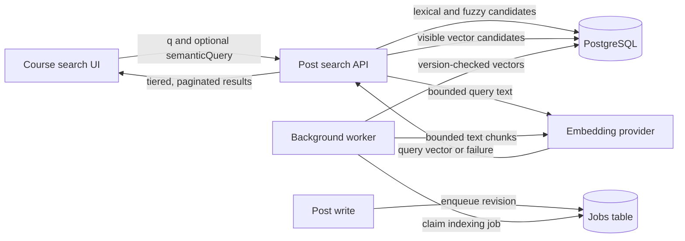

# Optional fused semantic post search

Status: proposed
Date: 2026-10-18

## Context

Course post search currently combines PostgreSQL English full-text matching and
`pg_trgm` fuzzy matching. It serves both the course search UI and the question
composer’s Related questions panel. Course, visibility, duplicate, tag, and
other filters apply before pagination; pinned results precede unpinned results.
The composer generates `OR` queries for lexical recall, while explicit search
operators have full-text-only semantics. This behavior must survive when
semantic search is unavailable.

The requested addition is semantic matching for questions and notes, including
Related questions, with full-text and fuzzy results taking priority. The
deployment operator supplies an embeddings API key in an ignored `.env` file.
No key means no semantic indexing or query calls; existing search continues.
The operator may use a hosted endpoint and accepts sending private course text
and search queries to that provider. This decision does **not** authorize
exposing the key to browsers or sending author identity metadata.

## Decision

Keep the post-search API and PostgreSQL as the owners of search. Use an internal
embedding-provider interface with an initial OpenAI-compatible HTTP adapter.
The operator configures a deployment-wide API key, endpoint URL, and model in
server-side environment variables. Neither a particular vendor nor a
per-user key is built into the public API. Semantic capability additionally
requires a provisioned PostgreSQL `pgvector` extension and optional embedding
schema. Without either the key or the extension, the application remains
lexical/fuzzy-only; ordinary migrations and startup do not require pgvector.

Persist model-tagged embeddings for bounded chunks of each active post’s title
and body. A durable background job creates or refreshes them after post
creation or text changes, and backfills existing posts when the feature is
enabled. New and edited posts remain immediately searchable through the
existing lexical indexes. A semantic query call has a strict timeout; failure
or invalid provider output falls back to lexical/fuzzy results rather than
failing the search request. Missing or stale embeddings do not produce a
semantic match.

An ordinary PostgreSQL catch-up table records eligible post writes when enqueue
is unavailable or fails in the post transaction, including when no provider key
is currently configured.
Enqueue failures cannot roll back post writes or leave an invisible gap behind
the incremental backfill cursor. The worker drains indexed catch-up rows in
bounded work; it removes a row only in the transaction that stores embeddings
for the post's current revision. Deletion and confirmed-duplicate merge remove
catch-up rows with embeddings. Pending catch-up rows, failed current-generation
jobs, and query-provider failures disable semantic candidates for search until
recovery; the existing lexical/fuzzy query path remains authoritative.
If health changes between relevance pages, the API rejects the semantic cursor
with `409 search_restart_required`; the feed restarts without a cursor while
preserving query and filters. It never presents an invented final page.

For relevance sorting, preserve pinned-first order and then use **strict match
tiers** within each pinned group: full-text matches, fuzzy-only matches, then
semantic-only matches. Semantic similarity orders only the last tier; it cannot
promote a result above a lexical or fuzzy match. Existing lexical/fuzzy score
and tie-break behavior remains unchanged inside those tiers. Explicit
chronological sorts retain their documented time ordering across the union of
eligible matches. All filters, authorization, duplicate suppression, and
pagination operate on the final visible candidate set, not on a globally
truncated vector top-K.

## Structure

The provider receives post title and body chunks for indexing and query text
for searches, but no author IDs, names, course metadata, cookies, or API
credentials other than its own server-side key. A hosted provider therefore
processes private course content even when the post is anonymous to students;
anonymity in search results does not make the content public. The operator is
responsible for selecting a provider whose data handling suits its courses. A
self-hosted protocol-compatible endpoint keeps text within the operator’s
infrastructure.

The embedding schema is separate from `posts` and associates each vector with
its post, model identity, source revision, and chunk ordinal. Post title/body
edits make previous vectors ineligible atomically through a revision mismatch.
The worker saves vectors only if the source revision is still current after the
provider call. Deletes and confirmed duplicate merges are excluded by joining
current post visibility at read time; deletion and course cleanup remove vector
rows with the post. A model change creates a new embedding generation and
requires reindexing; vectors from different models are never compared. Exact
cosine search is the initial retrieval mode; an approximate index is a later
profiling decision, not a prerequisite.

For ordinary text `q`, that text is the semantic query as well. For explicit
quoted, `OR`, or excluded-term searches, the operator syntax retains its
current lexical meaning and does not implicitly add semantic hits. Related
questions is the exception: the composer continues sending its existing
lexical `OR` query and additionally sends a bounded natural-language
`semanticQuery` made from the draft title/body sample. The API can use that
second string for fuzzy and semantic candidates without reinterpreting the
explicit `q` expression. When semantic search is disabled, `semanticQuery`
does not trigger an embedding call and the existing lexical search behavior
remains available. The API must validate and bound both strings.

The cursor binds the query and filters, the ranking version, and the semantic
capability/model generation. Relevance cursors order by pinned state, tier,
within-tier score, and stable post ID. An incompatible cursor is rejected
rather than silently continuing under a different ranking mode. Provider
failure during a later page degrades to lexical/fuzzy-only candidates; it must
not leak hidden items or return duplicate rows. Pagination and failure behavior
need contract tests at the API boundary.

## Technology choices

| Concern             | Choice                                              | Why                                                                       | Runner-up                                                             |
| ------------------- | --------------------------------------------------- | ------------------------------------------------------------------------- | --------------------------------------------------------------------- |
| Embedding transport | OpenAI-compatible HTTP behind an internal interface | Operator-configurable endpoint and model; no provider-specific public API | Multiple native provider adapters now add cost without a named need   |
| Vector storage      | Optional PostgreSQL pgvector schema                 | Keeps embeddings with post metadata and course filters                    | Dedicated vector DB adds a second authorization/index lifecycle       |
| Retrieval           | Exact cosine similarity initially                   | Deterministic recall and simple filtering at current scale                | HNSW can be added after profiling but complicates filtered recall     |
| Index refresh       | Existing durable worker/jobs table                  | Avoids provider latency in post writes and supports retries/backfill      | Synchronous embedding delays writes and fails them on provider outage |

The [OpenAI embeddings API guide](https://developers.openai.com/api/docs/guides/embeddings)
documents the protocol shape and shows that model dimensions and input limits
vary; chunk bounds and vector validation must be tied to the configured model.
The [pgvector project](https://github.com/pgvector/pgvector) documents
PostgreSQL 17 support, exact search by default, cosine distance, and optional
HNSW indexing. Availability and capabilities checked 2026-10-18. No specific
model version is hard-coded by this design.

## Alternatives rejected

- **Weighted reciprocal-rank fusion across all candidates:** semantic strength
  could overtake a full-text or fuzzy match, violating the chosen precedence.
- **Always-on pgvector migration:** no-key deployments with ordinary
  PostgreSQL would fail to start despite semantic search being optional.
- **Per-user embedding keys:** one course-wide index would mix models, billing,
  and data-handling policies while complicating shared search results.
- **Single vector for a whole post:** the allowed 100,000-character body can
  exceed model input limits and would lose coverage if silently truncated.
- **Synchronous write-time embedding:** provider slowness would delay or fail
  post creation/editing despite the immediately available lexical indexes.
- **Semantic expansion of user-entered boolean queries:** it would violate
  current `OR`, quote, and exclusion semantics.

## Trade-offs accepted

- Semantic matches may lag post creation/editing until the worker completes.
- Hosted providers receive private course text and search queries when the
  operator enables them; the chosen key is a deployment-level trust decision.
- Exact vector retrieval has a higher query cost than approximate ANN at large
  scale; benchmark before adding an index that might drop filtered matches.
- A provider outage or missing vectors reduces semantic recall but never
  removes the existing lexical/fuzzy search path.

## Failure modes

| Failure                                            | Behavior                                                                                                                 |
| -------------------------------------------------- | ------------------------------------------------------------------------------------------------------------------------ |
| Key absent                                         | No provider calls or semantic jobs; lexical/fuzzy search works unchanged.                                                |
| pgvector absent or semantic schema not provisioned | Start core app and search normally; report semantic capability unavailable.                                              |
| Provider slow, down, or malformed response         | Bound query wait; log bounded error metadata; return lexical/fuzzy results. Worker retries without blocking post writes. |
| Post changed while embedding is generated          | Version-checked save discards stale result and queues/retries the current revision.                                      |
| Post deleted, merged, or course access removed     | Read-time visibility/authorization excludes it before ranking and pagination; cleanup removes stored vectors.            |
| Model or endpoint changed                          | Disable mismatched vector generation until reindex; lexical/fuzzy results continue.                                      |

## Reversibility

The provider adapter, configured model, chunk size, and exact-versus-approximate
retrieval strategy are replaceable. The public `semanticQuery` parameter,
strict tier precedence, and deployment-level content-sharing decision are
contract-level choices that need deliberate migration if changed. The optional
embedding schema is removable without changing the authoritative post data.

## Open questions

- Select model-specific chunk/token bounds and similarity acceptance threshold
  using representative course data; these tune quality rather than change the
  architecture.
- Establish the deployment procedure and health signal for optional pgvector
  provisioning on each supported PostgreSQL environment.
